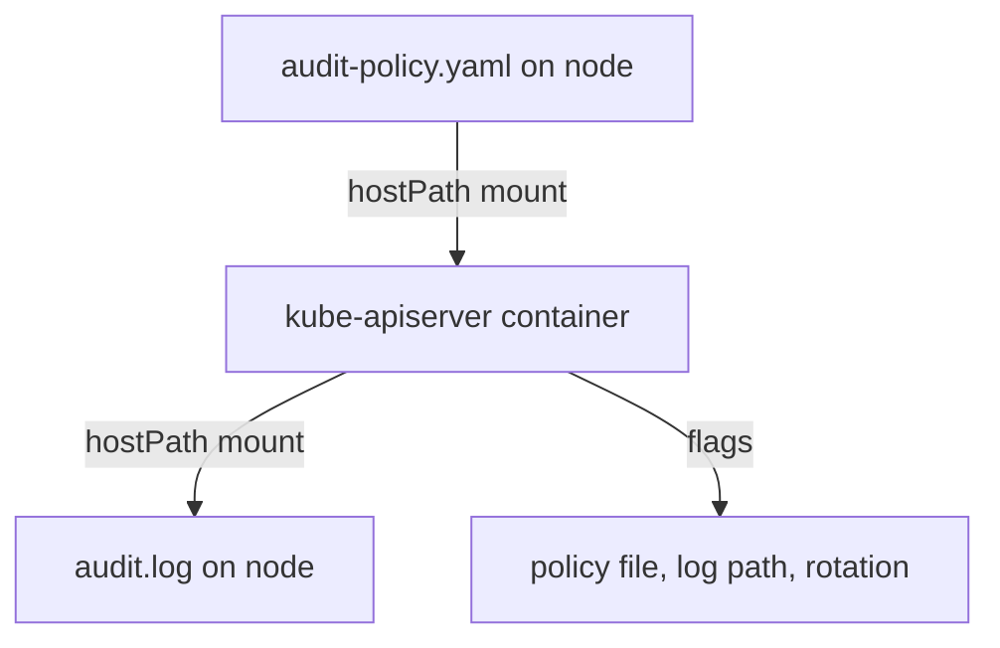

# Audit Logging

After an incident, the first question is who sent which request and when. By default the API server keeps no such record. Audit logging writes one event for each request, according to a policy that you provide. The benchmark checks that the policy file and the log path are set, and that the log has a retention limit. This part explains the policy format, the flags, the volume mounts that make it work in a static pod, and how to read an event.

## The audit policy

An audit policy is a file that lists rules. For each request the API server goes through the rules in order and uses the first rule that matches. The rule says how much to record. There are four levels:

- `None` records nothing.
- `Metadata` records who, what and when, without the request or response body.
- `Request` records the metadata and the request body.
- `RequestResponse` records the metadata, the request body and the response body.

A request passes through stages, and the field `omitStages` skips some of them. The stage `RequestReceived` fires before the work starts, and skipping it reduces the number of events. The staged policy has four rules in this order: nothing for the health endpoints, metadata for `secrets`, the request body for `pods` in `starfleet`, and metadata for everything else. Because the first match wins, the rule for the health endpoints comes first, and the catch-all rule comes last. Secrets get only the `Metadata` level because the body of a Secret holds the secret.

## The flags and the mounts

The API server needs these flags:

- `--audit-policy-file` is the path of the policy inside the API server container.
- `--audit-log-path` is the file where events are written.
- `--audit-log-maxage` is how many days to keep old log files.
- `--audit-log-maxbackup` is how many old log files to keep.
- `--audit-log-maxsize` is the size in megabytes at which the log rotates.

The API server runs in a container, so a path in a flag is a path inside that container. The policy file must be mounted into it, and the log directory must be a host path so that the log survives a restart and can be read on the node. This needs a `hostPath` volume and a `volumeMounts` entry for each. If the policy file is missing, the API server fails to start. If the log path is not on a mounted volume, the API server writes the log inside the container and loses it on restart.



The diagram shows that the policy goes into the container through a mount, and that the log comes out onto the node through another mount.

## Enable it

Look at the staged policy first. It is on the node, and nothing references it yet. Open a shell on the node with `astrona ssh astro-ats-031-playground-020-03` and print the file:

<!-- astrona:playground:renew -->

```sh
cat /opt/training/audit-policy.yaml
```

The file has mode `644`, so `student` can read it without `sudo`. The output on the playground node:

```text
apiVersion: audit.k8s.io/v1
kind: Policy
omitStages:
- RequestReceived
rules:
- level: None
  nonResourceURLs:
  - /healthz*
  - /livez*
  - /readyz*
- level: Metadata
  resources:
  - group: ""
    resources: ["secrets"]
- level: Request
  namespaces: ["starfleet"]
  resources:
  - group: ""
    resources: ["pods"]
- level: Metadata
```

Create the directories and put the policy in a directory that you can mount. Mounting a directory is more robust than mounting one file, because a file replaced by a new inode is not seen through a single file mount. Then copy the manifest to the work directory with `cp -p`, which keeps its mode:

```sh
sudo mkdir -p /etc/kubernetes/policy /var/log/kubernetes/audit /etc/kubernetes/edit
sudo cp /opt/training/audit-policy.yaml /etc/kubernetes/policy/audit-policy.yaml
sudo cp -p /etc/kubernetes/manifests/kube-apiserver.yaml /etc/kubernetes/edit/kube-apiserver.yaml
```

Now edit the copy in the work directory with an editor. The file belongs to `root`, so start the editor with `sudo`, for example `sudo vi` (the node also has `vim` and `nano`):

```sh
sudo vi /etc/kubernetes/edit/kube-apiserver.yaml
```

Add the five flags to the `command` list of the container, right after the line `- kube-apiserver`, with the same indentation as the other flags:

```yaml
    - --audit-policy-file=/etc/kubernetes/policy/audit-policy.yaml
    - --audit-log-path=/var/log/kubernetes/audit/audit.log
    - --audit-log-maxage=30
    - --audit-log-maxbackup=10
    - --audit-log-maxsize=100
```

Add two entries at the end of the `volumeMounts` list of the container, right before the line `  hostNetwork: true`:

```yaml
    - mountPath: /etc/kubernetes/policy
      name: audit-policy
      readOnly: true
    - mountPath: /var/log/kubernetes/audit
      name: audit-log
```

Add two entries at the end of the `volumes` list of the pod spec, right before the last line `status: {}`:

```yaml
  - hostPath:
      path: /etc/kubernetes/policy
      type: DirectoryOrCreate
    name: audit-policy
  - hostPath:
      path: /var/log/kubernetes/audit
      type: DirectoryOrCreate
    name: audit-log
```

These three snippets are fragments of the manifest, not files to apply with `kubectl`. Save the copy and leave the editor. Then move the copy into place:

```sh
sudo mv /etc/kubernetes/edit/kube-apiserver.yaml /etc/kubernetes/manifests/kube-apiserver.yaml
```

The kubelet sees the changed file and restarts the API server. Wait until the mirror pod shows the new flag and the API server is ready. The mirror pod can show the new flag a few seconds before the new API server is ready, so the loop checks both. `kubectl` fails while the API server is down, so the loop ignores errors and tries again, at most 60 times:

```sh
for attempt in $(seq 1 60); do
  if kubectl --request-timeout=3s -n kube-system get pod kube-apiserver-astro-ats-031-playground-020-03 -o jsonpath='{.spec.containers[0].command}' 2>/dev/null | grep -q -e '--audit-policy-file' && kubectl --request-timeout=3s get --raw=/readyz >/dev/null 2>&1; then echo "new flag visible and API server ready"; break; fi
  sleep 3
done
```

The loop prints `new flag visible and API server ready`. On the playground node this took 42 seconds. If the loop ends without the message, run `sudo crictl ps -a --name kube-apiserver` and `sudo crictl logs` with the container ID to find the error. Then restore the backup from `/opt/training/backup` with `sudo cp -p` to the work directory and `sudo mv` into the manifests directory.

## Read an event

Make a request, then find its event in the log. The log has one JSON object on each line, and it belongs to `root`. Other requests from the cluster components also appear, so `grep` picks the line of your request, and `python3 -m json.tool` formats it:

```sh
kubectl -n starfleet get pods
sudo grep '/namespaces/starfleet/pods?limit=500' /var/log/kubernetes/audit/audit.log | tail -n 1 | python3 -m json.tool
```

The output on the playground node, shortened: the last lines, with the timestamps and the `annotations` field, are left out:

```text
{
    "kind": "Event",
    "apiVersion": "audit.k8s.io/v1",
    "level": "Request",
    "auditID": "88e3b44c-9205-422b-8cba-98bb622be884",
    "stage": "ResponseComplete",
    "requestURI": "/api/v1/namespaces/starfleet/pods?limit=500",
    "verb": "list",
    "user": {
        "username": "kubernetes-admin",
        "groups": [
            "kubeadm:cluster-admins",
            "system:authenticated"
        ],
        "extra": {
            "authentication.kubernetes.io/credential-id": [
                "X509SHA256=8565cf7cb1556e2e0680e330e7dec27b2266b4f188975bf5be3ef5d605fad024"
            ]
        }
    },
    "sourceIPs": [
        "10.0.2.15"
    ],
    "userAgent": "kubectl/v1.35.10 (linux/arm64) kubernetes/ae6fece",
    "objectRef": {
        "resource": "pods",
        "namespace": "starfleet",
        "apiVersion": "v1"
    },
    "responseStatus": {
        "metadata": {},
        "code": 200
    },
```

The event shows the verb `list`, the URI of the pods in `starfleet`, your user name `kubernetes-admin` and a response code of `200`. The stage is `ResponseComplete`, because the policy skips `RequestReceived`. The level is `Request`, because the third rule of the policy matches `pods` in `starfleet`. A request that creates or changes a pod there also holds the request body. The `annotations` field, left out above, records the RBAC decision that allowed the request.

The log grows fast. On the playground node it held about 240 kilobytes after one minute, which is why the rotation flags matter.

You can now record every request. Next you reduce what the API server exposes about itself.

## Common pitfalls

> [!WARNING]
> - **No volume for the log.** The log is written inside the container and lost on restart.
> - **A rule order mistake.** The first matching rule wins, so a catch-all rule at the top hides every later rule.
> - **A policy that records everything at `RequestResponse`.** The log grows fast and holds Secret bodies. Keep Secrets at `Metadata`.
> - **No rotation flags.** The log fills the disk of the node.
