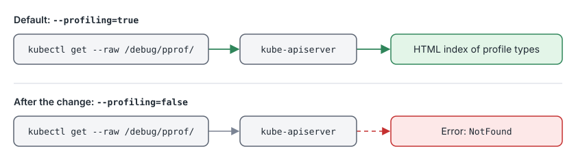
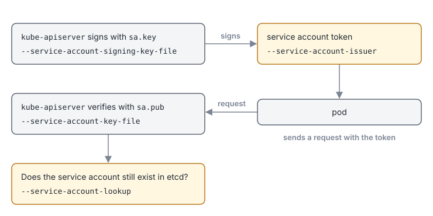

# Profiling, TLS And Service Account Flags

Some API server settings are not about who may connect. They are about what the server exposes, and how it protects its connections and its tokens. The benchmark groups several of them: profiling, the lowest Transport Layer Security (TLS) version, and the flags that control service account tokens. TLS is the protocol that encrypts HTTPS connections. This page explains each setting, tests profiling before and after the change, and ends with the flags that you check but usually leave alone.

## Profiling

Profiling is a debugging feature. When it is on, the API server serves performance data under the path `/debug/pprof`. This data shows the internals of the process, and an authorized caller can use the profiling endpoints to put load on the server.

The flag `--profiling` defaults to `true`, and the benchmark asks for `false`. Production clusters do not need the endpoint, and developers can turn it on again when they need it.



The drawing shows the test you run on this page: the same request before and after the change, and the two answers you should see.

Test the endpoint before you change anything. Open a shell on the node with `astrona ssh astro-ats-031-playground-020-03`. The request goes through the API server as your administrator user:

<!-- astrona:playground:renew -->

```sh
kubectl get --raw /debug/pprof/ | head -n 5
```

With profiling on, the response is the start of an HTML index of profile types. The output on the playground node:

```text
<html>
<head>
<title>/debug/pprof/</title>
<style>
.profile-name{
```

Now add the flag with the safe edit method. Copy the manifest with `-p`, insert the flag after the line `- kube-apiserver`, check the copy, and move it into place. The `sed` command below inserts the new line with the same indentation as the line it follows:

```sh
sudo mkdir -p /etc/kubernetes/edit
sudo cp -p /etc/kubernetes/manifests/kube-apiserver.yaml /etc/kubernetes/edit/kube-apiserver.yaml
sudo sed -i 's|^\( *\)- kube-apiserver$|&\n\1- --profiling=false|' /etc/kubernetes/edit/kube-apiserver.yaml
sudo grep -n -e 'kube-apiserver$' -e 'profiling' /etc/kubernetes/edit/kube-apiserver.yaml
```

The output on the playground node, where the audit flags were already added:

```text
7:    component: kube-apiserver
9:  name: kube-apiserver
14:    - kube-apiserver
15:    - --profiling=false
60:    name: kube-apiserver
```

The flag is on the line right after `- kube-apiserver`. The last line number depends on the earlier edits of your manifest. Move the copy into place only when the flag is there. Then wait until the mirror pod shows the new flag and the API server is ready:

```sh
sudo mv /etc/kubernetes/edit/kube-apiserver.yaml /etc/kubernetes/manifests/kube-apiserver.yaml
for attempt in $(seq 1 60); do
  if kubectl --request-timeout=3s -n kube-system get pod kube-apiserver-astro-ats-031-playground-020-03 -o jsonpath='{.spec.containers[0].command}' 2>/dev/null | grep -q -e '--profiling=false' && kubectl --request-timeout=3s get --raw=/readyz >/dev/null 2>&1; then echo "new flag visible and API server ready"; break; fi
  sleep 3
done
```

The loop prints `new flag visible and API server ready`. On the playground node, this took 46 seconds. Verify the change in two ways. First, read the arguments of the new pod. Then repeat the request to the profiling path:

```sh
kubectl -n kube-system get pod kube-apiserver-astro-ats-031-playground-020-03 -o jsonpath='{.spec.containers[0].command}' | tr ',' '\n' | grep profiling
kubectl get --raw /debug/pprof/ | head -n 5
```

The output on the playground node:

```text
"--profiling=false"
Error from server (NotFound): the server could not find the requested resource
```

The request now fails with a `NotFound` error, because the API server no longer registers the path. That is the result you want.

For up to a minute after the loop ends, `kubectl -n kube-system get pods` can still show the API server pod as `0/1`. The kubelet marks the pod ready only after its own startup and readiness probes pass. The pod then becomes `1/1` without any action from you.

## TLS

Profiling is about what the server shows. TLS is about how it protects its connections. The API server speaks HTTPS, and the flag `--tls-min-version` sets the lowest TLS version it accepts.

Current Kubernetes versions already refuse versions below TLS 1.2 by default. The benchmark still asks you to set the value explicitly, for example `--tls-min-version=VersionTLS12`, so that the setting does not depend on a default. The flag `--tls-cipher-suites` limits the cipher suites to strong ones. Both flags are optional for a standard cluster. A wrong cipher list can stop clients from connecting, so test with `kubectl` after a change.

The benchmark also checks the connections that the API server itself starts or accepts with certificates:

- `--client-ca-file` names the certificate authority that the API server uses to verify client certificates.
- `--etcd-certfile`, `--etcd-keyfile` and `--etcd-cafile` set the client certificate, its key and the certificate authority for the connection to etcd. The benchmark checks that they are set, so that the etcd connection is authenticated.

## Service account flags

Pods authenticate to the API server with service account tokens. The API server signs these tokens with a private key and verifies them with a public key. Three flags are involved:

- `--service-account-key-file` names the public key that verifies tokens.
- `--service-account-signing-key-file` names the private key that signs them.
- `--service-account-issuer` sets the issuer name inside the token.

The flag `--service-account-lookup` makes the API server check that the service account of a token still exists in etcd. Without it, a token of a deleted service account would stay valid until the token expires. The flag defaults to `true` in current versions, and the benchmark checks that it is not `false`.



The drawing shows which flag acts at which moment: the signing key when the token is made, and the public key and the lookup when a pod uses the token.

Read all these flags in one command:

```sh
sudo grep -e 'service-account' -e 'tls-' -e 'client-ca-file' -e 'etcd-' /etc/kubernetes/manifests/kube-apiserver.yaml
```

The output on the playground node:

```text
    - --client-ca-file=/etc/kubernetes/pki/ca.crt
    - --etcd-cafile=/etc/kubernetes/pki/etcd/ca.crt
    - --etcd-certfile=/etc/kubernetes/pki/apiserver-etcd-client.crt
    - --etcd-keyfile=/etc/kubernetes/pki/apiserver-etcd-client.key
    - --etcd-servers=https://127.0.0.1:2379
    - --requestheader-client-ca-file=/etc/kubernetes/pki/front-proxy-ca.crt
    - --service-account-issuer=https://kubernetes.default.svc.cluster.local
    - --service-account-key-file=/etc/kubernetes/pki/sa.pub
    - --service-account-signing-key-file=/etc/kubernetes/pki/sa.key
    - --tls-cert-file=/etc/kubernetes/pki/apiserver.crt
    - --tls-private-key-file=/etc/kubernetes/pki/apiserver.key
```

A kubeadm cluster sets the service account key flags, the client certificate authority and the etcd certificate flags. The `tls-` pattern matches only the certificate and the key of the server. kubeadm does not set `--tls-min-version`, `--tls-cipher-suites` or `--service-account-lookup`.

A check on a flag that is absent but has a secure default is a judgement call. The review states the default and decides if an explicit value is worth adding.

You have now covered the flags of the API server. The open question is the two components that run beside it, the controller manager and the scheduler, and the files that hold all of their settings.

## Common pitfalls

> [!WARNING]
> - **Testing too early.** The pod object shows the old arguments until the kubelet restarts the component. Wait for the readiness loop.
> - **Setting `--tls-cipher-suites` without a test.** A bad list can lock out clients, including `kubectl`.
> - **Inserting the flag at the wrong indentation.** A flag with a different indentation from the other list items makes the YAML invalid.
> - **Calling an absent flag a failure without checking the default.** Some defaults already meet the benchmark.
