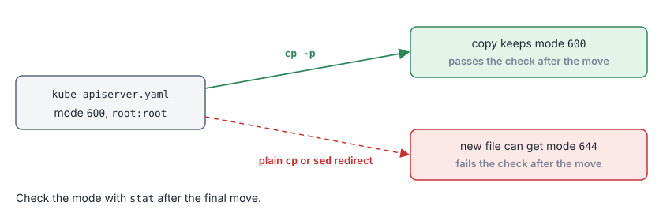

# Controller Manager, Scheduler And File Permissions

The API server is not the only control plane component with benchmark checks. The controller manager runs the control loops that keep the cluster in its desired state. The scheduler assigns pods to nodes. Both have a few settings in the benchmark. The files that hold the manifests and certificates of all components also have checks, and these are often the quickest failures to fix. This page covers the component flags and the file permissions, and ends with how to apply the changes.

## Controller manager flags

The controller manager has these checks:

- `--profiling=false` turns off the debugging endpoint, as for the API server.
- `--use-service-account-credentials=true` makes each controller run with its own service account instead of one shared identity. RBAC rules and audit events can then tell the controllers apart.
- `--service-account-private-key-file` names the key that signs service account tokens. It must be set, so that tokens can be issued.
- `--root-ca-file` names the certificate authority bundle that is placed in each service account, so that pods can verify the API server.
- `--bind-address=127.0.0.1` keeps the secure port of the controller manager on the loopback address.
- `--terminated-pod-gc-threshold` sets how many terminated pods are kept before they are deleted.

A kubeadm cluster already sets the key file, the root certificate file and `--use-service-account-credentials=true`. It also sets the bind address to `127.0.0.1`. Profiling is the setting that usually fails.

## Scheduler flags

The scheduler has fewer checks. Two of them matter: `--profiling=false` and `--bind-address=127.0.0.1`. The scheduler has no other secret to protect, so these checks are quick to read and fix.

## File permissions

The flags live in files, so the files need protection too. The static pod manifests hold the exact flags of each component, and a user who can write them can change the cluster.

The benchmark asks for these permissions:

- The manifests have mode `600` or stricter and are owned by `root:root`.
- The kubeconfig files of the components in `/etc/kubernetes` follow the same rule.
- The directory `/etc/kubernetes/pki` is owned by `root`, and the keys in it have mode `600`.
- kubeadm creates certificates with mode `644`. The benchmark editions differ in what they ask for certificates, so read the audit text of your edition.

In the playground, the three control plane manifests were widened on purpose. Show their current state. Open a shell on the node with `astrona ssh astro-ats-031-playground-020-03` and read the mode, the owner and the group of each file:

<!-- astrona:playground:renew -->

```sh
sudo stat -c '%a %U:%G %n' /etc/kubernetes/manifests/etcd.yaml /etc/kubernetes/manifests/kube-apiserver.yaml /etc/kubernetes/manifests/kube-controller-manager.yaml /etc/kubernetes/manifests/kube-scheduler.yaml
sudo stat -c '%a %U:%G %n' /etc/kubernetes/admin.conf /etc/kubernetes/controller-manager.conf /etc/kubernetes/scheduler.conf
```

The output on the playground node, after the scheduler manifest was restored from the backup once:

```text
600 root:root /etc/kubernetes/manifests/etcd.yaml
644 root:root /etc/kubernetes/manifests/kube-apiserver.yaml
644 root:root /etc/kubernetes/manifests/kube-controller-manager.yaml
600 root:root /etc/kubernetes/manifests/kube-scheduler.yaml
600 root:root /etc/kubernetes/admin.conf
600 root:root /etc/kubernetes/controller-manager.conf
600 root:root /etc/kubernetes/scheduler.conf
```

On a fresh playground, the scheduler manifest also shows `644`. The backups have mode `600`, so a restore with `cp -p` from `/opt/training/backup` sets it back to `600`. The kubeconfig files already pass.

Now fix the widened manifests. A mode change does not change the content of the file, so you do not need a copy:

```sh
sudo chown root:root /etc/kubernetes/manifests/kube-apiserver.yaml /etc/kubernetes/manifests/kube-controller-manager.yaml /etc/kubernetes/manifests/kube-scheduler.yaml
sudo chmod 600 /etc/kubernetes/manifests/kube-apiserver.yaml /etc/kubernetes/manifests/kube-controller-manager.yaml /etc/kubernetes/manifests/kube-scheduler.yaml
```

The kubelet runs as `root`, so it can still read the files. Verify with `stat` again, then check that the components are still ready. The user `student` cannot list `/etc/kubernetes/manifests`, so a root shell must expand the `*.yaml` pattern. `sudo sh -c` starts that shell:

```sh
sudo sh -c "stat -c '%a %U:%G %n' /etc/kubernetes/manifests/*.yaml"
kubectl -n kube-system get pods -l tier=control-plane
```

All four files now show `600 root:root`, and the four pods stay `Running`. On the playground node, the mode change restarted no component. If you changed the API server manifest in the minute before, its pod can still show `0/1` while the kubelet runs its probes. It becomes ready without any action from you.

## Apply the component flags

The files are now protected, so the last step is the profiling flag of the other two components. To add `--profiling=false` to the controller manager and the scheduler, use the same method as for the API server. Copy each manifest with `cp -p` to `/etc/kubernetes/edit`, insert the flag with `sed` after the first line of the command list, check the copy, and move it back. For the controller manager, the first line is `- kube-controller-manager`:

```sh
sudo cp -p /etc/kubernetes/manifests/kube-controller-manager.yaml /etc/kubernetes/edit/kube-controller-manager.yaml
sudo sed -i 's|^\( *\)- kube-controller-manager$|&\n\1- --profiling=false|' /etc/kubernetes/edit/kube-controller-manager.yaml
sudo grep -n -e '- kube-controller-manager$' -e profiling /etc/kubernetes/edit/kube-controller-manager.yaml
sudo mv /etc/kubernetes/edit/kube-controller-manager.yaml /etc/kubernetes/manifests/kube-controller-manager.yaml
```

The `grep` command prints `12:    - kube-controller-manager` and `13:    - --profiling=false`. For the scheduler, run the same four commands with `kube-scheduler` in place of `kube-controller-manager`. The `grep` command then prints `12:    - kube-scheduler` and `13:    - --profiling=false`.

After about a minute, read the new arguments of both mirror pods and the modes of the files:

```sh
kubectl -n kube-system get pod kube-controller-manager-astro-ats-031-playground-020-03 -o jsonpath='{.spec.containers[0].command}' | tr ',' '\n' | grep profiling
kubectl -n kube-system get pod kube-scheduler-astro-ats-031-playground-020-03 -o jsonpath='{.spec.containers[0].command}' | tr ',' '\n' | grep profiling
sudo sh -c "stat -c '%a %U:%G %n' /etc/kubernetes/manifests/*.yaml"
```

The output on the playground node:

```text
"--profiling=false"
"--profiling=false"
600 root:root /etc/kubernetes/manifests/etcd.yaml
600 root:root /etc/kubernetes/manifests/kube-apiserver.yaml
600 root:root /etc/kubernetes/manifests/kube-controller-manager.yaml
600 root:root /etc/kubernetes/manifests/kube-scheduler.yaml
```

A copy made with `cp -p` keeps the mode, so the fixed permissions stay after the move. The most common failure at this point is a manifest whose copy lost its mode, so always check `stat` after the final move.



The drawing shows why the copy step matters for the file check: only a copy that keeps the mode still passes after you move it back.

You have now made each kind of change that the benchmark asks for on the control plane: flags in a manifest, new volumes, and file attributes. The goal of each change is a verified value on the running component, not only a changed file.

## Common pitfalls

> [!WARNING]
> - **Losing the mode in a copy.** A plain `cp` or a redirect from `sed` can create a file with mode `644`. Use `cp -p` and check with `stat`.
> - **Making a file unreadable to the kubelet.** Use the owner `root` and the mode `600`, not another owner.
> - **Fixing only the API server.** The controller manager and the scheduler have their own profiling flag.
> - **Stopping at the file.** Confirm that the component runs with the new value and stays ready.
