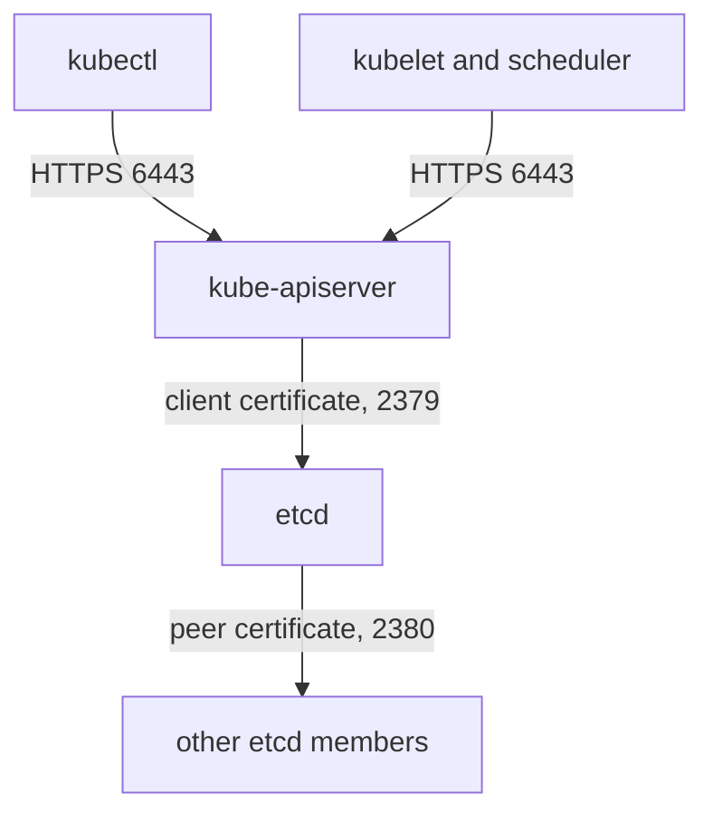

# What Lives In etcd And Who Talks To It

Before you judge the settings of etcd, you need to know what it holds and which components are allowed to reach it. Every later check follows from two facts: etcd contains the full state of the cluster, and only one component should ever be a client of it. This part shows the data, the ports, the certificates and the connection between the API server and etcd.

## What etcd stores

etcd is a distributed key-value store. The Kubernetes API server is the only component that reads from and writes to it during normal operation. The other components, such as the scheduler and the kubelet, talk to the API server, and the API server talks to etcd.

Every object has a key that starts with `/registry`. A pod in `starfleet` has a key like `/registry/pods/starfleet/shuttle`, and the Secret `launch-code` has the key `/registry/secrets/starfleet/launch-code`. The value is the serialized object. Because Secrets live in the same database, a person who copies the etcd data files or reads the database holds every credential of the cluster.

## Ports and certificates

etcd listens on two ports for two kinds of traffic. Port `2379` is the client port: the API server connects here to read and write. Port `2380` is the peer port: etcd members use it to replicate data to each other. A cluster with one control plane node has one member, so port `2380` is open but has no other member to talk to.

kubeadm also starts a listener for metrics on `127.0.0.1:2381` over plain HTTP, reachable only from the node itself. kubeadm creates a separate certificate authority (CA) for etcd. Its files are in `/etc/kubernetes/pki/etcd`. The CA signs the server certificate, the peer certificate and the client certificate that the API server uses.

Set the node name once and list the etcd certificate files:

<!-- astrona:playground:renew -->

```sh
NODE=astro-ats-031-playground-020-04-control-plane
podman exec $NODE ls /etc/kubernetes/pki/etcd
```

The listing shows `ca.crt` and `ca.key`, the server certificate and key, the peer certificate and key, and the client certificate that checks health. The API server uses a different client certificate, which is stored with the API server files in `/etc/kubernetes/pki`.

## Find the listeners

The command below lists the TCP ports the node listens on. The host filter keeps the two etcd ports:

```sh
podman exec $NODE ss -ltn | grep -e ':2379' -e ':2380' -e ':2381'
```

Port `2379` and port `2380` appear. Port `2381` appears on the loopback address only. The client port also listens on the node address, so other hosts on the node network can open a connection to it. What stops them from reading data is the TLS configuration of etcd, which the next part examines.

## See how the API server connects

The API server pod lists the etcd settings in its command. The `--etcd-servers` flag gives the address, and three more flags give the CA and the client certificate and key that the API server presents. The command below prints the command as a JSON list and keeps the etcd flags:

```sh
kubectl -n kube-system get pod kube-apiserver-$NODE -o jsonpath='{.spec.containers[0].command}' | tr ',' '\n' | grep etcd
```

You see `--etcd-servers=https://127.0.0.1:2379`, `--etcd-cafile`, `--etcd-certfile` and `--etcd-keyfile`. The address is the loopback address because kubeadm runs etcd on the same node as the API server.



The diagram shows that the API server is the only client of etcd. Every other component goes through the API server, which authenticates and authorizes each request first.

## What you can conclude

You now know that etcd holds all cluster state, that the API server is the single intended client on port `2379`, and that a separate CA protects the connection. The CIS Benchmark section for etcd tests exactly this arrangement: encrypted client traffic, encrypted peer traffic, and certificate checks on both. The open question is how etcd enforces that only holders of a valid certificate connect. The next part reads the flags that decide this.

## Common pitfalls

> [!WARNING]
> - **Assuming other components read etcd.** The scheduler, the controller manager and the kubelet use the API server. Only the API server needs an etcd client certificate.
> - **Treating the loopback listener as the only exposure.** Port `2379` also listens on the node address. TLS client authentication, not the address, protects it.
> - **Mixing up the two CAs.** etcd has its own CA in `/etc/kubernetes/pki/etcd`. The cluster CA in `/etc/kubernetes/pki` signs different certificates.
