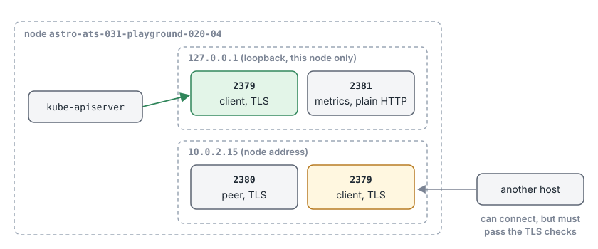
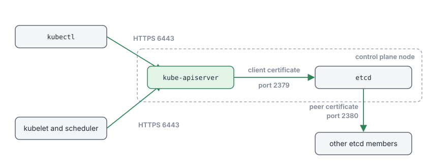

# What Lives In etcd And Who Talks To It

Before you judge the settings of etcd, you need to know what it holds and which components may reach it. Every later check follows from two facts. etcd contains the full state of the cluster, and only one component should ever be a client of it.

On this page, you look at the data in etcd, the ports it opens, the certificates it uses and the connection between the API server and etcd.

## What etcd stores

etcd is a distributed key-value store: a database that saves each value under a unique key and can copy the data to several machines. The Kubernetes API server is the only component that reads from and writes to etcd during normal operation. The other components, such as the scheduler and the kubelet, talk to the API server, and the API server talks to etcd.

Every object has a key that starts with `/registry`. A pod in `starfleet` has a key like `/registry/pods/starfleet/shuttle`, and the Secret `launch-code` has the key `/registry/secrets/starfleet/launch-code`. The value under the key is the serialized object, that is, the object written out as bytes.

Secrets live in the same database as every other object. So a person who copies the etcd data files, or reads the database, holds every credential of the cluster.

## Ports and certificates

etcd listens on two ports for two kinds of traffic:

- Port `2379` is the client port. The API server connects here to read and write data.
- Port `2380` is the peer port. etcd members use it to copy (replicate) data to each other. A cluster with one control plane node has one member, so port `2380` is open but has no other member to talk to.

kubeadm, the tool that installed the playground cluster, also starts a listener for metrics on `127.0.0.1:2381`. It uses plain HTTP, and only the node itself can reach it.

kubeadm creates a separate certificate authority (CA) for etcd. A CA is the key pair that signs certificates, so that anyone who trusts the CA also trusts the certificates it signed. The etcd CA files are in `/etc/kubernetes/pki/etcd`. This CA signs the etcd server certificate, the peer certificate and the client certificate that the API server uses.

Open a shell on the node and list the etcd certificate files. Only `root` can read the directory, so the command uses `sudo`:

<!-- astrona:playground:renew -->

```sh
astrona ssh astro-ats-031-playground-020-04
sudo ls /etc/kubernetes/pki/etcd
```

The listing shows these files:

- `ca.crt` and `ca.key`, the CA certificate and key;
- `server.crt` and `server.key`, the server certificate and key;
- `peer.crt` and `peer.key`, the peer certificate and key;
- `healthcheck-client.crt` and `healthcheck-client.key`, the client certificate and key that check the health of etcd.

The API server uses a different client certificate. It is stored with the API server files in `/etc/kubernetes/pki`.

## Find the listeners

Now look at the ports from the side of the node. The `ss -ltn` command lists the TCP ports the node listens on, and `grep` keeps the three etcd ports:

```sh
ss -ltn | grep -e ':2379' -e ':2380' -e ':2381'
```

The output on the playground node:

```text
LISTEN 0      4096       10.0.2.15:2380       0.0.0.0:*          
LISTEN 0      4096       10.0.2.15:2379       0.0.0.0:*          
LISTEN 0      4096       127.0.0.1:2381       0.0.0.0:*          
LISTEN 0      4096       127.0.0.1:2379       0.0.0.0:*          
```

Port `2381` listens on the loopback address only. Port `2379` listens on the loopback address and also on the node address `10.0.2.15`. Port `2380` listens on the node address.



The drawing shows that the client port is open on two addresses. So other hosts on the node network can open a connection to port `2379`. What stops them from reading data is the Transport Layer Security (TLS) configuration of etcd, not the address.

## See how the API server connects

The API server pod lists its etcd settings in its command. The `--etcd-servers` flag gives the address of etcd. Three more flags give the CA and the client certificate and key that the API server presents. The command below prints the container command as a JSON list and keeps the etcd flags:

```sh
NODE=astro-ats-031-playground-020-04
kubectl -n kube-system get pod kube-apiserver-$NODE -o jsonpath='{.spec.containers[0].command}' | tr ',' '\n' | grep etcd
```

The output on the playground node:

```text
"--etcd-cafile=/etc/kubernetes/pki/etcd/ca.crt"
"--etcd-certfile=/etc/kubernetes/pki/apiserver-etcd-client.crt"
"--etcd-keyfile=/etc/kubernetes/pki/apiserver-etcd-client.key"
"--etcd-servers=https://127.0.0.1:2379"
```

The address is the loopback address, because kubeadm runs etcd on the same node as the API server. The client certificate `apiserver-etcd-client.crt` lies in `/etc/kubernetes/pki`, but the etcd CA signed it. The API server checks the etcd server certificate with the etcd CA in `ca.crt`.



The drawing shows that the API server is the only client of etcd. Every other component goes through the API server, which authenticates and authorizes each request first.

## What you can conclude

You now know that etcd holds all cluster state, that the API server is the single intended client on port `2379`, and that a separate CA protects the connection. The etcd section of the CIS Benchmark tests exactly this setup: encrypted client traffic, encrypted peer traffic, and certificate checks on both. The open question is how etcd makes sure that only holders of a valid certificate can connect.

## Common pitfalls

> [!WARNING]
> - **Assuming other components read etcd.** The scheduler, the controller manager and the kubelet use the API server. Only the API server needs an etcd client certificate.
> - **Treating the loopback listener as the only exposure.** Port `2379` also listens on the node address. TLS client authentication protects it, not the address.
> - **Mixing up the two CAs.** etcd has its own CA in `/etc/kubernetes/pki/etcd`. The cluster CA in `/etc/kubernetes/pki` signs different certificates.
