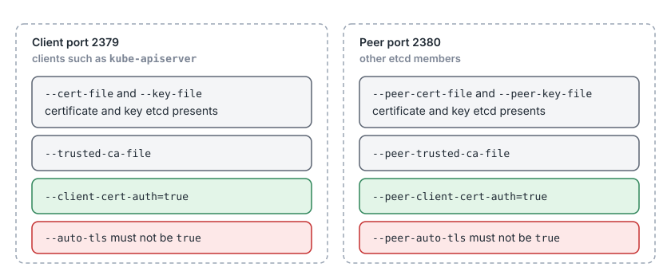
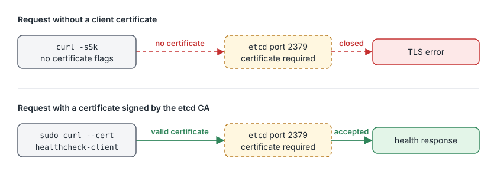

# Client And Peer TLS Flags

etcd protects its two ports with Transport Layer Security (TLS). TLS encrypts the traffic and uses certificates to prove who each side is. But encryption alone is not enough. If etcd accepts any client that completes the TLS handshake, an attacker on the node network can read the database.

The Center for Internet Security (CIS) Kubernetes Benchmark is a list of checks for a secure cluster. Its etcd section therefore checks a small set of flags. On this page, you read them in the real manifest and prove with a request what they do.

## The flags the benchmark checks

The etcd manifest is the file `/etc/kubernetes/manifests/etcd.yaml`, and the kubelet starts etcd from it. Each flag below has a client version for port `2379` and a peer version for port `2380`:

- `--cert-file` and `--key-file` give the certificate and private key that etcd presents to clients. `--peer-cert-file` and `--peer-key-file` do the same for peers.
- `--client-cert-auth=true` makes etcd require a valid client certificate on port `2379`. `--peer-client-cert-auth=true` does the same on port `2380`.
- `--trusted-ca-file` and `--peer-trusted-ca-file` name the certificate authority (CA) that signs the accepted client and peer certificates.
- `--auto-tls=true` lets etcd create a self-signed certificate for clients, and `--peer-auto-tls=true` does so for peers. Both must not be `true`. A self-signed certificate gives encryption, but no trusted identity.



The drawing puts each client flag next to its peer version. Green marks the setting that must be `true`, and red marks the setting that must not be `true`.

The benchmark also asks that etcd uses its own CA and not the CA of the cluster. If the cluster CA signed etcd client certificates, etcd could accept any certificate that this CA issued for another purpose. The check numbers differ between editions of the benchmark, so find a check by the flag it names.

## Read the flags

Now look at the real values. Open a shell on the node and print the lines of the manifest that hold the TLS settings. Only `root` can read the manifest, so the command uses `sudo`:

<!-- astrona:playground:renew -->

```sh
astrona ssh astro-ats-031-playground-020-04
sudo grep -e 'cert-file' -e 'key-file' -e 'client-cert-auth' -e 'trusted-ca-file' -e 'auto-tls' /etc/kubernetes/manifests/etcd.yaml
```

The output on the playground node:

```text
    - --cert-file=/etc/kubernetes/pki/etcd/server.crt
    - --client-cert-auth=true
    - --key-file=/etc/kubernetes/pki/etcd/server.key
    - --peer-cert-file=/etc/kubernetes/pki/etcd/peer.crt
    - --peer-client-cert-auth=true
    - --peer-key-file=/etc/kubernetes/pki/etcd/peer.key
    - --peer-trusted-ca-file=/etc/kubernetes/pki/etcd/ca.crt
    - --trusted-ca-file=/etc/kubernetes/pki/etcd/ca.crt
```

You see the certificate, key and CA flags for both the client side and the peer side. Both `client-cert-auth` flags are set to `true`.

You see no line with `auto-tls`. A flag that is not in the file keeps its default value, and the default of both `auto-tls` flags is `false`. So the missing flag passes the check. This is different from the API server, where a missing flag often means an insecure default.

A reviewer also confirms the flags on the running process, not only in the file. If the file changed recently, the kubelet may still run an older version of the pod. The pod object lists the command that the container really started with:

```sh
NODE=astro-ats-031-playground-020-04
kubectl -n kube-system get pod etcd-$NODE -o jsonpath='{.spec.containers[0].command}' | tr ',' '\n' | grep -e client-cert-auth -e auto-tls
```

The output is `"--client-cert-auth=true"` and `"--peer-client-cert-auth=true"`, and again there is no `auto-tls` line. Compare the result with the file. Both must agree before you record a pass.

## Prove what `--client-cert-auth` does

A flag in a file is a claim; a request is a proof. The command below runs `curl` on the node and asks etcd for its health without a client certificate. The `-k` option tells `curl` not to check the server certificate, so the test measures only the client side. The `-sS` options hide the progress bar but still print errors:

```sh
curl -sSk https://127.0.0.1:2379/health
```

etcd ends the handshake because the client sent no certificate, and `curl` reports a TLS error instead of a response. On the playground node, the error is:

```text
curl: (56) OpenSSL SSL_read: OpenSSL/3.0.13: error:0A00045C:SSL routines::tlsv13 alert certificate required, errno 0
```

The words `certificate required` name the reason. The exact error text depends on the `curl` and OpenSSL versions, so do not rely on the wording.

Now repeat the request with the health-check client certificate that kubeadm, the tool that installed the cluster, creates for etcd. Only `root` can read the key file, so this request uses `sudo`:

```sh
sudo curl -s --cacert /etc/kubernetes/pki/etcd/ca.crt --cert /etc/kubernetes/pki/etcd/healthcheck-client.crt --key /etc/kubernetes/pki/etcd/healthcheck-client.key https://127.0.0.1:2379/health; echo
```

This request succeeds and returns `{"health":"true","reason":""}`. The etcd CA signed the certificate, so etcd accepts the client.



The drawing shows that `--client-cert-auth=true` turns the TLS handshake into the access control. A client without a certificate from the etcd CA never reaches the data.

## A limit of the test on one node

The two requests prove client authentication on the local port. They do not prove the peer settings, because the playground has a single etcd member and no second member that could connect. For the peer flags, the review relies on the manifest and on the command of the running pod. On a cluster with three control plane nodes, you would also check that the members connect to each other with the peer certificates.

You have now read each flag, matched the file with the running pod, and seen one flag block a client. The open question in this area is not about a flag but about a directory: who can read the files where etcd keeps its data.

## Common pitfalls

> [!WARNING]
> - **Passing on the file alone.** Check the pod command too. The running pod is what the benchmark audits.
> - **Treating a missing `--auto-tls` as a finding.** The default is `false`, so a missing flag is the secure state.
> - **Using `curl` without `--cacert` and calling a failure a success.** A failed request with `-k` and no certificate proves the client check. A request with a certificate must also succeed, or the test says nothing.
> - **Assuming the peer flags were tested.** With one member, there is no peer traffic to observe.
