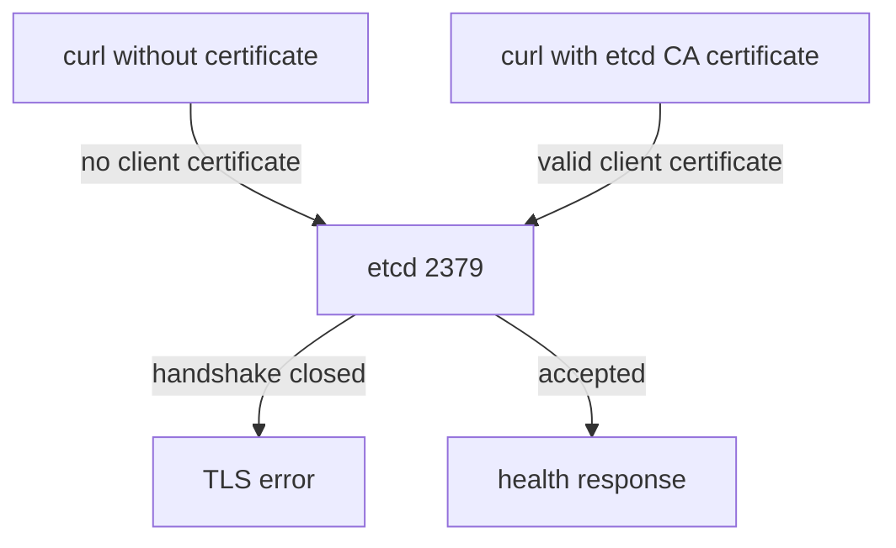

# Client And Peer TLS Flags

etcd protects its two ports with Transport Layer Security (TLS), which encrypts traffic and proves who each side is with certificates. Encryption alone is not enough. If etcd accepts any client that completes the handshake, an attacker on the node network can read the database. The etcd section of the benchmark therefore checks a small set of flags. This part reads them in the real manifest and proves with a request what they do.

## The flags the benchmark checks

The etcd manifest is the file `/etc/kubernetes/manifests/etcd.yaml`. The kubelet starts etcd from it. Each flag below has a client version for port `2379` and a peer version for port `2380`.

- `--cert-file` and `--key-file` give the certificate and private key that etcd presents to clients. `--peer-cert-file` and `--peer-key-file` do the same for peers.
- `--client-cert-auth=true` makes etcd require a valid client certificate on port `2379`. `--peer-client-cert-auth=true` does the same on port `2380`.
- `--trusted-ca-file` and `--peer-trusted-ca-file` name the CA that signs the accepted client and peer certificates.
- `--auto-tls=true` lets etcd create a self-signed certificate for clients. `--peer-auto-tls=true` does so for peers. Both must not be `true`, because a self-signed certificate gives encryption without a trusted identity.

The benchmark also asks that etcd uses its own CA and not the CA of the cluster. If the cluster CA signed etcd client certificates, every certificate issued for any other purpose by that CA could be accepted by etcd. The benchmark check numbers differ between editions, so find a check by the flag it names.

## Read the flags

Print the lines of the manifest that hold the TLS settings:

<!-- astrona:playground:renew -->

```sh
NODE=astro-ats-031-playground-020-04-control-plane
podman exec $NODE grep -e 'cert-file' -e 'key-file' -e 'client-cert-auth' -e 'trusted-ca-file' -e 'auto-tls' /etc/kubernetes/manifests/etcd.yaml
```

On a kubeadm cluster you see the certificate, key and CA flags for both the client and the peer side, and both `client-cert-auth` flags set to `true`. You see no line with `auto-tls`. A flag that is absent keeps its default, and the default of both `auto-tls` flags is `false`, so the absence passes the check. This differs from the API server, where an absent flag often means an insecure default.

A reviewer can also confirm the flags on the running process, not only in the file. The kubelet may still run an older version of the pod if the file changed recently. The pod object lists the command the container really started with:

```sh
kubectl -n kube-system get pod etcd-$NODE -o jsonpath='{.spec.containers[0].command}' | tr ',' '\n' | grep -e client-cert-auth -e auto-tls
```

Compare the result with the file. Both must agree before you record a pass.

## Prove what `--client-cert-auth` does

A flag in a file is a claim. A request is a proof. The command below runs `curl` inside the node and asks etcd for its health without a client certificate. The `-k` option tells `curl` not to verify the server certificate, so the test measures only the client side:

```sh
podman exec $NODE curl -sk https://127.0.0.1:2379/health
```

etcd closes the handshake because the client sent no certificate, and `curl` reports a TLS error instead of a response. The exact error text depends on the `curl` and etcd versions, so do not rely on the wording. Now repeat the request with the health-check client certificate that kubeadm creates for etcd:

```sh
podman exec $NODE curl -s --cacert /etc/kubernetes/pki/etcd/ca.crt --cert /etc/kubernetes/pki/etcd/healthcheck-client.crt --key /etc/kubernetes/pki/etcd/healthcheck-client.key https://127.0.0.1:2379/health
```

This request succeeds and returns a small JSON document that says whether etcd is healthy. The certificate is signed by the etcd CA, so etcd accepts the client.

## A limit of the test in kind

The two requests prove client authentication on the local port. They do not prove the peer settings, because the playground has a single etcd member and no second member to connect. For the peer flags, the review relies on the manifest and on the running pod command. On a cluster with three control plane nodes, you would also check that the members connect to each other with the peer certificates.



The diagram shows that `--client-cert-auth=true` turns the TLS handshake into the access control: a client without a certificate from the etcd CA never reaches the data.

You have now read each flag, matched the file with the running pod, and seen one flag block a client. The remaining etcd check in this area is not a flag but a directory. The next part covers who can read the files where etcd keeps its data.

## Common pitfalls

> [!WARNING]
> - **Passing on the file alone.** Check the pod command too. The running pod is what the benchmark audits.
> - **Treating a missing `--auto-tls` as a finding.** The default is `false`, so the absence is the secure state.
> - **Using `curl` without `--cacert` and calling a failure a success.** A failed request with `-k` and no certificate proves the client check. A request with a certificate must succeed, or the test says nothing.
> - **Assuming the peer flags were tested.** One member has no peer traffic to observe.
