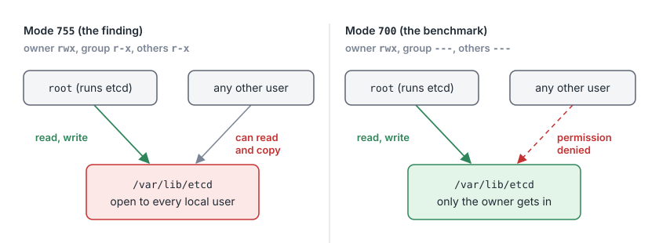

# Data Directory Ownership And Permissions

Transport Layer Security (TLS) protects etcd on the network. The files on the disk need protection too. etcd writes its data to a directory on the node, and a user who can read that directory can copy the database without ever contacting etcd. The copy contains every Secret.

On this page, you check the permissions and the ownership of the etcd data directory, and you fix a finding.

## What the directory holds

The `--data-dir` flag of etcd names the directory. kubeadm, the tool that installed the cluster, sets it to `/var/lib/etcd` and mounts it into the etcd pod as a `hostPath` volume, a volume that shows a directory of the node inside the pod.

Inside the data directory, the `member` directory holds two kinds of files:

- a write-ahead log (WAL), which records each change before etcd applies it;
- snapshot files of the database.

A copy of these files restores the full cluster state on another machine.

The Center for Internet Security (CIS) Kubernetes Benchmark, a list of checks for a secure cluster, asks for two things here:

- The directory permissions must be `700`. This means only the owner can read, write and enter the directory.
- The ownership should be `etcd:etcd`, a dedicated user and group. Then a compromise of another account cannot read the data.

The check numbers differ between editions of the benchmark. Find the checks by the words "data directory permissions" and "data directory ownership".

## Check the permissions

The playground widened the directory on purpose. Open a shell on the node. The `stat` command prints the mode as a number, then the owner and group, then the name:

<!-- astrona:playground:renew -->

```sh
astrona ssh astro-ats-031-playground-020-04
sudo stat -c '%a %U:%G %n' /var/lib/etcd
```

The output is `755 root:root /var/lib/etcd`. With mode `755`, the owner can do everything, and every other user on the node can read and enter the directory. This is the finding. A default kubeadm node creates the directory with mode `700`, so a result of `755` shows that something changed it.



The drawing compares the two modes. With `755`, any local user can copy the database; with `700`, only the owner can enter the directory.

## Who runs etcd

The ownership recommendation depends on the user that runs the etcd process. The `ps -C etcd` command selects the processes named `etcd` and prints their user. The `getent passwd etcd` command asks the node whether a user named `etcd` exists:

```sh
ps -C etcd -o user,pid,comm
getent passwd etcd
```

The output on the playground node (the process ID differs on your node):

```text
USER         PID COMMAND
root        1607 etcd
```

etcd runs as `root`, and the data directory belongs to `root:root`. `getent` prints nothing, because the node has no `etcd` user. This is the default on a kubeadm cluster.

The benchmark text for `etcd:etcd` assumes that a dedicated user runs etcd. On a kubeadm cluster, you can create that user, change the owner of the directory and run the static pod as that user. But kubeadm does not do this by default. A reviewer therefore records the ownership finding with its reason, and does not treat it as a mistake to fix with a single `chown`.

If you only change the owner while etcd still runs as `root`, nothing is gained. The change can even break a restart, if the process user cannot read the files.

The recommendation for permissions has no such condition. Mode `700` works with a process that runs as `root`, so you can apply it on every node.

## Fix the permissions

The fix is one command. It changes the mode of the directory itself, not of the files inside. On a normal installation, the directories `member/snap` and `member/wal` are already readable only by the owner.

```sh
sudo chmod 700 /var/lib/etcd
sudo stat -c '%a %U:%G %n' /var/lib/etcd
```

The second command now prints `700 root:root /var/lib/etcd`. etcd keeps its directory open, so the running process is not restarted or interrupted.

Next, confirm that the API server can still reach etcd. The API server has a readiness check for etcd:

```sh
kubectl get --raw='/readyz/etcd'; echo
```

The command prints `ok`. This is the pattern for every file permission finding: read the value, change one thing, read the value again, and test the service that depends on it.

kube-bench, the tool that checks a node against the benchmark, is installed on the node. Run the two data directory checks of the benchmark edition it uses: `1.1.11` for the permissions and `1.1.12` for the ownership.

```sh
sudo kube-bench run --check 1.1.11,1.1.12 | grep -e '^\[PASS\]' -e '^\[FAIL\]'
```

The output on the playground node:

```text
[PASS] 1.1.11 Ensure that the etcd data directory permissions are set to 700 or more restrictive (Automated)
[FAIL] 1.1.12 Ensure that the etcd data directory ownership is set to etcd:etcd (Automated)
```

The permissions check passes after the fix. The ownership check fails, and it fails on every default kubeadm node, because there is no `etcd` user. Record it as an accepted finding with the reason above.

## What the test does not cover

The `stat` result is correct for this node, but a review of a real server must look further. It must also ask who can log in with `sudo`, and which backup jobs copy `/var/lib/etcd`. Snapshot files that you create with `etcdctl snapshot save` need the same protection as the data directory, because they have the same contents.

You can now read, judge and repair the permissions of the data directory, and you know why the ownership finding needs a decision. The open question is what an attacker or a reviewer actually sees when they reach etcd with a valid certificate.

## Common pitfalls

> [!WARNING]
> - **Running `chown etcd:etcd` while etcd runs as root.** It gives no protection and can stop a restart. Change the owner only together with the user of the process.
> - **Using `chmod -R 700`.** Change only the data directory itself. A recursive change on other paths can break files that other components must read.
> - **Forgetting backups.** A snapshot or a copy of `/var/lib/etcd` on another path or machine holds the same Secrets and needs the same protection.
> - **Expecting check 1.1.12 to pass after `chmod`.** The ownership check needs an `etcd` user, and a kubeadm node has none. Record the finding with its reason.
