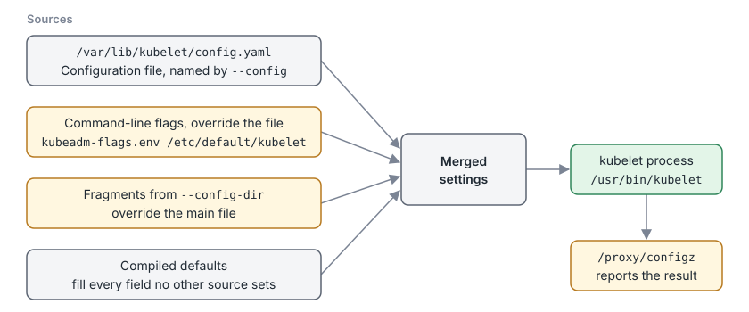

# Kubelet Configuration Sources

A reviewer who reads one file and reports a pass can be wrong. The kubelet, the agent that runs the pods on each node, takes its settings from more than one place. Before you change a kubelet setting, you must know which source wins and how to read the value the kubelet really uses.

You also need a routine to change a setting and restart the kubelet without leaving the node broken. This page builds that routine, and every later change to the kubelet uses it.

## The sources and their order

The kubelet reads a configuration file of kind `KubeletConfiguration`. On a kubeadm node this file is `/var/lib/kubelet/config.yaml`, and the flag `--config` names it. The kubelet also accepts command-line flags.

On a kubeadm node, systemd, the Linux service manager, starts the kubelet from a unit file and a drop-in file. A drop-in is a small file in a `.d` directory that adds to or replaces parts of a unit. Here the drop-in adds the flags from `/var/lib/kubelet/kubeadm-flags.env`. For every field that no source sets, the kubelet uses its compiled defaults.

The sources have a clear order:

- A flag overrides the same field in the file.
- Newer kubelet versions can also read extra configuration fragments from a directory named by the flag `--config-dir`. Those fragments override the main file. Check whether your kubelet uses that flag before you trust the main file alone.
- Compiled defaults fill every field that no other source sets.

Several flags that older guides use are now marked deprecated in favour of the file. So a kubeadm node usually keeps most settings in `config.yaml`.



The drawing shows the four sources, the two that override the file, and the `configz` endpoint that reports the merged result.

## Find the sources on the node

The order is clear on paper, so now find the real sources on your node. The playground has one node, `astro-ats-031-playground-020-05`. It is the control plane and also runs pods, so its kubelet is the one the playground weakened. Open a shell on the node, set the node name and print the kubelet unit file together with its drop-ins:

<!-- astrona:playground:renew -->

```sh
astrona ssh astro-ats-031-playground-020-05
NODE=astro-ats-031-playground-020-05
sudo systemctl cat kubelet
```

The output shows the main unit `/usr/lib/systemd/system/kubelet.service` and the drop-in `10-kubeadm.conf`. In the drop-in, the `ExecStart` line starts `/usr/bin/kubelet` with four variables. Two of them come from the drop-in itself, and two come from environment files. This part of the output is shortened to those lines:

```text
Environment="KUBELET_KUBECONFIG_ARGS=--bootstrap-kubeconfig=/etc/kubernetes/bootstrap-kubelet.conf --kubeconfig=/etc/kubernetes/kubelet.conf"
Environment="KUBELET_CONFIG_ARGS=--config=/var/lib/kubelet/config.yaml"
EnvironmentFile=-/var/lib/kubelet/kubeadm-flags.env
EnvironmentFile=-/etc/default/kubelet
ExecStart=/usr/bin/kubelet $KUBELET_KUBECONFIG_ARGS $KUBELET_CONFIG_ARGS $KUBELET_KUBEADM_ARGS $KUBELET_EXTRA_ARGS
```

The file `/etc/default/kubelet` can set `KUBELET_EXTRA_ARGS`, so it is a second place where flags can hide. Next, print the kubeadm environment file and the command line that the kubelet process really runs with. The `grep` pattern keeps only the kubelet line:

```sh
sudo cat /var/lib/kubelet/kubeadm-flags.env
ps -eo args | grep '[k]ubelet '
```

On this node the output is:

```text
KUBELET_KUBEADM_ARGS=""
/usr/bin/kubelet --bootstrap-kubeconfig=/etc/kubernetes/bootstrap-kubelet.conf --kubeconfig=/etc/kubernetes/kubelet.conf --config=/var/lib/kubelet/config.yaml
```

The process line shows the effective flags. It has `--config=/var/lib/kubelet/config.yaml` and no flag such as `--anonymous-auth` or `--read-only-port`. If such a flag were there, it would override the file. On this node no flag overrides the file, so the file decides.

## Read the effective configuration

The process line tells you which flags exist, but not the final value of each field. For that, ask the kubelet itself. The API server can proxy a request to the kubelet of a node and return the configuration the kubelet runs with. The path ends in `configz`. The result is the merged value of all sources, so it is the most reliable view:

```sh
kubectl get --raw "/api/v1/nodes/$NODE/proxy/configz" | python3 -m json.tool | grep -A2 -e '"anonymous"' -e '"authorization"'
```

The output shows the two weak settings from the starting state:

```text
            "anonymous": {
                "enabled": true
            }
--
        "authorization": {
            "mode": "AlwaysAllow",
            "webhook": {
```

This request needs permission to use the `nodes/proxy` resource, so only a highly privileged user can run it. The `student` user has the `kubernetes-admin` credentials, so the request works here.

## A safe edit routine

Now you can read the real value, so you are ready to change it. Every change to the kubelet follows the same steps:

1. Make a backup outside the directory you edit.
2. Change one field.
3. Check the file with `grep` before you restart.
4. Restart the kubelet with `sudo systemctl restart kubelet` and wait for it.
5. Read the effective value again with `configz`.

The kubelet has no dry-run mode for its file. A syntax error or an unknown field makes the kubelet fail to start, and the node then goes `NotReady`. Duplicated keys also stop the kubelet, because the kubelet parses the file strictly. This is why the routine removes a key before it adds it again.

Make the backup now, and confirm that it exists next to the copy that the playground made:

```sh
sudo cp /var/lib/kubelet/config.yaml /root/kubelet-config.yaml.bak
sudo ls -l /root/kubelet-config.yaml.bak /opt/training/backup
```

The listing shows your new file `/root/kubelet-config.yaml.bak`. In `/opt/training/backup` it shows the file `kubelet-config.yaml`. That copy holds the kubeadm configuration from before the playground weakened it. The same directory also holds copies of the API server and etcd manifests.

To recover from a broken edit, copy a backup over `config.yaml` and restart the kubelet. If the node does not return, read the kubelet log with `sudo journalctl -u kubelet --no-pager -n 50`. On this node the kubelet also runs the control plane static pods. So while the kubelet is stopped, nothing restarts the API server if it fails. Keep the shell on the node open while you work.

You now know where the kubelet gets its settings, how to read the value it really uses, and how to protect yourself from a broken edit. The question still open is which settings decide who may talk to the kubelet.

## Common pitfalls

> [!WARNING]
> - **Reading only `config.yaml`.** A flag can override the file. Read `configz` or the process line.
> - **Editing without a backup.** A bad edit makes the kubelet fail to start, and the node goes `NotReady`.
> - **Adding a key twice.** The kubelet parses the file strictly, and a duplicate key stops it.
> - **Changing the wrong node.** On a cluster with several nodes, open the shell on the node you mean to change. Read the kubelet log if the node does not return.
