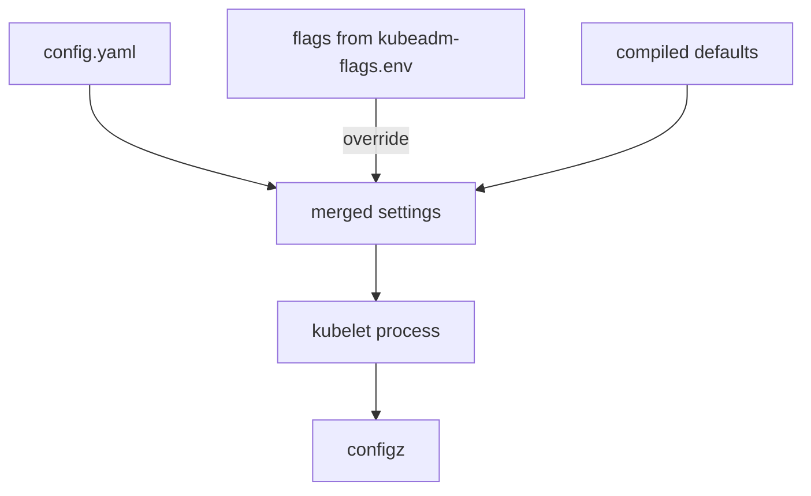

# Kubelet Configuration Sources

A reviewer who reads one file and reports a pass can be wrong, because the kubelet takes its settings from more than one place. Before you change a kubelet setting, you must know which source wins, how to read the effective value, and how to change the setting and restart the kubelet without leaving the node broken. This part builds that routine, and the later parts reuse it.

## The sources and their order

The kubelet reads a configuration file of kind `KubeletConfiguration`. On a kubeadm node the file is `/var/lib/kubelet/config.yaml`, and the flag `--config` names it. The kubelet also accepts command-line flags. On a kubeadm node, systemd starts the kubelet from a unit file and a drop-in file, and the drop-in adds the flags from `/var/lib/kubelet/kubeadm-flags.env`. A drop-in is a small file in a `.d` directory that adds to or replaces parts of a unit. The kubelet applies compiled defaults for everything else.

A flag overrides the same field in the file. Newer kubelet versions can also read extra configuration fragments from a directory named by the flag `--config-dir`, and those fragments override the main file. Check whether your kubelet uses that flag before you trust the main file alone. Several flags used by older guides are marked deprecated in favour of the file, so a kubeadm node usually keeps most settings in `config.yaml`.

## Find the sources on the worker

The worker kubelet is the one the playground weakened. Set the names and print the unit file together with its drop-ins:

<!-- astrona:playground:renew -->

```sh
WORKER=astro-ats-031-playground-020-05-worker
podman exec $WORKER systemctl cat kubelet
```

The output shows the main unit and the drop-in `10-kubeadm.conf`. Find the `ExecStart` line and the environment files it reads. Then print the environment file and the process command line that the kubelet really runs with. The host filter keeps the kubelet line:

```sh
podman exec $WORKER cat /var/lib/kubelet/kubeadm-flags.env
podman exec $WORKER ps -eo args | grep '[k]ubelet'
```

The process line shows the effective flags. Look for `--config=/var/lib/kubelet/config.yaml`. If you see a flag such as `--anonymous-auth` or `--read-only-port` there, it overrides the file. In this playground the process line has no such flag, so the file decides.

## Read the effective configuration

The API server can proxy a request to the kubelet of a node and return the configuration the kubelet runs with. The path ends in `configz`. The result is the merged value of all sources, so it is the most reliable view:

```sh
kubectl get --raw "/api/v1/nodes/$WORKER/proxy/configz" | python3 -m json.tool | grep -A2 -e '"anonymous"' -e '"authorization"'
```

The output shows `enabled: true` under `anonymous` and the mode `AlwaysAllow` under `authorization`. These are the two weak settings from the starting state. The same request needs permission to use the `nodes/proxy` resource, so only a highly privileged user can run it.

## A safe edit routine

Every change to the kubelet follows the same steps. First, make a backup outside the directory you edit. Second, change one field. Third, check the file with `grep` before you restart. Fourth, restart the kubelet with `systemctl restart kubelet` and wait for it. Fifth, read the effective value again with `configz`.

The kubelet has no dry-run mode for its file. A syntax error or an unknown field makes the kubelet fail to start, and the node then goes `NotReady`. Duplicated keys also stop the kubelet, because the file is parsed strictly. This is why the routine removes a key before it adds it again. Make the backup now and confirm that it exists:

```sh
podman exec $WORKER cp /var/lib/kubelet/config.yaml /root/kubelet-config.yaml.bak
podman exec $WORKER ls -l /root/kubelet-config.yaml.bak /opt/training/backup
```

To recover from a broken edit, copy the backup over `config.yaml` and restart the kubelet. If the node does not return, read the log with `podman exec $WORKER journalctl -u kubelet --no-pager -n 50`.



The diagram shows that the kubelet merges the file, the flags and the defaults, and that `configz` reports the merged result.

You now know where to look, how to read the real value, and how to protect yourself from a broken edit. The next question is which settings decide who may talk to the kubelet.

## Common pitfalls

> [!WARNING]
> - **Reading only `config.yaml`.** A flag can override the file. Read `configz` or the process line.
> - **Editing without a backup.** A bad edit makes the kubelet fail to start and the node `NotReady`.
> - **Adding a key twice.** The file is parsed strictly, and a duplicate key stops the kubelet.
> - **Changing the wrong node.** Name the worker container in every command, and read the kubelet log if the node does not return.
