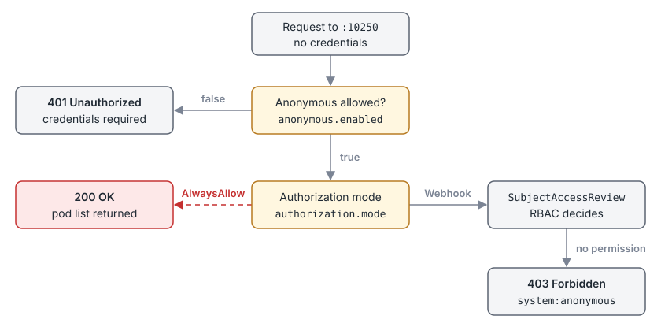

# Kubelet Authentication And Authorization

The kubelet serves an HTTPS API on port `10250`. Through this API, a caller can list the pods of the node, read container logs and run commands in containers. Two settings decide who may do this. Authentication proves who the caller is. Authorization decides what that caller may do.

When both settings are weak, any host that can open a connection to the node controls the pods on it. This page shows that exposure in the playground and then fixes it.

## The settings

The kubelet configuration has one block for each of the two settings. The `authentication` block lists three ways a caller can prove who it is:

- `anonymous.enabled` lets requests without credentials through as the user `system:anonymous`. The benchmark requires `false`.
- `webhook.enabled` makes the kubelet check bearer tokens with a `TokenReview` request to the API server. A bearer token is a secret string that the caller sends in the request header. Service accounts and users with tokens authenticate this way.
- `x509.clientCAFile` names the certificate authority (CA) that signs the client certificates the kubelet accepts. The API server connects to the kubelet with a certificate signed by this CA.

The `authorization` block has a `mode`. The mode `AlwaysAllow` allows every authenticated request. With anonymous authentication on, that means every request. The mode `Webhook` makes the kubelet send a `SubjectAccessReview` request to the API server for each request, so Kubernetes role-based access control (RBAC) decides. The benchmark requires `Webhook`.

The two settings work together, and the answer code tells you which one stopped a request:

- With anonymous authentication off, a request without credentials gets the status `401 Unauthorized`.
- With anonymous authentication on but the mode `Webhook`, the request authenticates as `system:anonymous`. RBAC finds no permission, and the kubelet answers `403 Forbidden`.
- With both settings weak, the request succeeds.



The drawing shows that `anonymous.enabled` decides first whether a request without credentials goes on, and `authorization.mode` then decides what happens to it.

## Show the exposure

Now see the weak case for yourself. The playground has one node, so the request goes from the node to its own kubelet port. Open a shell on the node, find the InternalIP address of the node, and send an anonymous request to port `10250` at that address.

The request uses the node network address, not the loopback address, so it takes the same path as a request from another host. The option `-o /dev/null -w` prints only the HTTP status code:

<!-- astrona:playground:renew -->

```sh
astrona ssh astro-ats-031-playground-020-05
NODE=astro-ats-031-playground-020-05
NODE_IP=$(kubectl get node $NODE -o jsonpath='{.status.addresses[?(@.type=="InternalIP")].address}')
echo $NODE_IP
curl -sk -o /dev/null -w '%{http_code}\n' https://$NODE_IP:10250/pods
```

The output is:

```text
10.0.2.15
200
```

A request with no credentials listed every pod on the node, including the control plane pods. The same request to a hardened kubelet fails. This is the finding. It is also what the benchmark checks in the settings: anonymous access is enabled, and the mode does not check permissions.

## Fix the settings

Take a backup, then change the two values. The first `sed` command finds the line `anonymous:` and changes `enabled` on the next line. The second `sed` command changes the authorization mode. Both patterns depend on the layout that kubeadm writes, so print the result before you restart:

```sh
sudo cp /var/lib/kubelet/config.yaml /root/kubelet-config.yaml.bak
sudo sed -i '/^  anonymous:/{n;s/enabled: true/enabled: false/}' /var/lib/kubelet/config.yaml
sudo sed -i 's/^  mode: AlwaysAllow$/  mode: Webhook/' /var/lib/kubelet/config.yaml
sudo grep -A1 -e '^  anonymous:' -e '^authorization:' /var/lib/kubelet/config.yaml
```

The `grep` prints:

```text
  anonymous:
    enabled: false
--
authorization:
  mode: Webhook
```

If a line is unchanged, the layout of your file differs from the pattern. In that case, do not restart the kubelet. Edit the file by hand to get the same result. Restart the kubelet only when both lines are right:

```sh
sudo systemctl restart kubelet
```

## Verify with a request, not with the file

A changed file proves nothing until the kubelet runs with it, so test with a real request. The restart takes a few seconds. The loop below repeats the anonymous request until it returns `401` or has tried 30 times. A request that fails to connect prints `000`, so the loop keeps trying:

```sh
for attempt in $(seq 1 30); do
  code=$(curl -sk -o /dev/null -w '%{http_code}' https://$NODE_IP:10250/pods)
  echo "attempt $attempt: $code"
  if [ "$code" = "401" ]; then break; fi
  sleep 3
done
kubectl get node $NODE
```

On this node the output was:

```text
attempt 1: 000
attempt 2: 401
NAME                              STATUS   ROLES           AGE     VERSION
astro-ats-031-playground-020-05   Ready    control-plane   3m42s   v1.35.10
```

The first attempt ran while the kubelet was still starting, so it could not connect. The loop then ends with `401`: the kubelet now requires credentials.

The node stays `Ready`. The API server connects with its client certificate, which the `x509` source accepts, and `Webhook` authorization allows the API server user. So the fix did not cut the control plane off from the kubelet.

To confirm, read the effective values again with the `configz` request (`kubectl get --raw "/api/v1/nodes/$NODE/proxy/configz"`). It must show `anonymous` as `false` and the mode as `Webhook`.

You have now closed the two settings that give unauthenticated access to the kubelet API, and you proved it with a request. The question still open is the kubelet's other listener, which needs no credentials at all, and the Transport Layer Security (TLS) options that decide the quality of the connection.

## Common pitfalls

> [!WARNING]
> - **Setting authorization to `Webhook` and leaving anonymous on.** Anonymous requests then get `403`. That looks safe, but the kubelet still processes them. The benchmark asks for both settings.
> - **Setting `AlwaysAllow` to debug a problem and forgetting it.** It turns every authenticated and anonymous request into an allowed request.
> - **Declaring success because the file changed.** The kubelet reads the file only when it starts. Restart it and test with a request.
> - **Removing the `x509` source.** The API server cannot reach the kubelet, and the node goes `NotReady`.
