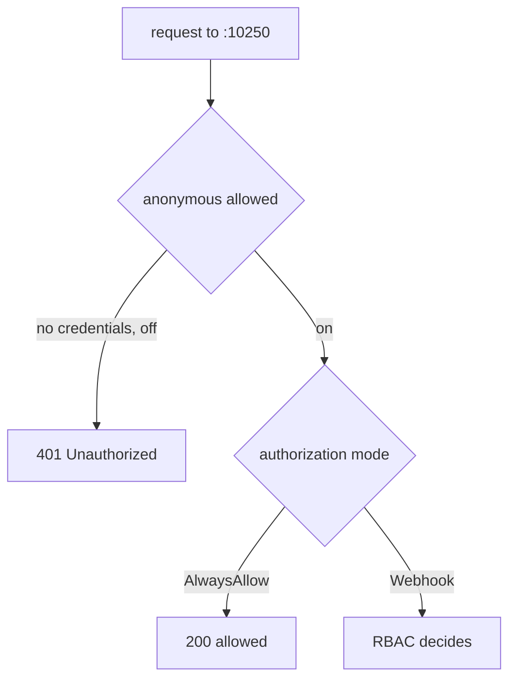

# Kubelet Authentication And Authorization

The kubelet serves an HTTPS API on port `10250`. Through this API a caller can list the pods of the node, read container logs and execute commands in containers. Two settings decide who may do this: authentication, which proves who the caller is, and authorization, which decides what that caller may do. When both are weak, any host that can open a connection to the node controls the pods on it. This part shows the exposure in the playground and fixes it.

## The settings

Authentication has three sources in the `authentication` block of the kubelet configuration.

- `anonymous.enabled` lets requests without credentials through as the user `system:anonymous`. The benchmark requires `false`.
- `webhook.enabled` makes the kubelet check bearer tokens with a `TokenReview` request to the API server. Service accounts and users with tokens authenticate this way.
- `x509.clientCAFile` names the certificate authority (CA) that signs accepted client certificates. The API server connects to the kubelet with a certificate signed by this CA.

Authorization has a `mode` in the `authorization` block. The mode `AlwaysAllow` allows every authenticated request, and with anonymous authentication on, every request. The mode `Webhook` makes the kubelet send a `SubjectAccessReview` to the API server for each request, so Kubernetes RBAC decides. The benchmark requires `Webhook`.

The two settings work together. With anonymous authentication off, a request without credentials gets the status `401 Unauthorized`. With anonymous authentication on but the mode `Webhook`, the request authenticates as `system:anonymous`, RBAC finds no permission and the kubelet answers `403 Forbidden`. With both weak, the request succeeds.

## Show the exposure

Find the address of the worker node and send an anonymous request to the kubelet port from the control plane node. The option `-o /dev/null -w` prints only the HTTP status code:

<!-- astrona:playground:renew -->

```sh
CONTROL=astro-ats-031-playground-020-05-control-plane
WORKER=astro-ats-031-playground-020-05-worker
WORKER_IP=$(kubectl get node $WORKER -o jsonpath='{.status.addresses[?(@.type=="InternalIP")].address}')
podman exec $CONTROL curl -sk -o /dev/null -w '%{http_code}\n' https://$WORKER_IP:10250/pods
```

The command prints `200`. A request with no credentials listed every pod on the worker. The same request to a hardened kubelet fails. This is the finding, and it is also the check the benchmark makes with the settings: anonymous access enabled and a mode that does not check permissions.

## Fix the settings

Take a backup, then change the two values. The first `sed` command finds the line `anonymous:` and changes `enabled` on the next line. The second changes the authorization mode. Both patterns depend on the layout that kubeadm writes, so print the result before you restart:

```sh
podman exec $WORKER cp /var/lib/kubelet/config.yaml /root/kubelet-config.yaml.bak
podman exec $WORKER sed -i '/^  anonymous:/{n;s/enabled: true/enabled: false/}' /var/lib/kubelet/config.yaml
podman exec $WORKER sed -i 's/^  mode: AlwaysAllow$/  mode: Webhook/' /var/lib/kubelet/config.yaml
podman exec $WORKER grep -A1 -e '^  anonymous:' -e '^authorization:' /var/lib/kubelet/config.yaml
```

The `grep` must show `enabled: false` after `anonymous:` and `mode: Webhook` after `authorization:`. If a line is unchanged, the layout of your file differs from the pattern, so do not restart the kubelet. Edit the file by hand with the same result. Restart the kubelet only when both lines are right:

```sh
podman exec $WORKER systemctl restart kubelet
```

## Verify with a request, not with the file

The restart takes a few seconds. The loop below repeats the anonymous request until it returns `401` or it has tried 30 times. A request that fails to connect prints `000`, so the loop keeps trying:

```sh
for attempt in $(seq 1 30); do
  code=$(podman exec $CONTROL curl -sk -o /dev/null -w '%{http_code}' https://$WORKER_IP:10250/pods)
  echo "attempt $attempt: $code"
  if [ "$code" = "401" ]; then break; fi
  sleep 3
done
kubectl get node $WORKER
```

The loop ends with `401`: the kubelet now requires credentials. The node is `Ready` again because the API server connects with its client certificate, which the `x509` source accepts, and `Webhook` authorization allows the API server user. That the node stays `Ready` shows that the fix did not cut the control plane off from the kubelet.

Read the effective values again with `configz` as in the previous routine to confirm `anonymous` is `false` and the mode is `Webhook`.



The diagram shows that anonymous authentication decides whether a request without credentials goes on, and the authorization mode decides what happens next.

You have closed the two settings that give unauthenticated access to the kubelet API. The kubelet has another listener that needs no credentials at all, and TLS options that decide the quality of the connection. The next part covers both.

## Common pitfalls

> [!WARNING]
> - **Turning authorization to `Webhook` and leaving anonymous on.** Anonymous requests then get `403`, which looks safe but still lets the kubelet process them. The benchmark asks for both settings.
> - **Setting `AlwaysAllow` to debug a problem and forgetting it.** It turns every authenticated and anonymous request into an allowed request.
> - **Declaring success because the file changed.** The kubelet reads the file at start. Restart it and test with a request.
> - **Removing the `x509` source.** The API server cannot reach the kubelet and the node goes `NotReady`.
