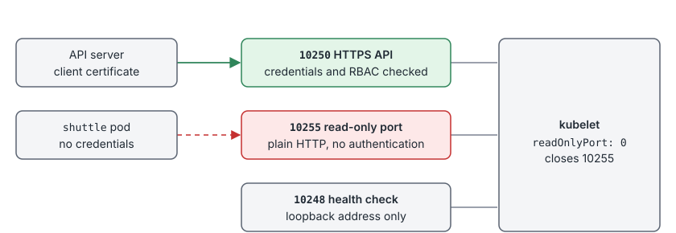

# Read-Only Port, Ports And TLS Settings

Closing the authenticated API of the kubelet is not enough if a second listener answers without authentication. The kubelet has a read-only HTTP port that does exactly this. This page finds that port, shows what it exposes and closes it.

After that, the page reviews the Transport Layer Security (TLS) settings of the main kubelet port. TLS is the protocol that encrypts the HTTPS connection. The page also covers certificate rotation, which keeps the kubelet certificates from expiring.

## The ports of the kubelet

The kubelet listens on several ports, and each one has a different level of protection:

- Port `10250` is the HTTPS API. The authentication and authorization settings protect it, so a caller needs credentials, and with `Webhook` authorization, role-based access control (RBAC) checks each request.
- Port `10248` is a health check on the loopback address, so only the node itself can reach it.
- Port `10255` is the read-only port. It serves plain HTTP with no authentication and no encryption. It exposes information such as the list of pods and the metrics of the node.

The field `readOnlyPort` in the kubelet configuration controls port `10255`, and the value `0` disables it. The benchmark requires that the port is disabled. Newer kubelet versions disable it by default, but the playground opens it on purpose.



The drawing shows the three ports, who can reach each one, and that `readOnlyPort: 0` closes port `10255`.

## Show the exposure

The `shuttle` pod is a client pod in the cluster. Pods can reach the IP address of a node, so a compromised pod could read this port. Open a shell on the node, find the InternalIP address of the node, and send a request from `shuttle` to port `10255` at that address. The `head -c 300` command keeps only the first 300 characters of the answer:

<!-- astrona:playground:renew -->

```sh
astrona ssh astro-ats-031-playground-020-05
NODE=astro-ats-031-playground-020-05
NODE_IP=$(kubectl get node $NODE -o jsonpath='{.status.addresses[?(@.type=="InternalIP")].address}')
kubectl -n starfleet exec shuttle -- wget -q -T 3 -O- http://$NODE_IP:10255/pods | head -c 300; echo
```

The answer is a JSON document of kind `PodList`. It starts like this:

```text
{"kind":"PodList","apiVersion":"v1","metadata":{},"items":[{"metadata":{"name":"kube-controller-manager-astro-ats-031-playground-020-05","namespace":"kube-system","uid":"9ff03813badd74cbda79c7178a12ec51","labels":{"component":"kube-controller-manager","tier":"control-plane"},"annotations":{"kubernet
```

The full document lists every pod of the node, with its images, environment variable names and volumes. On this node the list includes the control plane pods, because the node runs them. The request carried no credentials and no certificate.

## Close the port

The fix is one field, but the key must exist only once in the file. So the commands remove any existing line first and then append the new one. A blank line before the new key protects against a file that does not end with a line break. The file belongs to `root`, so `sudo tee -a` appends the line:

```sh
sudo cp /var/lib/kubelet/config.yaml /root/kubelet-config.yaml.bak
sudo sed -i '/^readOnlyPort:/d' /var/lib/kubelet/config.yaml
printf '\nreadOnlyPort: 0\n' | sudo tee -a /var/lib/kubelet/config.yaml >/dev/null
sudo grep -n 'readOnlyPort' /var/lib/kubelet/config.yaml
sudo systemctl restart kubelet
```

The `grep` shows exactly one line, which is `54:readOnlyPort: 0` on this node. Wait about ten seconds for the kubelet to restart, then repeat the request from `shuttle`:

```sh
kubectl -n starfleet exec shuttle -- wget -q -T 3 -O- http://$NODE_IP:10255/pods
```

The kubelet no longer listens on the port, so the node refuses the connection:

```text
wget: can't connect to remote host (10.0.2.15): Connection refused
command terminated with exit code 1
```

If the request still returns the pod list, the kubelet has not restarted yet. Run the request again after a few seconds.

## TLS settings of port 10250

With the plain HTTP port closed, all access goes through port `10250`. The quality of that connection depends on fields in the same file:

- `tlsMinVersion` sets the lowest TLS version the kubelet accepts. The value `VersionTLS12` or higher removes old protocol versions. If the field is empty, the default of the Go library applies. Recent Go versions set that default to TLS 1.2 for servers.
- `tlsCipherSuites` lists the allowed cipher suites, which are the encryption methods a connection may use. The benchmark asks for a list of strong ciphers, and a restricted list limits the kubelet to those. A list that is too narrow can stop clients from connecting, so test after a change.
- `tlsCertFile` and `tlsPrivateKeyFile` name the serving certificate. If they are empty, the kubelet creates a self-signed certificate, which clients cannot verify.

Set the minimum version with the same remove-and-append routine, and check the effective value after the restart:

```sh
sudo sed -i '/^tlsMinVersion:/d' /var/lib/kubelet/config.yaml
printf '\ntlsMinVersion: VersionTLS12\n' | sudo tee -a /var/lib/kubelet/config.yaml >/dev/null
sudo systemctl restart kubelet
kubectl get --raw "/api/v1/nodes/$NODE/proxy/configz" | python3 -m json.tool | grep -e tlsMinVersion -e readOnlyPort
```

The `configz` output is one line:

```text
        "tlsMinVersion": "VersionTLS12",
```

The field `readOnlyPort` is absent, because the kubelet leaves a zero value out of the output. Absent means the port is closed. If the request returns an error right after the restart, wait a few seconds and run it again.

## Certificates and rotation

A strong TLS setup still fails if a certificate expires, so two more fields matter. `rotateCertificates: true` makes the kubelet request a new client certificate from the API server before the old one expires. Without it, the client certificate expires after its validity period, usually one year, and the node stops working.

`serverTLSBootstrap: true` makes the kubelet request its serving certificate through the certificate signing request (CSR) API instead of using a self-signed one. An administrator, or a controller you install, must approve these requests. Until a request is approved, the kubelet cannot serve a certificate that clients trust. This is why the playground does not turn `serverTLSBootstrap` on.

The benchmark asks for both settings. A real cluster that turns on the second one must also have a plan for approving the requests.

You have now closed the unauthenticated listener and set a minimum TLS version for the authenticated one. The question still open is the group of kubelet checks about kernel behaviour, timeouts and file permissions.

## Common pitfalls

> [!WARNING]
> - **Protecting only port `10250`.** Port `10255` needs no credentials. Set `readOnlyPort: 0`.
> - **Writing the key twice.** A duplicate key stops the kubelet. Remove the old line first.
> - **Turning on `serverTLSBootstrap` without approving requests.** The pending requests leave the kubelet without a trusted serving certificate.
> - **Using a very narrow `tlsCipherSuites` list.** Clients that support none of the ciphers lose access. Test the API server and your monitoring after the change.
