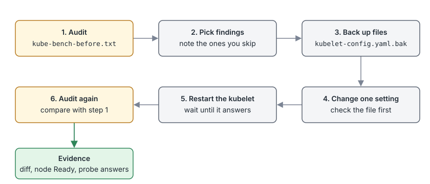

# Remediate Findings End To End

On the exam and in real work, a single fix is rarely the whole task. You get a list of failing checks on a node. You must close each one without breaking the node, and you must show that each one is closed.

The method is always the same loop: audit, back up, change one setting, restart, audit again and compare. This page runs the loop for a mixed list of findings on the kubelet of the playground node. It ends by stating what the evidence proves and what it does not.

## The loop

The loop has six steps, in this order:

1. Audit: record the state before any change.
2. Pick the findings that you can and must fix. Note those you do not fix, with the reason.
3. Back up every file you touch, outside the directories that a service loads.
4. Change one setting at a time and check the file.
5. Restart the component that reads the file and wait for it.
6. Audit again and compare with the first record.

Step 6 is the one people skip. A file edit is not a result. The result is the effective value on the running process, plus a working node.



The drawing shows the six steps in order, and that the evidence comes from the last step, not from the change itself.

## The audit with kube-bench

The first step needs a tool. `kube-bench` is a tool that runs the checks of the Center for Internet Security (CIS) Kubernetes Benchmark against a node. The target `node` covers section 4 of the benchmark, the worker node checks, which are about the kubelet.

On the playground node, the binary is `/usr/local/bin/kube-bench`, and its benchmark files are in `/etc/kube-bench/cfg`. It reads files that only `root` can read, so run it with `sudo`.

The commands on this page expect the starting state of the playground, with the kubelet still weak. If you changed the kubelet before, your lists are shorter than the ones shown here. Open a shell on the node, save the report to a file and list the failing checks:

<!-- astrona:playground:renew -->

```sh
astrona ssh astro-ats-031-playground-020-05
NODE=astro-ats-031-playground-020-05
sudo kube-bench run --targets node > kube-bench-before.txt
grep -e '^\[FAIL\]' kube-bench-before.txt
```

In the starting state the `grep` prints six failing checks:

```text
[FAIL] 4.1.1 Ensure that the kubelet service file permissions are set to 600 or more restrictive (Automated)
[FAIL] 4.1.5 Ensure that the --kubeconfig kubelet.conf file permissions are set to 600 or more restrictive (Automated)
[FAIL] 4.1.9 If the kubelet config.yaml configuration file is being used validate permissions set to 600 or more restrictive (Automated)
[FAIL] 4.2.1 Ensure that the --anonymous-auth argument is set to false (Automated)
[FAIL] 4.2.2 Ensure that the --authorization-mode argument is not set to AlwaysAllow (Automated)
[FAIL] 4.2.10 Ensure that the --rotate-certificates argument is not set to false (Automated)
```

The summary at the end of the file shows 11 PASS, 6 FAIL and 7 WARN. Match each failing check to a kubelet setting you know: file permissions, anonymous authentication, the authorization mode and certificate rotation.

The open read-only port is not in this list. Check `4.2.4`, "Verify that the --read-only-port argument is set to 0", is a manual check, so kube-bench reports it as `[WARN]`. A `[WARN]` line is not a pass, so read the warnings too. Keep the file as the record from before.

## A manual audit you can repeat

kube-bench reads the node in its own way, so it helps to have a second record that you control. The function below prints the effective values of the settings this page changes, and the modes of the kubelet files. It reads `configz`, so it shows what the kubelet really runs with. Save the output to a file before and after the change:

```sh
audit_kubelet() {
  kubectl get --raw "/api/v1/nodes/$NODE/proxy/configz" | python3 -c 'import json,sys; c=json.load(sys.stdin)["kubeletconfig"]; print("anonymous", c["authentication"]["anonymous"]["enabled"]); print("authorization", c["authorization"]["mode"]); print("readOnlyPort", c.get("readOnlyPort", 0)); print("rotateCertificates", c.get("rotateCertificates")); print("streamingConnectionIdleTimeout", c.get("streamingConnectionIdleTimeout")); print("tlsMinVersion", c.get("tlsMinVersion"))'
  sudo stat -c '%a %n' /var/lib/kubelet/config.yaml /etc/kubernetes/kubelet.conf
}
audit_kubelet > audit-before.txt
cat audit-before.txt
```

The output lists one line per setting. In the starting state it is:

```text
anonymous True
authorization AlwaysAllow
readOnlyPort 10255
rotateCertificates None
streamingConnectionIdleTimeout 4h0m0s
tlsMinVersion None
644 /var/lib/kubelet/config.yaml
644 /etc/kubernetes/kubelet.conf
```

`None` means that `configz` does not contain the field. So `rotateCertificates` is `false`, and `tlsMinVersion` is not set. If you applied some of these fixes before, those lines already show the secure values. Read the real output of your cluster, and do not assume it.

## Fix the list

With both records saved, you can make the changes. Define a helper that sets one top-level key in the kubelet file. It removes the key if it exists and appends the new one, so the key appears only once. Then apply every setting that is still wrong. Each line is safe to run again, because the helper replaces the value:

```sh
set_kubelet_field() {
  sudo sed -i "/^$1:/d" /var/lib/kubelet/config.yaml
  printf '\n%s: %s\n' "$1" "$2" | sudo tee -a /var/lib/kubelet/config.yaml >/dev/null
}
sudo cp /var/lib/kubelet/config.yaml /root/kubelet-config.yaml.bak
set_kubelet_field readOnlyPort 0
set_kubelet_field rotateCertificates true
set_kubelet_field streamingConnectionIdleTimeout 5m
set_kubelet_field tlsMinVersion VersionTLS12
sudo sed -i '/^  anonymous:/{n;s/enabled: true/enabled: false/}' /var/lib/kubelet/config.yaml
sudo sed -i 's/^  mode: AlwaysAllow$/  mode: Webhook/' /var/lib/kubelet/config.yaml
sudo chmod 600 /var/lib/kubelet/config.yaml /etc/kubernetes/kubelet.conf
sudo grep -c -e '^readOnlyPort' -e '^rotateCertificates' -e '^streamingConnectionIdleTimeout' -e '^tlsMinVersion' /var/lib/kubelet/config.yaml
```

The last command counts the lines for the four keys. It must print `4`, one line per key. A larger number means a duplicate key, and the kubelet would not start. Do not restart until the count is right.

## Restart and compare

Restart the kubelet and wait until the API answers through it. The loop reads `configz` until the anonymous setting is `False`, at most 30 times. Then the commands save the second record, compare the two records, and check the node and the `probe` Service:

```sh
sudo systemctl restart kubelet
for attempt in $(seq 1 30); do
  if audit_kubelet 2>/dev/null | grep -q '^anonymous False'; then echo "kubelet restarted"; break; fi
  sleep 3
done
audit_kubelet > audit-after.txt
diff audit-before.txt audit-after.txt
kubectl get nodes
kubectl -n starfleet exec shuttle -- wget -q -T 3 -O- http://probe/
```

On this node the output was:

```text
kubelet restarted
1,8c1,8
< anonymous True
< authorization AlwaysAllow
< readOnlyPort 10255
< rotateCertificates None
< streamingConnectionIdleTimeout 4h0m0s
< tlsMinVersion None
< 644 /var/lib/kubelet/config.yaml
< 644 /etc/kubernetes/kubelet.conf
---
> anonymous False
> authorization Webhook
> readOnlyPort 0
> rotateCertificates True
> streamingConnectionIdleTimeout 5m0s
> tlsMinVersion VersionTLS12
> 600 /var/lib/kubelet/config.yaml
> 600 /etc/kubernetes/kubelet.conf
NAME                              STATUS   ROLES           AGE    VERSION
astro-ats-031-playground-020-05   Ready    control-plane   6m5s   v1.35.10
version=v1 host=probe-7db6ffd7d6-l26mc greeting=hello
```

The `diff` shows each changed line, and that is your evidence. The node is `Ready`, and the `probe` Service still answers, so both the node and the workload work. Your `AGE` and pod name differ.

Now run `kube-bench` again into a second file and list the failures:

```sh
sudo kube-bench run --targets node > kube-bench-after.txt
grep -e '^\[FAIL\]' kube-bench-after.txt
```

One check still fails:

```text
[FAIL] 4.1.1 Ensure that the kubelet service file permissions are set to 600 or more restrictive (Automated)
```

The summary now shows 17 PASS, 1 FAIL and 6 WARN. The checks for the settings you fixed are gone, and the check you did not touch remains. Check `4.1.1` reads the mode of `/lib/systemd/system/kubelet.service`, which is `644` on this node. The loop did not change that file.

To close it too, run `sudo chmod 600 /lib/systemd/system/kubelet.service`. Then run the check again with `sudo kube-bench run --targets node --check 4.1.1`. On this node the check then shows `[PASS]`.

## What the evidence proves

The comparison proves two things: the effective values changed, and the node and the application still work. It does not prove that the cluster is compliant. The benchmark has many more checks.

A passing tool result also depends on how the audit reads the node. A check can pass while the setting is wrong, or fail while the setting is right. This is why the loop ends with the effective value, not only with the tool output.

You have now run the full loop once, from the first audit to the evidence. On an exam the same loop applies, with a different component each time: the API server manifest, the etcd manifest or the kubelet file. The question to ask each time is the same one: what does the running process use now, and does everything still work?

## Common pitfalls

> [!WARNING]
> - **Skipping the first audit.** Without the record from before, you cannot show what changed.
> - **Fixing several files and restarting once without checking.** One duplicate key or typo stops the kubelet. Check the file first.
> - **Trusting the tool output alone.** Confirm the effective value on the running process.
> - **Reading only the `[FAIL]` lines.** Manual checks such as the read-only port appear as `[WARN]`. Read them and decide on each one.
