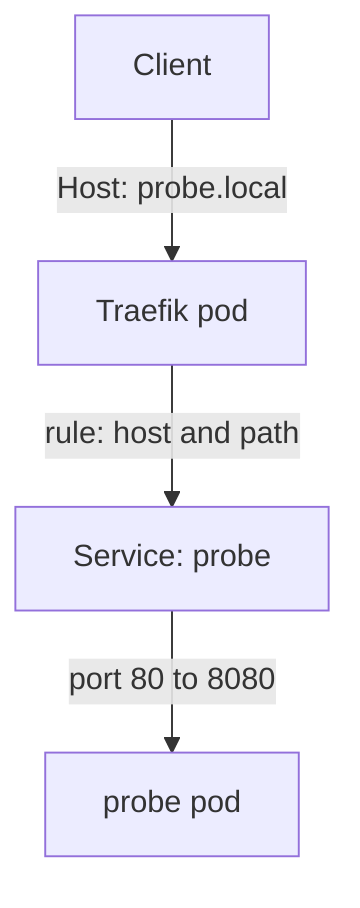

# Ingress Routing: Controller, Class, Host And Path

A Service of type `ClusterIP` is reachable only inside the cluster. To publish many web applications on one address, the cluster needs a component that reads the host name and the path of each HTTP request and chooses the Service. This part explains which component does what, how a rule matches a request, and then you route a request through Traefik without TLS first.

## Three separate things

An **Ingress** is a namespaced object with routing rules. It stores the rules and nothing else. An **IngressClass** is a cluster-wide object that names a controller, for example `traefik.io/ingress-controller`. An Ingress selects its controller with `spec.ingressClassName`. An **Ingress controller** is a program running in pods. It watches the API server for Ingress objects of its class and turns them into its own routing configuration. It needs RBAC permission to read Ingresses, Services, EndpointSlices and Secrets.

If `ingressClassName` names a class that no controller serves, nothing happens: the API server accepts the Ingress and no request is routed. Other controllers use different annotations, so a task always names the class to use. Look at the class and the controller in the playground:

<!-- astrona:playground:renew -->

```sh
kubectl get ingressclass
kubectl -n ingress-system get deployment,service
```

The `traefik` class lists the controller name. The `traefik` Service in `ingress-system` has the port 80 for the entrypoint `web` and the port 443 for the entrypoint `websecure`. An **entrypoint** is a port on which Traefik accepts connections.

## How a rule matches a request

A rule in `spec.rules` has an optional `host` and a list of `http.paths`. The controller first compares the `Host` header (for HTTPS, the server name) with `host`. A rule without `host` matches every host. A path entry has a `path`, a `pathType` and a `backend.service` with a Service `name` and a port. The port is the Service port, either `number` or `name`.

The `pathType` has three values. `Exact` matches only the identical path. `Prefix` matches by path elements separated by `/`: the prefix `/api` matches `/api` and `/api/v1`, but not `/apiary`. `ImplementationSpecific` leaves the matching to the controller. When several paths match, the longest one wins, and `Exact` wins over `Prefix` for the same path.

Then the controller picks a ready pod from the EndpointSlices of the Service and sends the request to the pod port. If no rule matches, the controller answers itself with `404`.



The diagram shows that the controller, not the Ingress object, receives the request and chooses the Service from the rule.

## Route a request without TLS

Save this as `ingress-probe-http.yaml`. It routes the host `probe.local` with the path prefix `/` to port 80 of the `probe` Service. The annotation tells Traefik to serve this route on the `web` entrypoint only.

```yaml
apiVersion: networking.k8s.io/v1
kind: Ingress
metadata:
  name: probe-http
  namespace: starfleet
  annotations:
    traefik.ingress.kubernetes.io/router.entrypoints: web
spec:
  ingressClassName: traefik
  rules:
  - host: probe.local
    http:
      paths:
      - path: /
        pathType: Prefix
        backend:
          service:
            name: probe
            port:
              number: 80
```

Apply it:

```sh
kubectl apply -f ingress-probe-http.yaml
```

Then check the result. The `describe` output lists the host, the path and the backend with the pod addresses of the Service.

```sh
kubectl -n starfleet describe ingress probe-http
```

Your machine cannot reach the cluster network directly, so use a port forward. Open a second terminal, run this command, and leave it running. It forwards local ports 8080 and 8443 to the ports 80 and 443 of the Traefik Service.

```sh
kubectl -n ingress-system port-forward service/traefik 8080:80 8443:443
```

In the first terminal, send two requests to the forwarded port. The first sets the `Host` header to the name in the rule. The second uses a name that no rule has.

```sh
curl -s -H 'Host: probe.local' http://127.0.0.1:8080/
curl -s -H 'Host: other.local' http://127.0.0.1:8080/
```

The first request returns one line with `version=v1`, the name of the pod that answered, and `greeting=hello`. The second request returns `404 page not found` from Traefik, because no rule matches the host `other.local`. The `Host` header chose the route, not the address `127.0.0.1` that curl connected to.

You can now route by host and path. The route still travels in clear text. The next question is what a certificate must contain so that a client trusts the server.

## Common pitfalls

> [!WARNING]
> - **No controller for the class.** An Ingress whose `ingressClassName` no controller serves is stored and ignored.
> - **Using the pod port in the backend.** The backend names the Service port (80), not the container port (8080).
> - **Prefix without path elements in mind.** `Prefix` `/api` does not match `/apiary`.
> - **Testing with the wrong Host.** The controller routes by host name. A request to the IP address without the right `Host` header returns `404`.
