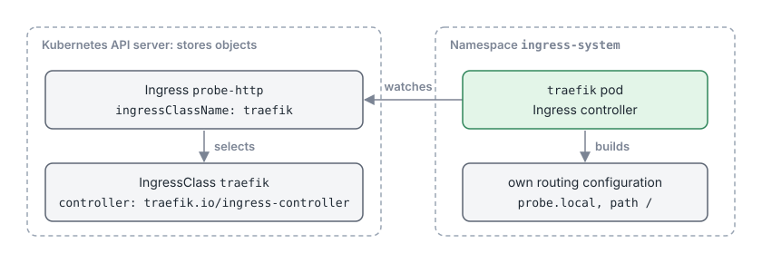
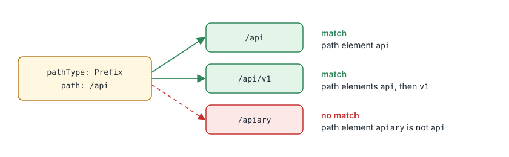
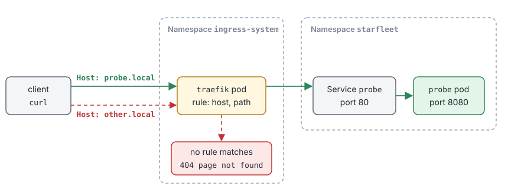

# Ingress Routing: Controller, Class, Host And Path

A Service of type `ClusterIP` has an address that works only inside the cluster. To publish many web applications on one address, the cluster needs a component that reads the host name and the path of each HTTP request and then chooses the right Service. On this page, you learn which component does what and how a rule matches a request. Then you route a request through Traefik, first without TLS.

## Three separate things

Ingress routing uses three objects that sit close together, so people often mix them up. Each one has a different job:

- An **Ingress** is a namespaced object with routing rules. It stores the rules and does nothing else.
- An **IngressClass** is a cluster-wide object that names a controller, for example `traefik.io/ingress-controller`. An Ingress selects its class with the field `spec.ingressClassName`.
- An **Ingress controller** is a program that runs in pods. It watches the API server for Ingress objects of its class and turns them into its own routing configuration.

The controller needs permission to read the objects it uses. Role-based access control (RBAC) is the Kubernetes system that grants these permissions. The controller needs RBAC permission to read Ingresses, Services, EndpointSlices and Secrets.



The drawing shows who does the work. The API server only stores the Ingress and the IngressClass, and the Traefik pod in `ingress-system` reads them and builds its routes.

If `ingressClassName` names a class that no controller serves, nothing happens. The API server accepts the Ingress, but no request is routed. Each controller also reads its own annotations, so a task always names the class to use. Look at the class and the controller in the playground:

<!-- astrona:playground:renew -->

```sh
kubectl get ingressclass
kubectl -n ingress-system get deployment,service
```

The `traefik` class lists the controller name. The `traefik` Service in `ingress-system` has port 80 for the entrypoint `web` and port 443 for the entrypoint `websecure`. An **entrypoint** is a port on which Traefik accepts connections.

## How a rule matches a request

Now that you know the controller does the routing, the next question is how it picks a route. A rule in `spec.rules` has an optional `host` and a list of `http.paths`. The controller first compares the `Host` header of the request with `host`. For HTTPS, it compares the server name that the client sends. A rule without `host` matches every host.

Each path entry has a `path`, a `pathType` and a `backend.service`. The backend gives a Service `name` and a port. The port is the Service port, written either as `number` or as `name`.

The `pathType` field has three values:

- `Exact` matches only the identical path.
- `Prefix` matches by path elements, which are the parts between the `/` characters. The prefix `/api` matches `/api` and `/api/v1`, but not `/apiary`.
- `ImplementationSpecific` leaves the matching to the controller.

When several paths match, the longest one wins. For the same path, `Exact` wins over `Prefix`.



The drawing compares three request paths with the prefix `/api`. Only the paths whose first element is exactly `api` match.

After the rule matches, the controller picks a ready pod from the EndpointSlices of the Service. It then sends the request to the pod port. If no rule matches, the controller answers the request itself with `404`.



The drawing shows that the controller, not the Ingress object, receives the request and chooses the Service from the rule.

## Route a request without TLS

With these rules in mind, you can write a first route. Save this as `ingress-probe-http.yaml`. It routes the host `probe.local` with the path prefix `/` to port 80 of the `probe` Service. The annotation tells Traefik to serve this route on the `web` entrypoint only.

```yaml
apiVersion: networking.k8s.io/v1
kind: Ingress
metadata:
  name: probe-http
  namespace: starfleet
  annotations:
    traefik.ingress.kubernetes.io/router.entrypoints: web
spec:
  ingressClassName: traefik
  rules:
  - host: probe.local
    http:
      paths:
      - path: /
        pathType: Prefix
        backend:
          service:
            name: probe
            port:
              number: 80
```

Apply it:

```sh
kubectl apply -f ingress-probe-http.yaml
```

Then check the result. The `describe` output lists the host, the path and the backend, with the pod addresses of the Service.

```sh
kubectl -n starfleet describe ingress probe-http
```

Your machine cannot reach the cluster network directly, so you need a port forward. Open a second terminal, run this command, and leave it running. It forwards the local ports 8080 and 8443 to the ports 80 and 443 of the Traefik Service.

```sh
kubectl -n ingress-system port-forward service/traefik 8080:80 8443:443
```

In the first terminal, send two requests to the forwarded port. The first one sets the `Host` header to the name in the rule. The second one uses a name that no rule has.

```sh
curl -s -H 'Host: probe.local' http://127.0.0.1:8080/
curl -s -H 'Host: other.local' http://127.0.0.1:8080/
```

The first request returns one line with `version=v1`, the name of the pod that answered, and `greeting=hello`. The second request returns `404 page not found` from Traefik, because no rule matches the host `other.local`. The `Host` header chose the route, not the address `127.0.0.1` that `curl` connected to.

You can now route a request by host and path. But the request still travels in clear text, and the client cannot check who answered. The open question is what a certificate must contain so that a client trusts the server.

## Common pitfalls

> [!WARNING]
> - **No controller for the class.** The API server stores an Ingress whose `ingressClassName` no controller serves, and nothing routes it.
> - **Using the pod port in the backend.** The backend names the Service port (80), not the container port (8080).
> - **Forgetting that `Prefix` works by path elements.** `Prefix` `/api` does not match `/apiary`.
> - **Testing with the wrong Host.** The controller routes by host name. A request to the IP address without the right `Host` header returns `404`.
