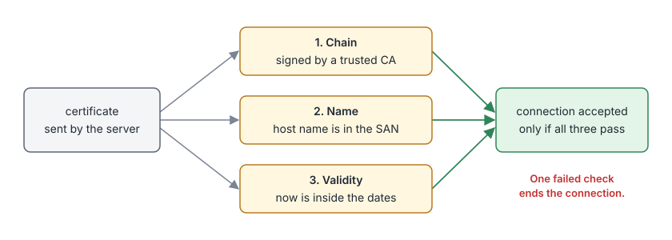
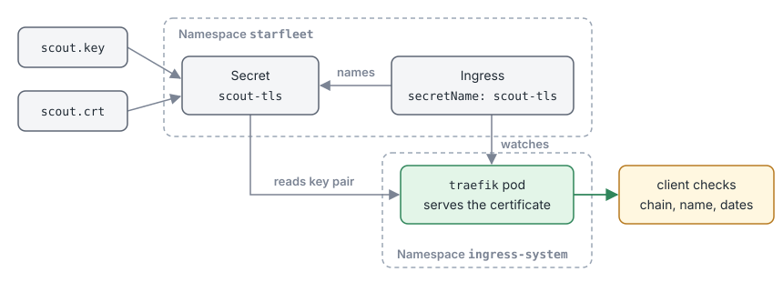

# Certificates And The TLS Secret

When a browser or `curl` opens an HTTPS connection, the server sends a certificate. The client accepts the connection only if the certificate passes several checks. If you build an Ingress without knowing these checks, you cannot tell why a client rejects it. On this page, you learn what a certificate contains and what the client checks. Then you inspect a certificate, create a new one and store it in a Kubernetes TLS Secret.

## What a certificate contains

A certificate is a signed document that links a public key to one or more names. Its important fields are:

- the **subject**, the name of the owner of the certificate;
- the **issuer**, the name of whoever signed it;
- the **validity period**, with a "not before" and a "not after" time;
- the public key;
- the **Subject Alternative Names (SAN)**, the list of DNS names or IP addresses for which the certificate is valid.

Modern clients check only the SAN. They ignore the common name (CN) in the subject when a SAN exists.

The server also holds the matching **private key**. During the TLS handshake, which is the exchange of messages that sets up the encrypted connection, the server uses this key to prove that it owns the certificate. Anyone who gets the private key can pretend to be the server, so the key is a secret.

The next question is why a client should believe the certificate at all. A **certificate authority (CA)** is an organisation or service that signs certificates. A client has a list of CA certificates that it trusts. It trusts a certificate that a trusted CA signed, either directly or through an intermediate CA.

A **self-signed** certificate is signed with its own private key. Its issuer and its subject are the same. A client trusts it only if you give the client that exact certificate as a trusted CA.

## What the client verifies

The client makes three separate checks, and each one can fail on its own:

- **The chain.** The certificate leads through valid signatures to a CA that the client trusts.
- **The name.** The host name that the client wanted to reach appears in the SAN.
- **The validity.** The current time is inside the validity period.

A failure in any one check ends the connection. So a certificate that is trusted but issued for another name is still rejected. This is how a client notices that a server answers for a name it should not.



The drawing shows the three checks side by side. One failed check is enough for the client to end the connection.

## Inspect the certificate in the playground

Now look at a real certificate. The Secret `probe-tls` in `starfleet` holds the certificate that Traefik will serve for `probe.local`. A Secret of type `kubernetes.io/tls` has two keys: `tls.crt` for the certificate and `tls.key` for the private key. Kubernetes stores both values base64 encoded.

Base64 is an encoding, not encryption. Anybody who can read the Secret can read the key. So restrict `get` access to Secrets with role-based access control (RBAC), the Kubernetes system that grants permissions.

Read the type, decode the certificate to a file, and print its fields with `openssl`:

<!-- astrona:playground:renew -->

```sh
kubectl -n starfleet get secret probe-tls -o jsonpath='{.type}{"\n"}'
kubectl -n starfleet get secret probe-tls -o jsonpath='{.data.tls\.crt}' | base64 --decode > probe.crt
openssl x509 -in probe.crt -noout -subject -issuer -dates
openssl x509 -in probe.crt -noout -text | grep -A1 'Subject Alternative Name'
```

The type is `kubernetes.io/tls`. The subject and the issuer are both `CN = probe.local`, which shows that the certificate is self-signed. The dates show that it is valid for one day only. The SAN line shows `DNS:probe.local`, so a client that connects to `probe.local` and trusts this file passes the name check.

## Create a certificate and a TLS Secret

A new application needs its own certificate. Create a self-signed certificate for the host `scout.local`, valid for 30 days. The command needs OpenSSL 1.1.1 or newer for the `-addext` option. The `-nodes` option leaves the private key without a passphrase, because the controller must read the key without one.

```sh
openssl req -x509 -newkey rsa:2048 -nodes -days 30 -keyout scout.key -out scout.crt -subj /CN=scout.local -addext subjectAltName=DNS:scout.local
```

Before you store the files, check that the key belongs to the certificate. If they match, both files contain the same public key. The command below prints a message only when the two public keys are identical.

```sh
diff <(openssl x509 -in scout.crt -noout -pubkey) <(openssl pkey -in scout.key -pubout) && echo "key matches certificate"
```

This check saves a long search later, because the controller rejects a Secret with a key and a certificate that do not match. Now create the Secret. The command `kubectl create secret tls` reads both files, sets the type to `kubernetes.io/tls` and gives the keys the correct names.

```sh
kubectl -n starfleet create secret tls scout-tls --cert=scout.crt --key=scout.key
kubectl -n starfleet describe secret scout-tls
```

The `describe` output lists the keys `tls.crt` and `tls.key` with their sizes in bytes. It does not show their values.

## Where the Secret must live

The Secret is ready, so the last question is how an Ingress finds it. An Ingress refers to the Secret by name in `spec.tls[].secretName`. The Secret must be in the same namespace as the Ingress. The controller reads the Secret through the API server.

Because the controller has RBAC permission to read Secrets, an attacker who takes over the controller can read every TLS key it can read. For this reason, some installations limit the controller to the namespaces that it serves.



The drawing shows that the Ingress only names the Secret. The controller reads the key pair and serves the certificate to clients.

You now have two certificates and know what a client checks. The `probe-tls` Secret is ready, but no Ingress uses it yet. The open question is how to attach it to an Ingress and check the connection from the client side.

## Common pitfalls

> [!WARNING]
> - **A SAN that does not list the host.** Modern clients reject a certificate that has the host only in the CN. Put the host in the SAN.
> - **Key and certificate from different pairs.** Compare the public keys before you create the Secret.
> - **Secret in another namespace.** The Ingress and its Secret must be in the same namespace.
> - **Treating base64 as protection.** Anyone with `get` access to the Secret can decode the private key.
> - **Committing `scout.key` to Git.** Keep private keys out of repositories.
