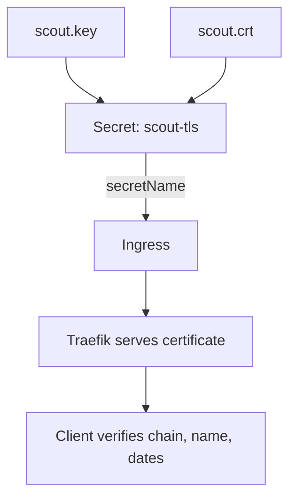

# Certificates And The TLS Secret

When a browser or `curl` opens an HTTPS connection, the server sends a certificate. The client accepts the connection only if the certificate passes several checks. If you build an Ingress without knowing these checks, you cannot tell why a client rejects it. This part explains what a certificate contains and what the client verifies, and then you inspect a certificate, create a new one and store it in a Kubernetes TLS Secret.

## What a certificate contains

A certificate is a signed document that links a public key to one or more names. Its important fields are the **subject**, the **issuer**, the **validity period** (not before, not after), the public key, and the **Subject Alternative Names (SAN)**. The SAN lists the DNS names or IP addresses for which the certificate is valid. Modern clients check only the SAN. The common name (CN) in the subject is ignored when a SAN exists.

The server also holds the matching **private key**. During the TLS handshake the server proves with this key that it owns the certificate. Anyone who obtains the private key can impersonate the server, so the key is a secret.

A **certificate authority (CA)** is an organisation or service that signs certificates. A client has a list of CA certificates that it trusts. A certificate that a trusted CA signed, directly or through an intermediate CA, is trusted. A **self-signed** certificate is signed with its own private key. Its issuer and subject are the same, so the client trusts it only if you give the client that exact certificate as a trusted CA.

## What the client verifies

The client makes three independent checks. First, the **chain**: the certificate leads through valid signatures to a CA that the client trusts. Second, the **name**: the host name the client wanted to reach appears in the SAN. Third, the **validity**: the current time is inside the validity period. A failure in any one check ends the connection. A certificate that is trusted but issued for another name is still rejected. This is how a client notices that a server answers for a name it should not.

## Inspect the certificate in the playground

The Secret `probe-tls` in `starfleet` holds the certificate that Traefik will serve for `probe.local`. A Secret of type `kubernetes.io/tls` has two keys: `tls.crt` for the certificate and `tls.key` for the private key. Both are stored base64 encoded. Base64 is an encoding, not encryption, so anybody who can read the Secret can read the key. Restrict `get` access to Secrets with RBAC.

Read the type, decode the certificate to a file, and print its fields with `openssl`:

<!-- astrona:playground:renew -->

```sh
kubectl -n starfleet get secret probe-tls -o jsonpath='{.type}{"\n"}'
kubectl -n starfleet get secret probe-tls -o jsonpath='{.data.tls\.crt}' | base64 --decode > probe.crt
openssl x509 -in probe.crt -noout -subject -issuer -dates
openssl x509 -in probe.crt -noout -text | grep -A1 'Subject Alternative Name'
```

The type is `kubernetes.io/tls`. The subject and the issuer are both `CN = probe.local`, which shows that the certificate is self-signed. The dates show that it is valid for one day only. The SAN line shows `DNS:probe.local`. A client that connects to `probe.local` and trusts this file passes the name check.

## Create a certificate and a TLS Secret

A new application needs its own certificate. Create a self-signed certificate for the host `scout.local`, valid for 30 days. The command needs OpenSSL 1.1.1 or newer for `-addext`. The option `-nodes` leaves the private key without a passphrase, which a controller needs.

```sh
openssl req -x509 -newkey rsa:2048 -nodes -days 30 -keyout scout.key -out scout.crt -subj /CN=scout.local -addext subjectAltName=DNS:scout.local
```

Before you store the files, check that the key belongs to the certificate. Both contain the same public key if they match. The command below prints a message only when the two public keys are identical.

```sh
diff <(openssl x509 -in scout.crt -noout -pubkey) <(openssl pkey -in scout.key -pubout) && echo "key matches certificate"
```

A Secret with a mismatching pair makes the controller reject the certificate, so this check saves a long search later. Now create the Secret. The command `kubectl create secret tls` reads both files, sets the type to `kubernetes.io/tls` and names the keys correctly.

```sh
kubectl -n starfleet create secret tls scout-tls --cert=scout.crt --key=scout.key
kubectl -n starfleet describe secret scout-tls
```

The `describe` output lists the keys `tls.crt` and `tls.key` with their sizes in bytes, and not their values.

## Where the Secret must live

An Ingress refers to the Secret by name in `spec.tls[].secretName`. The Secret must be in the same namespace as the Ingress. The controller reads it through the API server. Because the controller has RBAC permission to read Secrets, a controller compromise exposes every TLS key it can read. Some installations limit the controller to the namespaces that it serves.



The diagram shows that the Ingress only names the Secret; the controller reads the key pair and serves it to clients.

You now have two certificates and know what a client checks. The `probe-tls` Secret is ready, but no Ingress uses it yet. The next step is to attach it to an Ingress and to verify the connection from the client side.

## Common pitfalls

> [!WARNING]
> - **A SAN that does not list the host.** A certificate with only a CN is rejected by modern clients. Put the host in the SAN.
> - **Key and certificate from different pairs.** Compare the public keys before you create the Secret.
> - **Secret in another namespace.** The Ingress and its Secret must share a namespace.
> - **Treating base64 as protection.** Anyone with `get` access to the Secret can decode the private key.
> - **Committing `scout.key` to Git.** Keep private keys out of repositories.
