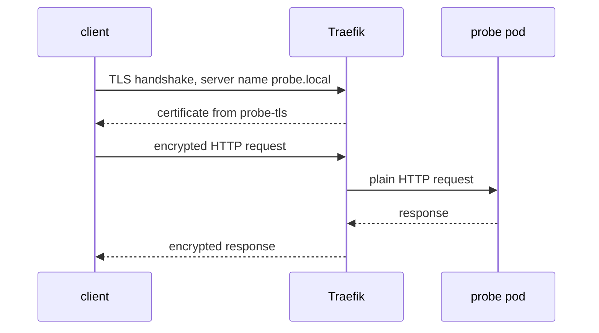

# Configure An Ingress With TLS And Verify It

A route with a certificate is only secure when the client verifies the certificate. Many examples hide a failure by switching verification off, which keeps the encryption but removes the proof of identity. This part attaches the `probe-tls` Secret to an Ingress, then tests from the client side with verification on, once for the correct name and once for a wrong name.

## The TLS section of an Ingress

The field `spec.tls` is a list. Each entry has `hosts`, the host names for which the certificate is used, and `secretName`, the Secret that holds the key pair. The `rules` section still decides where requests go. The `tls` section decides which certificate the controller shows. The two are connected only by the host name, so the host in `tls.hosts` should be the same as the host in the rule. Kubernetes does not check that the certificate really contains that name.

Traefik reads the annotations `traefik.ingress.kubernetes.io/router.entrypoints: websecure` and `traefik.ingress.kubernetes.io/router.tls: 'true'`. The first puts the route on the HTTPS entrypoint. The second marks the router as a TLS router. In other controllers the annotations differ, but `spec.tls` is the same.

<!-- astrona:playground:renew -->

Save this as `ingress-probe.yaml`:

```yaml
apiVersion: networking.k8s.io/v1
kind: Ingress
metadata:
  name: probe
  namespace: starfleet
  annotations:
    traefik.ingress.kubernetes.io/router.entrypoints: websecure
    traefik.ingress.kubernetes.io/router.tls: 'true'
spec:
  ingressClassName: traefik
  rules:
  - host: probe.local
    http:
      paths:
      - path: /
        pathType: Prefix
        backend:
          service:
            name: probe
            port:
              number: 80
  tls:
  - hosts:
    - probe.local
    secretName: probe-tls
```

Apply it:

```sh
kubectl apply -f ingress-probe.yaml
```

Then check the result. The `describe` output has a `TLS` section that lists `probe-tls terminates probe.local`, and a `Rules` section with the backend pods.

```sh
kubectl -n starfleet describe ingress probe
```

## Test with verification turned on

The port forward from the routing steps must still run in a second terminal. If you closed it, start it again:

```sh
kubectl -n ingress-system port-forward service/traefik 8080:80 8443:443
```

The client must trust the certificate and must reach the name `probe.local`. The option `--cacert` gives curl the certificate as its only trusted CA. The option `--resolve` tells curl to connect to `127.0.0.1:8443` when the URL says `probe.local`, so curl sends `probe.local` as the server name and checks it against the certificate. Make sure `probe.crt` exists in your current folder; this command recreates it:

```sh
kubectl -n starfleet get secret probe-tls -o jsonpath='{.data.tls\.crt}' | base64 --decode > probe.crt
curl -s --cacert probe.crt --resolve probe.local:8443:127.0.0.1 https://probe.local:8443/
```

The request succeeds and prints the `probe` response with `version=v1`. Three things happened: the client checked the chain against `probe.crt`, checked the name `probe.local` in the SAN, and checked the dates. Traefik then ended the TLS connection and sent a plain HTTP request to the Service.

## Test the rejection

Now ask `openssl` to connect with the server name `probe.local` but verify the certificate against another name. The `s_client` command prints the verification result. The first command checks the correct name, and the second a wrong name.

```sh
openssl s_client -connect 127.0.0.1:8443 -servername probe.local -CAfile probe.crt -verify_hostname probe.local </dev/null 2>&1 | grep -i 'verif'
openssl s_client -connect 127.0.0.1:8443 -servername probe.local -CAfile probe.crt -verify_hostname wrong.local </dev/null 2>&1 | grep -i 'verif'
```

The first command ends with `Verify return code: 0 (ok)`. The second reports a hostname mismatch with verify return code 62. The chain is the same and fully trusted. Only the name differs, and that alone makes the client reject the server. This is the property that protects a client from a server that has a valid certificate for a different name.

## Where the encryption stops



The diagram shows that TLS ends at the controller. Between Traefik and the pod the request travels unencrypted, inside the cluster network. If the traffic inside the cluster must be encrypted as well, the backend needs its own TLS listener and the controller must be set to connect with HTTPS. Controllers use their own annotations for that, and a network policy or a service mesh can add protection inside the cluster.

You have a working HTTPS route and you have seen verification pass and fail. The remaining problem is what the client receives when several hosts exist, or when the Secret or the host name is wrong.

## Common pitfalls

> [!WARNING]
> - **Using `curl -k` to make a test pass.** The option `-k` keeps encryption but skips the identity check. A passing request then proves nothing about the certificate.
> - **Different names in `rules` and `tls`.** The route works, but the controller shows a different certificate.
> - **Assuming TLS reaches the pod.** TLS ends at the controller unless you configure encryption to the backend.
> - **Port-forward not running.** A connection refused on `127.0.0.1:8443` means the forward stopped, not that the Ingress is wrong.
