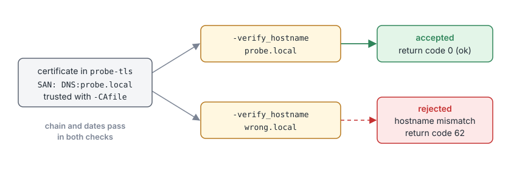
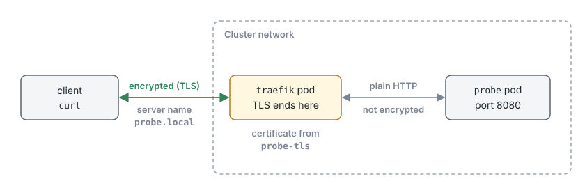

# Configure An Ingress With TLS And Verify It

A route with a certificate is only secure when the client checks the certificate. Many examples hide a failure by turning the check off. That keeps the encryption, but it removes the proof of who the server is. On this page, you attach the `probe-tls` Secret to an Ingress. Then you test from the client side with the check turned on, once for the correct name and once for a wrong name.

## The TLS section of an Ingress

The field `spec.tls` is a list. Each entry has two fields:

- `hosts`, the host names for which the certificate is used;
- `secretName`, the Secret that holds the key pair.

The `rules` section still decides where requests go. The `tls` section decides which certificate the controller shows. Only the host name connects the two, so the host in `tls.hosts` should be the same as the host in the rule. Kubernetes does not check that the certificate really contains that name.

Traefik also reads two annotations. `traefik.ingress.kubernetes.io/router.entrypoints: websecure` puts the route on the HTTPS entrypoint, which is the port where Traefik accepts HTTPS connections. `traefik.ingress.kubernetes.io/router.tls: 'true'` marks the router as a TLS router. Other controllers use other annotations, but `spec.tls` is the same for all of them.

<!-- astrona:playground:renew -->

Save this as `ingress-probe.yaml`:

```yaml
apiVersion: networking.k8s.io/v1
kind: Ingress
metadata:
  name: probe
  namespace: starfleet
  annotations:
    traefik.ingress.kubernetes.io/router.entrypoints: websecure
    traefik.ingress.kubernetes.io/router.tls: 'true'
spec:
  ingressClassName: traefik
  rules:
  - host: probe.local
    http:
      paths:
      - path: /
        pathType: Prefix
        backend:
          service:
            name: probe
            port:
              number: 80
  tls:
  - hosts:
    - probe.local
    secretName: probe-tls
```

Apply it:

```sh
kubectl apply -f ingress-probe.yaml
```

Then check the result. The `describe` output has a `TLS` section that lists `probe-tls terminates probe.local`, and a `Rules` section with the backend pods.

```sh
kubectl -n starfleet describe ingress probe
```

## Test with verification turned on

The Ingress exists, so now test it the way a real client would. The port forward to the Traefik Service must still run in a second terminal. If you closed it, start it again:

```sh
kubectl -n ingress-system port-forward service/traefik 8080:80 8443:443
```

The client must trust the certificate, and it must ask for the name `probe.local`. Two `curl` options make this work:

- `--cacert` gives `curl` the certificate as its only trusted CA (certificate authority).
- `--resolve` tells `curl` to connect to `127.0.0.1:8443` when the URL says `probe.local`. So `curl` sends `probe.local` as the server name and checks it against the certificate.

Make sure `probe.crt` exists in your current folder. The first command below creates it again:

```sh
kubectl -n starfleet get secret probe-tls -o jsonpath='{.data.tls\.crt}' | base64 --decode > probe.crt
curl -s --cacert probe.crt --resolve probe.local:8443:127.0.0.1 https://probe.local:8443/
```

The request succeeds and prints the `probe` response with `version=v1`. Three things happened. The client checked the chain against `probe.crt`, checked the name `probe.local` in the SAN (Subject Alternative Names), and checked the dates. Traefik then ended the TLS connection and sent a plain HTTP request on to the Service.

## Test the rejection

A passing test only means something if a wrong name fails. Now ask `openssl` to connect with the server name `probe.local`, but to check the certificate against a name you choose. The `s_client` command prints the result of the check. The first command checks the correct name, and the second checks a wrong name.

```sh
openssl s_client -connect 127.0.0.1:8443 -servername probe.local -CAfile probe.crt -verify_hostname probe.local </dev/null 2>&1 | grep -i 'verif'
openssl s_client -connect 127.0.0.1:8443 -servername probe.local -CAfile probe.crt -verify_hostname wrong.local </dev/null 2>&1 | grep -i 'verif'
```

The first command ends with `Verify return code: 0 (ok)`. The second reports a hostname mismatch with verify return code 62. The chain is the same and fully trusted. Only the name differs, and that alone makes the client reject the server. This check protects a client from a server that has a valid certificate for a different name.



The drawing shows the two checks against the same certificate. The chain and the dates pass both times, and only the name decides the result.

## Where the encryption stops

You have proved that the client talks to the right server. It is also important to know how far the encryption goes. The TLS connection ends at the controller, as the drawing shows.



The drawing shows that TLS ends at the controller. Between Traefik and the pod, the request travels unencrypted inside the cluster network.

If the traffic inside the cluster must be encrypted as well, the backend needs its own TLS listener, and you must set the controller to connect with HTTPS. Controllers use their own annotations for that. A network policy or a service mesh can also add protection inside the cluster.

You now have a working HTTPS route, and you have seen the check pass and fail. The open question is what the client receives when the controller serves several hosts, or when the Secret or the host name is wrong.

## Common pitfalls

> [!WARNING]
> - **Using `curl -k` to make a test pass.** The option `-k` keeps the encryption but skips the identity check. A passing request then proves nothing about the certificate.
> - **Different names in `rules` and `tls`.** The route works, but the controller shows a different certificate.
> - **Assuming TLS reaches the pod.** TLS ends at the controller unless you configure encryption to the backend.
> - **Port forward not running.** A connection refused on `127.0.0.1:8443` means the forward stopped, not that the Ingress is wrong.
