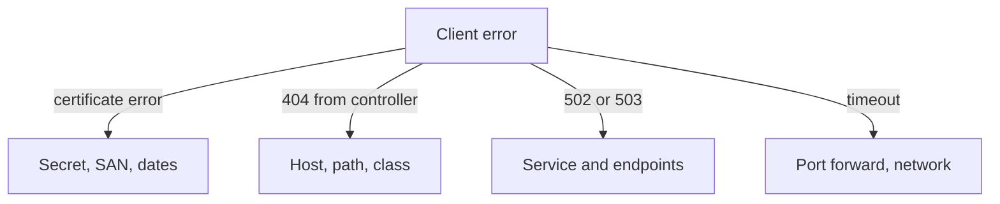

# Several Hosts, Server Name Selection And Troubleshooting

One Traefik instance usually serves many host names, and each name needs its own certificate. The controller has to choose the certificate before it has read a single HTTP header, because the TLS handshake comes first. This part explains how the client's requested name selects the certificate, shows what a client receives when the Secret is missing, and gives a checklist for failures.

## Server Name Indication

During the TLS handshake the client sends the name it wants in the **Server Name Indication (SNI)** extension. The controller looks for a certificate for that name among all the Ingress `tls` entries it knows. If it finds one, it serves it. If it finds none, it serves its **default certificate**, a certificate that Traefik generates itself and that no client trusts. The HTTP `Host` header is read later, after the handshake, and picks the route.

This means two failures look alike from the client side: a wrong host name and a missing or broken Secret both end in the default certificate, and the client reports a verification error in both cases.

## Add a second host

The `scout-tls` Secret from the certificate steps holds a certificate for `scout.local`. Route that host to the `probe` Service as well. Save this as `ingress-scout.yaml`:

<!-- astrona:playground:renew -->

```yaml
apiVersion: networking.k8s.io/v1
kind: Ingress
metadata:
  name: scout
  namespace: starfleet
  annotations:
    traefik.ingress.kubernetes.io/router.entrypoints: websecure
    traefik.ingress.kubernetes.io/router.tls: 'true'
spec:
  ingressClassName: traefik
  rules:
  - host: scout.local
    http:
      paths:
      - path: /
        pathType: Prefix
        backend:
          service:
            name: probe
            port:
              number: 80
  tls:
  - hosts:
    - scout.local
    secretName: scout-tls
```

Apply it:

```sh
kubectl apply -f ingress-scout.yaml
```

Then check which certificate the controller serves for each name. The port forward from the earlier steps must still run (`kubectl -n ingress-system port-forward service/traefik 8080:80 8443:443`). Each command opens a connection with a different SNI and prints the subject of the certificate that comes back.

```sh
openssl s_client -connect 127.0.0.1:8443 -servername probe.local </dev/null 2>/dev/null | openssl x509 -noout -subject
openssl s_client -connect 127.0.0.1:8443 -servername scout.local </dev/null 2>/dev/null | openssl x509 -noout -subject
openssl s_client -connect 127.0.0.1:8443 -servername unknown.local </dev/null 2>/dev/null | openssl x509 -noout -subject
```

The first subject names `probe.local`, the second names `scout.local`, and the third names Traefik's own default certificate. The same address and port gave three different certificates, selected by the name the client asked for.

## A missing Secret

Break the second Ingress on purpose. Save this as `ingress-scout-missing-secret.yaml`. It is the same Ingress, but the Secret name does not exist:

```yaml
apiVersion: networking.k8s.io/v1
kind: Ingress
metadata:
  name: scout
  namespace: starfleet
  annotations:
    traefik.ingress.kubernetes.io/router.entrypoints: websecure
    traefik.ingress.kubernetes.io/router.tls: 'true'
spec:
  ingressClassName: traefik
  rules:
  - host: scout.local
    http:
      paths:
      - path: /
        pathType: Prefix
        backend:
          service:
            name: probe
            port:
              number: 80
  tls:
  - hosts:
    - scout.local
    secretName: scout-tls-missing
```

Apply it:

```sh
kubectl apply -f ingress-scout-missing-secret.yaml
```

Then check the result. The API server accepted the object without complaint, because it does not check Secret names. The failure shows in the controller log and in the certificate that the client receives.

```sh
kubectl -n ingress-system logs deployment/traefik --tail=20
openssl s_client -connect 127.0.0.1:8443 -servername scout.local </dev/null 2>/dev/null | openssl x509 -noout -subject
```

The log has an error line that says the Secret `scout-tls-missing` in `starfleet` cannot be found. The subject is now the default certificate of Traefik, not `scout.local`. Restore the working Ingress:

```sh
kubectl apply -f ingress-scout.yaml
```

## A checklist for TLS failures

When an HTTPS request fails, check from the outside in. First read the error of the client: a verification error points to the certificate, a timeout points to the network, and a `404` from the controller points to the route. Second, check that the IngressClass is right and the controller pod runs. Third, read `kubectl describe ingress` for the rules and the TLS section. Fourth, read the controller log, which names missing Secrets and backend problems. Fifth, check the Secret: the type must be `kubernetes.io/tls`, the keys `tls.crt` and `tls.key` must exist, and it must be in the namespace of the Ingress. Sixth, inspect the certificate: its SAN must contain the host, and `openssl x509 -checkend 0 -noout -in probe.crt` tells you whether it has expired. Last, check that the backend Service has ready endpoints.



The diagram shows that the kind of client error tells you which object to inspect first.

You can now route, secure and verify an Ingress, and find the cause of the usual failures. Keep in mind that a valid HTTPS route protects the connection to the controller, and the application still needs its own authentication.

## Common pitfalls

> [!WARNING]
> - **Reading a verification error as a routing error.** A wrong Secret, a wrong host and a missing certificate all end in the default certificate.
> - **Expecting the API server to validate the Secret name.** It does not. Read the controller log.
> - **Expired certificates.** A certificate with a short lifetime stops working without any change in the cluster. Check the dates.
> - **Secret in the wrong namespace.** The Ingress and the Secret must be in the same namespace.
