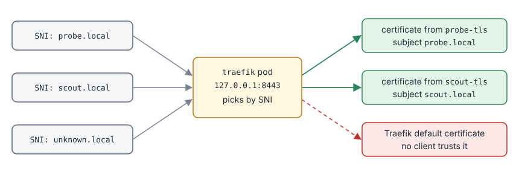
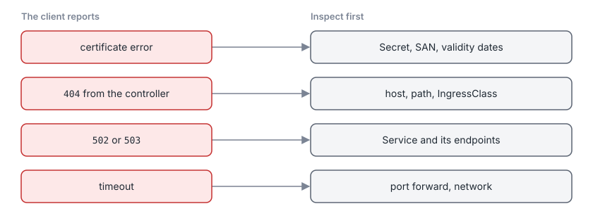

# Several Hosts, Server Name Selection And Troubleshooting

One Traefik instance usually serves many host names, and each name needs its own certificate. The controller must choose the certificate before it has read a single HTTP header, because the TLS handshake comes first. On this page, you learn how the name that the client asks for selects the certificate. You also see what a client receives when the Secret is missing, and you get a checklist for failures.

## Server Name Indication

During the TLS handshake, the client sends the name it wants in the **Server Name Indication (SNI)** extension. SNI is a field in the first handshake message, so the server knows the requested name before it sends a certificate. The controller looks for a certificate for that name among all the Ingress `tls` entries it knows.

If the controller finds a certificate, it serves it. If it finds none, it serves its **default certificate**. This is a certificate that Traefik generates itself, and no client trusts it. The controller reads the HTTP `Host` header later, after the handshake, and uses it to pick the route.

This means two failures look alike from the client side. A wrong host name and a missing or broken Secret both end in the default certificate. In both cases, the client reports a verification error.

## Add a second host

To see SNI at work, the controller needs a second host with its own certificate. The `scout-tls` Secret in `starfleet` holds a self-signed certificate for `scout.local`. Route that host to the `probe` Service as well.

<!-- astrona:playground:renew -->

Save this as `ingress-scout.yaml`:

```yaml
apiVersion: networking.k8s.io/v1
kind: Ingress
metadata:
  name: scout
  namespace: starfleet
  annotations:
    traefik.ingress.kubernetes.io/router.entrypoints: websecure
    traefik.ingress.kubernetes.io/router.tls: 'true'
spec:
  ingressClassName: traefik
  rules:
  - host: scout.local
    http:
      paths:
      - path: /
        pathType: Prefix
        backend:
          service:
            name: probe
            port:
              number: 80
  tls:
  - hosts:
    - scout.local
    secretName: scout-tls
```

Apply it:

```sh
kubectl apply -f ingress-scout.yaml
```

Then check which certificate the controller serves for each name. The port forward to the Traefik Service must still run in a second terminal (`kubectl -n ingress-system port-forward service/traefik 8080:80 8443:443`). Each command opens a connection with a different SNI and prints the subject of the certificate that comes back.

```sh
openssl s_client -connect 127.0.0.1:8443 -servername probe.local </dev/null 2>/dev/null | openssl x509 -noout -subject
openssl s_client -connect 127.0.0.1:8443 -servername scout.local </dev/null 2>/dev/null | openssl x509 -noout -subject
openssl s_client -connect 127.0.0.1:8443 -servername unknown.local </dev/null 2>/dev/null | openssl x509 -noout -subject
```

The first subject names `probe.local`, and the second names `scout.local`. The third names the default certificate of Traefik. The same address and port gave three different certificates, and the name that the client asked for selected each one.



The drawing shows how Traefik picks the certificate from the SNI name. A name with no matching `tls` entry gets the default certificate, which the client does not trust.

## A missing Secret

The default certificate also appears when a Secret is missing, and it helps to see that once on purpose. Break the second Ingress. Save this as `ingress-scout-missing-secret.yaml`. It is the same Ingress, but the Secret name does not exist:

```yaml
apiVersion: networking.k8s.io/v1
kind: Ingress
metadata:
  name: scout
  namespace: starfleet
  annotations:
    traefik.ingress.kubernetes.io/router.entrypoints: websecure
    traefik.ingress.kubernetes.io/router.tls: 'true'
spec:
  ingressClassName: traefik
  rules:
  - host: scout.local
    http:
      paths:
      - path: /
        pathType: Prefix
        backend:
          service:
            name: probe
            port:
              number: 80
  tls:
  - hosts:
    - scout.local
    secretName: scout-tls-missing
```

Apply it:

```sh
kubectl apply -f ingress-scout-missing-secret.yaml
```

Then check the result. The API server accepted the object without complaint, because it does not check Secret names. The failure shows in the controller log and in the certificate that the client receives.

```sh
kubectl -n ingress-system logs deployment/traefik --tail=20
openssl s_client -connect 127.0.0.1:8443 -servername scout.local </dev/null 2>/dev/null | openssl x509 -noout -subject
```

The log has an error line that says the Secret `scout-tls-missing` in `starfleet` cannot be found. The subject is now the default certificate of Traefik, not `scout.local`. Restore the working Ingress:

```sh
kubectl apply -f ingress-scout.yaml
```

## A checklist for TLS failures

The missing Secret showed that a failure can hide in several objects. When an HTTPS request fails, check from the outside in, in this order:

1. Read the error of the client. A verification error points to the certificate, a timeout points to the network, and a `404` from the controller points to the route.
2. Check that the IngressClass is right and that the controller pod runs.
3. Read `kubectl describe ingress` for the rules and the TLS section.
4. Read the controller log. It names missing Secrets and backend problems.
5. Check the Secret. The type must be `kubernetes.io/tls`, the keys `tls.crt` and `tls.key` must exist, and the Secret must be in the namespace of the Ingress.
6. Inspect the certificate. Its SAN (Subject Alternative Names) must contain the host, and `openssl x509 -checkend 0 -noout -in probe.crt` tells you whether it has expired.
7. Check that the backend Service has ready endpoints.



The drawing shows that the kind of client error tells you which object to inspect first.

You can now route, secure and verify an Ingress, and you can find the cause of the usual failures. Keep one limit in mind: a valid HTTPS route protects only the connection to the controller. The open question for every application is still how it checks who the user is, because TLS on the Ingress does not do that.

## Common pitfalls

> [!WARNING]
> - **Reading a verification error as a routing error.** A wrong Secret, a wrong host and a missing certificate all end in the default certificate.
> - **Expecting the API server to check the Secret name.** It does not. Read the controller log.
> - **Expired certificates.** A certificate with a short lifetime stops working without any change in the cluster. Check the dates.
> - **Secret in the wrong namespace.** The Ingress and the Secret must be in the same namespace.
