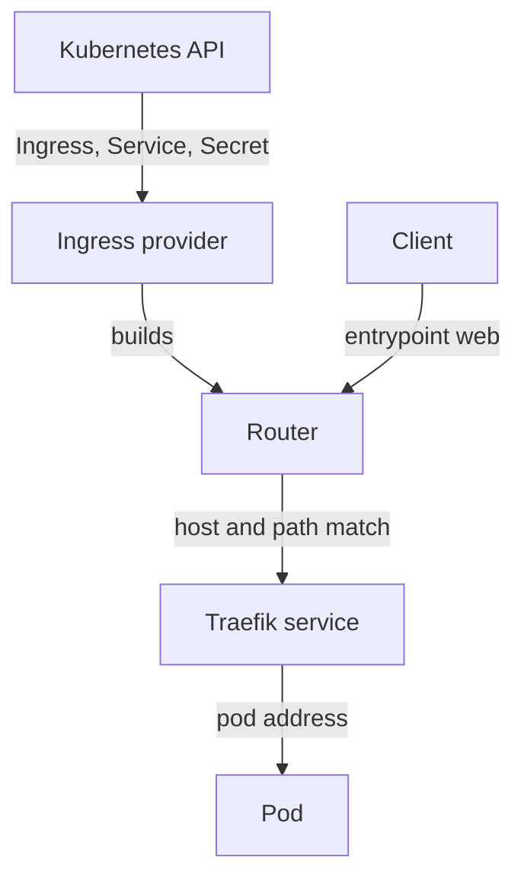

# Ingress Controller Architecture With Traefik

A Service of type `ClusterIP` is reachable only inside the cluster, and a Service of type `NodePort` or `LoadBalancer` publishes one application per port or address. To publish many web applications on one address, the cluster needs a component that reads the host name and path of every HTTP request and chooses the Service. This part explains how Traefik does that and which component does each step. It has no commands, so you can read it before you start the hands-on work.

## Three Kubernetes objects and one program

An **Ingress** is a namespaced Kubernetes object that holds routing rules: a host name, a path and a backend Service. It stores the rules and does nothing else. An **IngressClass** is a cluster-wide object that names a controller. For Traefik, the field `spec.controller` of the class holds `traefik.io/ingress-controller`. An Ingress chooses its controller with `spec.ingressClassName`.

The **Ingress controller** is a normal program that runs in pods. Traefik watches the Kubernetes API for Ingress objects of its class, for the Services and EndpointSlices they name, and for the Secrets they use for TLS. It needs RBAC (role-based access control) permission to read all of these. When one of them changes, Traefik rebuilds its routing table without a restart.

If an Ingress names a class that no controller serves, the API server still accepts it, and nothing routes it. If the class name is correct but the controller has no permission to read a Service or a Secret, the route is incomplete and the reason appears only in the controller log.

## The Traefik building blocks

Traefik uses its own words, and the same words appear in its logs and in its dashboard. A **provider** is a source of routing configuration. The Kubernetes Ingress provider is the one that reads Ingress objects. An **entrypoint** is a port on which Traefik accepts connections. In this section the entrypoint `web` listens for HTTP and the entrypoint `websecure` listens for HTTPS.

A **router** matches a request. Each rule of an Ingress becomes a router with a matching rule built from the host and the path, for example a host match combined with a path prefix match. A **middleware** changes a request or a response before it reaches the backend, for example by redirecting it or adding a header. A **service** in Traefik terms is the group of backend addresses that a router sends requests to. Traefik builds it from the EndpointSlices of the Kubernetes Service and sends requests to the pod addresses directly.

The settings that open ports and choose providers are the **static configuration**. In this section they are command-line arguments of the Traefik container. The routers, middlewares and services that come from Ingress objects are the **dynamic configuration**, and they change while Traefik runs.

The diagram shows that the provider builds the routers from the Kubernetes API, and the router, not the Ingress object, receives the request and chooses the backend.

## What happens to one request

A client sends `GET /` with the header `Host: probe.local` to the Traefik Service. Traefik accepts the connection on the entrypoint `web`. It compares the `Host` header and the path with all routers on that entrypoint. If several routers match, the one with the highest priority wins, and by default a longer rule has a higher priority than a shorter one. Traefik then picks a pod address of the backend and forwards the request. The pod answers, and Traefik passes the answer back to the client.

If no router matches, Traefik answers itself with the status `404` and the text `404 page not found`. This answer comes from the controller, not from your application, which is the first thing to check when a test returns it. If a router matches but the backend has no ready pod, the answer is an error status from Traefik, usually `503`.

## What the controller can see

The controller reads Secrets, so a compromised controller exposes every TLS private key it can read. Traefik can be limited to some namespaces with a provider setting, and the cluster role can be narrowed. The dashboard and the API show the complete routing table, so they must not be reachable from untrusted networks. Later parts of this module and the next modules come back to these points with commands.

You now know the objects, the Traefik words and the path of one request. The next question is how this looks as real objects in a cluster, and which fields you must be able to read.

## Common pitfalls

> [!WARNING]
> - **Thinking the Ingress routes traffic.** The Ingress stores rules. The controller routes.
> - **Wrong or missing class.** An Ingress without a class that a controller serves is accepted by the API server and ignored.
> - **Reading a Traefik 404 as an application error.** A plain `404 page not found` means no router matched.
> - **Forgetting RBAC.** A controller that cannot read a Service or Secret builds an incomplete route and reports it only in its log.
