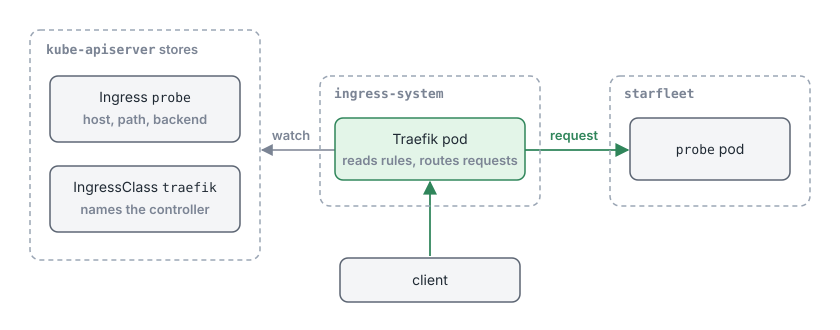
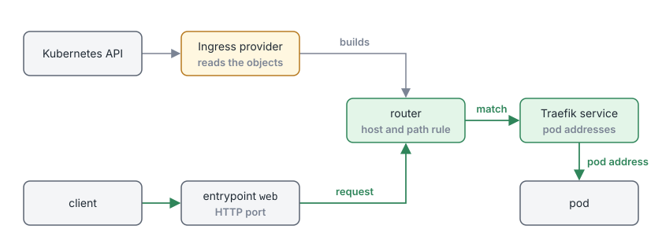
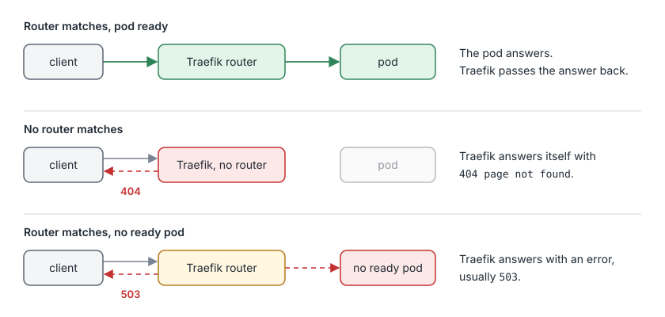

# Ingress Controller Architecture With Traefik

A Service of type `ClusterIP` is reachable only inside the cluster. A Service of type `NodePort` or `LoadBalancer` publishes one application per port or per address. To publish many web applications on one address, the cluster needs one more component. That component reads the host name and the path of every HTTP request and chooses the Service that gets it.

On this page, you see how Traefik does this job and which component does each step. The page has no commands, so you can read it before you start the hands-on work.

## Three Kubernetes objects and one program

Three Kubernetes objects and one program work together. It helps to keep them apart from the start, because the object that holds a rule is not the one that acts on it.

- An **Ingress** is a namespaced Kubernetes object that holds routing rules: a host name, a path and a backend Service. It stores the rules and does nothing else.
- An **IngressClass** is a cluster-wide object that names a controller. For Traefik, the field `spec.controller` of the class holds `traefik.io/ingress-controller`. An Ingress chooses its controller with `spec.ingressClassName`.
- The **Ingress controller** is a normal program that runs in pods. It reads the Ingress objects and does the routing.

Traefik watches the Kubernetes API for Ingress objects of its class. It also watches the Services and EndpointSlices those Ingress objects name, and the Secrets they use for TLS (Transport Layer Security). An EndpointSlice is the object that lists the pod addresses behind a Service. To read all of these, Traefik needs RBAC (role-based access control) permission. When one of them changes, Traefik rebuilds its routing table without a restart.

The drawing shows the split of work. The API server only stores the objects, and the Traefik pod reads them and routes each request to a pod.

Two failures follow from this split, and the API server reports neither of them. If an Ingress names a class that no controller serves, the API server still accepts it, and nothing routes it. If the class name is correct but the controller has no permission to read a Service or a Secret, the route is incomplete. The reason then appears only in the controller log.

## The Traefik building blocks

Traefik uses its own words. The same words appear in its logs and in its dashboard, so you need to know them:

- A **provider** is a source of routing configuration. The Kubernetes Ingress provider is the one that reads Ingress objects.
- An **entrypoint** is a port on which Traefik accepts connections. In this playground, the entrypoint `web` listens for HTTP and the entrypoint `websecure` listens for HTTPS.
- A **router** matches a request. Each rule of an Ingress becomes a router with a matching rule built from the host and the path, for example a host match combined with a path prefix match.
- A **middleware** changes a request or a response before it reaches the backend, for example by redirecting it or adding a header.
- A **service**, in Traefik terms, is the group of backend addresses that a router sends requests to. Traefik builds it from the EndpointSlices of the Kubernetes Service and sends requests to the pod addresses directly.

Traefik splits its settings into two kinds. The settings that open ports and choose providers are the **static configuration**. In this playground, they are command-line arguments of the Traefik container. The routers, middlewares and services that come from Ingress objects are the **dynamic configuration**, and they change while Traefik runs.

The drawing shows that the provider builds the routers from the Kubernetes API. The router, not the Ingress object, receives the request and chooses the backend.

## What happens to one request

With these words, you can follow one request from start to end. A client sends `GET /` with the header `Host: probe.local` to the Traefik Service. Traefik accepts the connection on the entrypoint `web`.

Traefik then compares the `Host` header and the path with all routers on that entrypoint. If several routers match, the one with the highest priority wins. By default, a longer rule has a higher priority than a shorter one. Traefik then picks a pod address of the backend and forwards the request. The pod answers, and Traefik passes the answer back to the client.

Not every request finds a working route. Traefik answers in different ways, and the answer tells you where to look:

- **A router matches and a pod is ready.** The pod answers, and Traefik passes the answer back.
- **No router matches.** Traefik answers itself with the status `404` and the text `404 page not found`. This answer comes from the controller, not from your application, so it is the first thing to check when a test returns it.
- **A router matches, but the backend has no ready pod.** Traefik answers with an error status, usually `503`.

The drawing shows that only the first case reaches your application. The `404` and the `503` both come from Traefik.

## What the controller can see

The controller sits in a powerful place, and that has a security cost. Traefik reads Secrets, so a compromised controller exposes every TLS private key it can read. A provider setting can limit Traefik to some namespaces, and the cluster role can be narrowed.

The dashboard and the API of Traefik show the complete routing table. So they must not be reachable from untrusted networks. Keep these points in mind when you read the installation and the API with real commands.

You now know the objects, the Traefik words and the path of one request. The open question is how this looks as real objects in a cluster, and which fields you must be able to read.

## Common pitfalls

> [!WARNING]
> - **Thinking the Ingress routes traffic.** The Ingress stores rules. The controller routes.
> - **Wrong or missing class.** The API server accepts an Ingress whose class no controller serves, and no controller routes it.
> - **Reading a Traefik 404 as an application error.** A plain `404 page not found` means no router matched.
> - **Forgetting RBAC.** A controller that cannot read a Service or a Secret builds an incomplete route and reports it only in its log.
