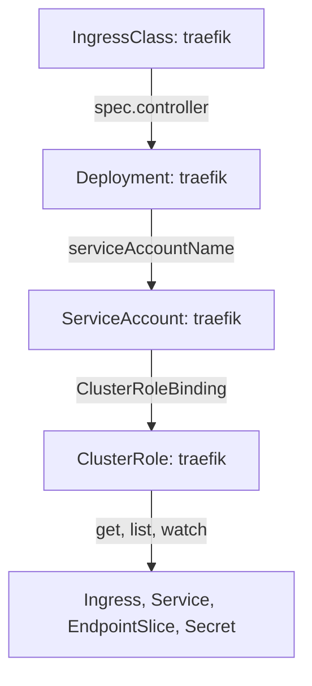

# Read The Traefik Installation On kind

On a real cluster you often meet a controller that someone else installed. To trust it, test it or fix it, you must be able to read its installation: which objects exist, which arguments it runs with, which ports it opens and which permissions it has. This part reads the Traefik installation of the playground object by object and connects each setting to its effect.

## The objects of an installation

A Traefik installation on Kubernetes has the same few objects whatever tool created them. A Namespace holds the controller. A ServiceAccount gives the pod an identity. A ClusterRole lists what that identity may read, and a ClusterRoleBinding gives the role to the ServiceAccount. A Deployment runs the Traefik pod. A Service gives the pod a stable address. An IngressClass links the name `traefik` to the controller.

In the playground a single manifest created all of them when the cluster started. On a `kind` cluster that you build yourself, you apply a manifest or a Helm chart in the same way. A `kind` node is a container, so the node addresses are not reachable from your machine by default. A `kind` cluster configuration can map node ports to ports on your machine with `extraPortMappings`. This playground uses `kubectl port-forward` instead, so it needs no mapping.

<!-- astrona:playground:renew -->

List the class, then the controller objects:

```sh
kubectl get ingressclass traefik -o yaml
kubectl -n ingress-system get deployment,service,pod
```

The class has `spec.controller: traefik.io/ingress-controller`. This string is what Traefik compares with its own name. The Service `traefik` shows the ports 80, 443 and 8080. The Service forwards them to the named container ports `web`, `websecure` and `dashboard`.

## The arguments define the static configuration

Print the arguments of the Traefik container:

```sh
kubectl -n ingress-system get deployment traefik -o jsonpath='{.spec.template.spec.containers[0].args}{"\n"}'
```

The list contains one argument per setting. `--providers.kubernetesingress=true` switches on the Ingress provider. `--providers.kubernetesingress.ingressclass=traefik` limits Traefik to Ingress objects of the class `traefik`. `--entrypoints.web.address=:8000` and `--entrypoints.websecure.address=:8443` create the two entrypoints on container ports 8000 and 8443. The Service maps its ports 80 and 443 to them. The argument `--accesslog=true` makes Traefik write one log line per request, and `--api.insecure=true` publishes the API and the dashboard on port 8080 without any authentication. That setting is acceptable only in a learning cluster.

Because the entrypoint ports are above 1024, the container needs no extra privileges to bind them. This is the reason why the Service ports differ from the container ports.

## The permissions

Print the rules of the cluster role and ask the API server what the ServiceAccount may do:

```sh
kubectl get clusterrole traefik -o yaml
kubectl auth can-i list ingresses --all-namespaces --as=system:serviceaccount:ingress-system:traefik
kubectl auth can-i delete deployments --all-namespaces --as=system:serviceaccount:ingress-system:traefik
```

The role grants `get`, `list` and `watch` on Services, Endpoints, Secrets, Namespaces, EndpointSlices, Ingresses and IngressClasses. It grants no write verbs. The first `can-i` command prints `yes` and the second prints `no`. The permission to read Secrets in all namespaces is the one to remember: Traefik needs it to load TLS certificates, and it also means that anything that takes over the Traefik pod can read every Secret in the cluster.



The diagram shows that the Deployment runs as the ServiceAccount, the binding gives that account the read permissions, and the IngressClass names the controller.

You can now read an installation. Nothing is routed yet, because no Ingress exists. The next part creates the first one and sends requests to it.

## Common pitfalls

> [!WARNING]
> - **Class name and controller name mixed up.** The Ingress uses the IngressClass name (`traefik`). The class holds the controller name (`traefik.io/ingress-controller`).
> - **An Ingress provider limited to one class.** Traefik with `ingressclass=traefik` ignores Ingress objects of any other class.
> - **Leaving `--api.insecure=true` on.** It exposes the full routing table to anyone who can reach port 8080.
> - **Using broad read access for Secrets without knowing it.** A controller with cluster-wide Secret access is a high-value target.
