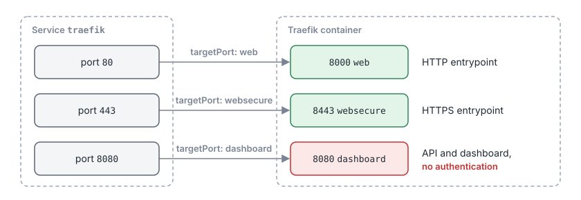

# Read The Traefik Installation On kind

On a real cluster, you often meet a controller that someone else installed. To trust it, test it or fix it, you must be able to read its installation. You need to know which objects exist, which arguments the controller runs with, which ports it opens and which permissions it has.

On this page, you read the Traefik installation of the playground object by object. For each setting, you see what effect it has.

## The objects of an installation

A Traefik installation on Kubernetes has the same few objects, whatever tool created them. Each object has one job:

- A **Namespace** holds the controller.
- A **ServiceAccount** gives the pod an identity.
- A **ClusterRole** lists what that identity may read, and a **ClusterRoleBinding** gives the role to the ServiceAccount.
- A **Deployment** runs the Traefik pod.
- A **Service** gives the pod a stable address.
- An **IngressClass** links the name `traefik` to the controller.

In the playground, a single manifest created all of them when the cluster started. On a `kind` cluster that you build yourself, you apply a manifest or a Helm chart in the same way. Helm is a package manager for Kubernetes, and a chart is one of its packages.

A `kind` node is a container, so your machine cannot reach the node addresses by default. A `kind` cluster configuration can map node ports to ports on your machine with `extraPortMappings`. This playground uses `kubectl port-forward` instead, so it needs no mapping.

<!-- astrona:playground:renew -->

Start with the IngressClass, then list the controller objects:

```sh
kubectl get ingressclass traefik -o yaml
kubectl -n ingress-system get deployment,service,pod
```

The class has `spec.controller: traefik.io/ingress-controller`. Traefik compares this string with its own name to decide whether the class belongs to it. The Service `traefik` shows the ports 80, 443 and 8080. The Service forwards them to the named container ports `web`, `websecure` and `dashboard`.

## The arguments define the static configuration

The Service shows where requests go. The container arguments show what Traefik does with them, because they are its static configuration. Print the arguments of the Traefik container:

```sh
kubectl -n ingress-system get deployment traefik -o jsonpath='{.spec.template.spec.containers[0].args}{"\n"}'
```

The list contains one argument per setting:

- `--providers.kubernetesingress=true` switches on the Ingress provider.
- `--providers.kubernetesingress.ingressclass=traefik` limits Traefik to Ingress objects of the class `traefik`.
- `--entrypoints.web.address=:8000` and `--entrypoints.websecure.address=:8443` create the two entrypoints on container ports 8000 and 8443. The Service maps its ports 80 and 443 to them.
- `--accesslog=true` makes Traefik write one log line per request.
- `--api.insecure=true` publishes the API and the dashboard on port 8080 without any authentication. This setting is acceptable only in a learning cluster.

The entrypoint ports are above 1024, so the container needs no extra privileges to open them. That is why the Service ports differ from the container ports.



The drawing shows how each Service port reaches a named container port, and which Traefik feature listens there.

## The permissions

Ports and arguments decide what Traefik offers. The permissions decide what Traefik can read in the cluster. Print the rules of the cluster role, then ask the API server what the ServiceAccount may do:

```sh
kubectl get clusterrole traefik -o yaml
kubectl auth can-i list ingresses --all-namespaces --as=system:serviceaccount:ingress-system:traefik
kubectl auth can-i delete deployments --all-namespaces --as=system:serviceaccount:ingress-system:traefik
```

The role grants `get`, `list` and `watch` on Services, Endpoints, Secrets, Namespaces, EndpointSlices, Ingresses and IngressClasses. It grants no write verbs. The first `can-i` command prints `yes`, and the second prints `no`.

The permission to read Secrets in all namespaces is the one to remember. Traefik needs it to load TLS certificates. It also means that anyone who takes over the Traefik pod can read every Secret in the cluster.


The drawing shows the chain of objects. The Deployment runs as the ServiceAccount, the binding gives that account the read permissions, and the IngressClass names the controller.

You can now read an installation: its objects, its static configuration and its permissions. Nothing is routed yet, because no Ingress exists. The open question is how to create the first route and send a request to it.

## Common pitfalls

> [!WARNING]
> - **Mixing up the class name and the controller name.** The Ingress uses the IngressClass name (`traefik`). The class holds the controller name (`traefik.io/ingress-controller`).
> - **Forgetting that the provider is limited to one class.** Traefik with `ingressclass=traefik` ignores Ingress objects of any other class.
> - **Leaving `--api.insecure=true` on.** It shows the full routing table to anyone who can reach port 8080.
> - **Giving broad read access to Secrets without knowing it.** A controller with cluster-wide Secret access is a high-value target.
