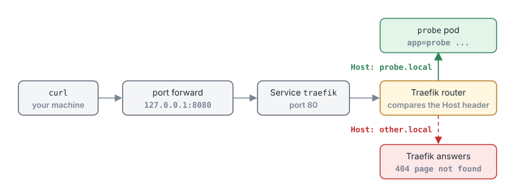

# First Ingress And Host Header Testing

A rule only proves itself when a request takes the route. Two things stand in the way. Your machine cannot reach the cluster network directly, and the host names in the rules are not in DNS (the Domain Name System, which turns names into addresses).

So you need a way to send a request to Traefik and to choose the host name yourself. On this page, you create the first Ingress and test it from your machine with a port forward and a `Host` header. Then you test the case where no rule matches.

## The Ingress fields that matter

An Ingress has only a few fields that decide the route. Each one has a clear job:

- `spec.ingressClassName` selects the controller.
- Each entry of `spec.rules` has a `host` and a list of `http.paths`.
- A path entry has a `path`, a `pathType` and a `backend.service` with the Service `name` and the Service `port`.

The port is the Service port (80 here), not the container port (8080). The Service forwards the request to the container port by itself.

Traefik also reads one annotation for the plain HTTP route. An annotation is a key and value in the object's metadata that a program can read. `traefik.ingress.kubernetes.io/router.entrypoints: web` puts the router on the HTTP entrypoint only. Without that annotation, Traefik adds the router to all entrypoints.

<!-- astrona:playground:renew -->

Save this as `ingress-probe.yaml`:

```yaml
apiVersion: networking.k8s.io/v1
kind: Ingress
metadata:
  name: probe
  namespace: starfleet
  annotations:
    traefik.ingress.kubernetes.io/router.entrypoints: web
spec:
  ingressClassName: traefik
  rules:
  - host: probe.local
    http:
      paths:
      - path: /
        pathType: Prefix
        backend:
          service:
            name: probe
            port:
              number: 80
```

Apply it:

```sh
kubectl apply -f ingress-probe.yaml
```

Then check the result. The `describe` output lists the host, the path and the backend with the pod address.

```sh
kubectl -n starfleet get ingress probe
kubectl -n starfleet describe ingress probe
```

The `ADDRESS` column of `get ingress` can stay empty. A controller fills it only when it is set up to publish a status address, and this Traefik is not. An empty address does not mean that the route is broken.

## Send requests with a Host header

The route exists, so now you need a way in from your machine. Open a second terminal, start the port forward and leave it running. It forwards local port 8080 to Service port 80, and local port 8443 to Service port 443.

```sh
kubectl -n ingress-system port-forward service/traefik 8080:80 8443:443
```

In the first terminal, send one request with the host name from the rule and one with another name:

```sh
curl -s -H 'Host: probe.local' http://127.0.0.1:8080/
curl -s -H 'Host: other.local' http://127.0.0.1:8080/
```

The first request returns one line that starts with `app=probe`. The line goes on with the pod name, the path and the host that the backend received. The second request returns `404 page not found` from Traefik, because no router matches `other.local`.

The address `127.0.0.1` is only where `curl` connected. The `Host` header chose the route. The option `--resolve probe.local:8080:127.0.0.1` with the URL `http://probe.local:8080/` does the same, and it also sends the name in the URL.



The drawing shows that both requests reach Traefik on the same address. The router compares the `Host` header, and only the matched request reaches the `probe` pod.

You can now route one host to one Service and tell a matched request from an unmatched one. The open question is how Traefik matches the path when one host has several rules.

## Common pitfalls

> [!WARNING]
> - **Using the container port.** The backend names the Service port (80), not the pod port (8080).
> - **Forgetting the Host header.** A request to the IP address without the right `Host` returns the Traefik `404`.
> - **Closing the port forward.** A refused connection on `127.0.0.1:8080` means that the forward stopped, not that the Ingress is wrong.
> - **Reading a Traefik 404 as a broken application.** The pod never saw that request.
