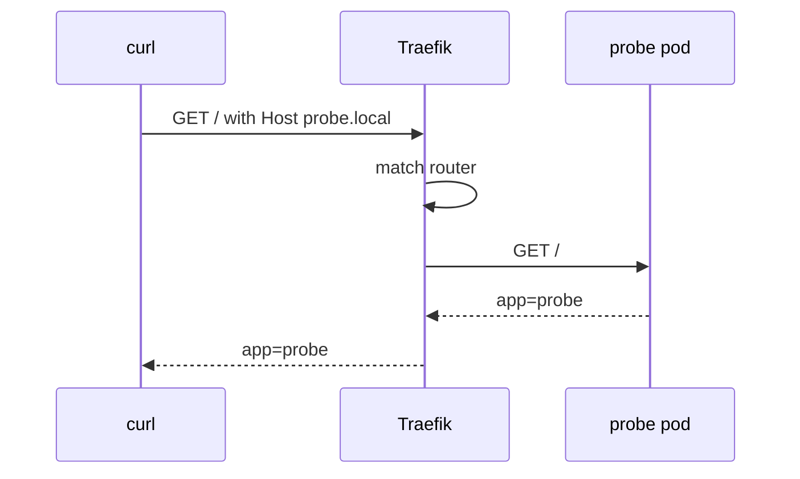

# First Ingress And Host Header Testing

A rule only proves itself when a request takes the route. Your machine cannot reach the cluster network directly and the host names in the rules are not in DNS, so you need a way to send a request to Traefik and to choose the host name yourself. This part creates the first Ingress and tests it from your machine with a port forward and a `Host` header, then tests the case where no rule matches.

## The Ingress fields that matter

An Ingress needs `spec.ingressClassName` to select the controller. Each entry of `spec.rules` has a `host` and a list of `http.paths`. A path entry has a `path`, a `pathType` and a `backend.service` with the Service `name` and the Service `port`. The port is the Service port (80 here), not the container port (8080).

Traefik reads one annotation for the plain HTTP route: `traefik.ingress.kubernetes.io/router.entrypoints: web` puts the router on the HTTP entrypoint only. Without that annotation Traefik adds the router to all entrypoints.

<!-- astrona:playground:renew -->

Save this as `ingress-probe.yaml`:

```yaml
apiVersion: networking.k8s.io/v1
kind: Ingress
metadata:
  name: probe
  namespace: starfleet
  annotations:
    traefik.ingress.kubernetes.io/router.entrypoints: web
spec:
  ingressClassName: traefik
  rules:
  - host: probe.local
    http:
      paths:
      - path: /
        pathType: Prefix
        backend:
          service:
            name: probe
            port:
              number: 80
```

Apply it:

```sh
kubectl apply -f ingress-probe.yaml
```

Then check the result. The `describe` output lists the host, the path and the backend with the pod address.

```sh
kubectl -n starfleet get ingress probe
kubectl -n starfleet describe ingress probe
```

The `ADDRESS` column of `get ingress` can stay empty. A controller fills it only when it is set up to publish a status address, and this Traefik is not. An empty address does not mean the route is broken.

## Send requests with a Host header

Open a second terminal, start the port forward and leave it running. It forwards local port 8080 to Service port 80 and local port 8443 to Service port 443.

```sh
kubectl -n ingress-system port-forward service/traefik 8080:80 8443:443
```

In the first terminal, send one request with the host name from the rule and one with another name:

```sh
curl -s -H 'Host: probe.local' http://127.0.0.1:8080/
curl -s -H 'Host: other.local' http://127.0.0.1:8080/
```

The first request returns one line that starts with `app=probe`, followed by the pod name, the path and the host that the backend received. The second request returns `404 page not found` from Traefik, because no router matches `other.local`. The address `127.0.0.1` is only where `curl` connected. The `Host` header chose the route. The option `--resolve probe.local:8080:127.0.0.1` with the URL `http://probe.local:8080/` does the same and also sends the name in the URL.



The diagram shows that the router match uses the `Host` header, and the pod receives the request only after the match.

You can route one host to one Service and see the difference between a matched and an unmatched request. The next question is how the path is matched when one host has several rules.

## Common pitfalls

> [!WARNING]
> - **Using the container port.** The backend names the Service port (80), not the pod port (8080).
> - **Forgetting the Host header.** A request to the IP address without the right `Host` returns the Traefik `404`.
> - **Closing the port forward.** A refused connection on `127.0.0.1:8080` means the forward stopped, not that the Ingress is wrong.
> - **Reading a Traefik 404 as a broken application.** The pod never saw that request.
