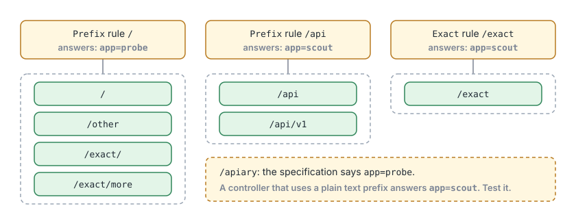

# Path Types And Priority

One host often serves several paths, and one request can match more than one rule. The result then depends on the path type and on which rule the controller prefers. A wrong choice sends requests to the wrong Service, or hides a Service completely.

On this page, you learn the path types of the Ingress API and how Traefik chooses between rules that overlap. Then you test the boundary cases with real requests.

## The three path types

Every path in an Ingress needs a `pathType` field. It tells the controller how to compare the path of the request with the path of the rule. There are three values:

- `Exact` matches only the identical path. So `/exact` does not match `/exact/` or `/exact/more`.
- `Prefix` matches by path elements, which are the parts between the `/` characters. The prefix `/api` matches `/api` and `/api/v1`, and the Kubernetes specification says it must not match `/apiary`.
- `ImplementationSpecific` leaves the decision to the controller. A task that needs behavior you can predict uses `Prefix` or `Exact` instead.

Sometimes several paths of one Ingress match a request. The specification then says that the longest matching path wins, and that `Exact` wins over `Prefix` for the same path.

Traefik implements this order by giving each router a priority. By default, the priority is the length of the generated rule, so a rule with a longer path has a higher priority. The annotation `traefik.ingress.kubernetes.io/router.priority` sets the priority by hand when the default is not enough.

## Test overlapping paths

The rules are easier to trust once you have seen them work. The Ingress below has three paths on the host `paths.local`:

- the path `/` goes to `probe`;
- the path `/api` goes to `scout`;
- the exact path `/exact` goes to `scout`.

<!-- astrona:playground:renew -->

Save this as `ingress-paths.yaml`:

```yaml
apiVersion: networking.k8s.io/v1
kind: Ingress
metadata:
  name: paths
  namespace: starfleet
  annotations:
    traefik.ingress.kubernetes.io/router.entrypoints: web
spec:
  ingressClassName: traefik
  rules:
  - host: paths.local
    http:
      paths:
      - path: /
        pathType: Prefix
        backend:
          service:
            name: probe
            port:
              number: 80
      - path: /api
        pathType: Prefix
        backend:
          service:
            name: scout
            port:
              number: 80
      - path: /exact
        pathType: Exact
        backend:
          service:
            name: scout
            port:
              number: 80
```

Apply it:

```sh
kubectl apply -f ingress-paths.yaml
```

Start the port forward in a second terminal if it is not running. Then send the requests in the first terminal. Each response starts with the `app` name of the Service that answered.

```sh
kubectl -n ingress-system port-forward service/traefik 8080:80 8443:443
```

```sh
for path in / /other /api /api/v1 /apiary /exact /exact/ /exact/more; do
  printf '%s -> ' "$path"
  curl -s -H 'Host: paths.local' "http://127.0.0.1:8080$path" | cut -d' ' -f1
done
```

The loop shows a clear pattern:

- `/` and `/other` return `app=probe`, because only the prefix `/` matches them.
- `/api` and `/api/v1` return `app=scout`, because `/api` is longer than `/`.
- `/exact` returns `app=scout`, but `/exact/` and `/exact/more` return `app=probe`. The exact rule does not match them, and the prefix `/` does.



The drawing sorts each tested path by the rule that matches it. The path `/apiary` is marked as a case to test, because the answer depends on the controller.

The path `/apiary` is the boundary case. The specification says it must not match the prefix `/api`, so the correct answer is `app=probe`. If your version of Traefik returns `app=scout`, it treats the prefix as a plain text prefix. Compare the result with the specification, and do not assume that the controller follows it.

## What the backend receives

The response also shows what the pod saw. Each response ends with the `path` field that the pod received. The pod sees the path exactly as the client sent it, including `/api`, because Traefik does not remove the prefix by default.

Removing or rewriting a path is the job of a middleware, such as the strip-prefix middleware. A middleware is a separate Traefik object, and an Ingress refers to it with the annotation `traefik.ingress.kubernetes.io/router.middlewares`. If a backend expects the path without the prefix, a missing middleware shows up as a `404` from the application, not from Traefik.

You can now predict which rule handles a request and which path the backend receives. The open question is how to publish several Services from one host, and what to do with requests that match no rule.

## Common pitfalls

> [!WARNING]
> - **Leaving out `pathType`.** The API server rejects an Ingress path without it.
> - **Trusting `Prefix` without testing the boundary.** Check `/apiary` against `/api` in the controller you use.
> - **Expecting the prefix to be removed.** The backend gets the full path unless a middleware changes it.
> - **Relying on `ImplementationSpecific`.** Its meaning differs between controllers.
