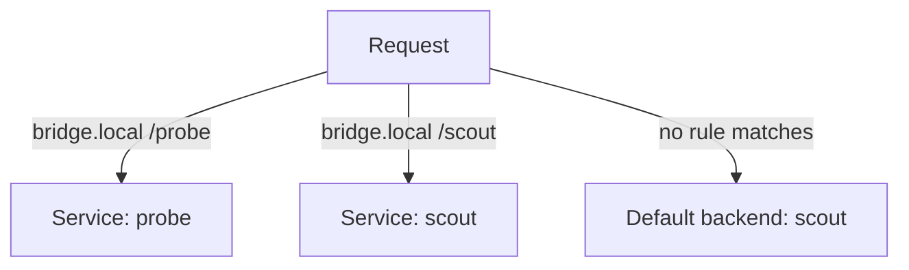

# Several Services And A Default Backend

A real cluster publishes many Services on one address. An Ingress can send each path or each host to a different Service, and it can name one Service that answers every request no other rule matches. This part builds both, shows how the two ways to split traffic differ, and explains what a client sees for an unknown host or path.

## Fan-out by path and by host

A **fan-out** is one host with several paths, each path going to its own Service. A **name-based virtual host** setup is several hosts, each with its own rules. Both are written in `spec.rules`. For a fan-out, one rule has several `paths`. For separate hosts, `rules` has several entries with different `host` values. A rule without a `host` matches every host and is the usual way to catch requests for names you did not list.

The field `spec.defaultBackend` names a Service that receives every request no rule matches. Traefik supports it as a catch-all router with the lowest priority. Only one Ingress of a class should define a default backend, because two definitions compete and the result is not predictable.

<!-- astrona:playground:renew -->

Save this as `ingress-bridge.yaml`. It publishes `probe` under `/probe` and `scout` under `/scout` on the host `bridge.local`, and it sends everything else to `scout`.

```yaml
apiVersion: networking.k8s.io/v1
kind: Ingress
metadata:
  name: bridge
  namespace: starfleet
  annotations:
    traefik.ingress.kubernetes.io/router.entrypoints: web
spec:
  ingressClassName: traefik
  defaultBackend:
    service:
      name: scout
      port:
        number: 80
  rules:
  - host: bridge.local
    http:
      paths:
      - path: /probe
        pathType: Prefix
        backend:
          service:
            name: probe
            port:
              number: 80
      - path: /scout
        pathType: Prefix
        backend:
          service:
            name: scout
            port:
              number: 80
```

Apply it:

```sh
kubectl apply -f ingress-bridge.yaml
```

Start the port forward in a second terminal if it is not running:

```sh
kubectl -n ingress-system port-forward service/traefik 8080:80 8443:443
```

Then send four requests: both paths on the listed host, an unknown path on the listed host, and an unknown host.

```sh
curl -s -H 'Host: bridge.local' http://127.0.0.1:8080/probe
curl -s -H 'Host: bridge.local' http://127.0.0.1:8080/scout
curl -s -H 'Host: bridge.local' http://127.0.0.1:8080/unknown
curl -s -H 'Host: elsewhere.local' http://127.0.0.1:8080/
```

The first request returns `app=probe` and the second returns `app=scout`. The third and the fourth also return `app=scout`, because the default backend answers every request that matches no rule, including requests for a host that no rule names. Without the `defaultBackend` field, the third and fourth requests would return the Traefik `404 page not found`.



The diagram shows that the two rules take their requests first, and the default backend takes the rest.

## When a backend is missing

If a rule names a Service that does not exist, the API server still accepts the Ingress. Traefik cannot build the backend and returns an error status for that route, and it logs the reason. If the Service exists but has no ready pod, the route exists and the request fails with `503`. Read the Service and its EndpointSlices before you blame the Ingress.

You can now publish several Services and decide what unmatched requests receive. The graded task on the next page asks you to build a similar route set yourself. The last part of this module reads the controller's own evidence.

## Common pitfalls

> [!WARNING]
> - **Two default backends in one class.** Only one Ingress of a class should define `defaultBackend`.
> - **A host rule hidden by a rule without a host.** Check which rule is more specific when two rules overlap.
> - **Naming a Service in another namespace.** An Ingress backend must be in the namespace of the Ingress.
> - **Mixing up a 404 from Traefik and a 404 from the pod.** The body text tells them apart: Traefik answers `404 page not found`.
