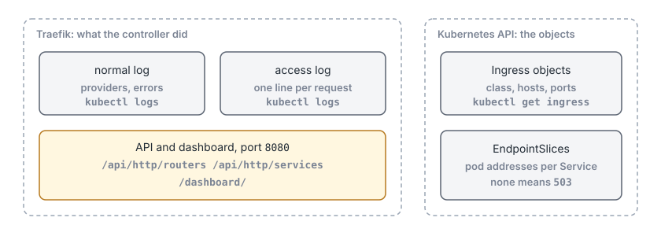

# Inspect The Running Controller

When a route does not work, the Ingress object shows only what you asked for. The controller shows what it did with it. Traefik records this in three places: its log, its access log and its API.

On this page, you send a few requests and then read each of the three. At the end, you can say which router handled a request and why another request found no router.

## The log and the access log

Start with the logs, because they need nothing more than `kubectl`. Traefik writes both logs to the standard output of its container, so `kubectl logs` shows them. The two logs have different jobs:

- The **normal log** has the level `INFO` in this playground. It reports the start of the providers and errors, for example a Service that Traefik cannot find.
- The **access log** has one line per request. The argument `--accesslog=true` switches it on.

<!-- astrona:playground:renew -->

Save this as `ingress-inspect.yaml`. It routes the host `inspect.local` to the `probe` Service:

```yaml
apiVersion: networking.k8s.io/v1
kind: Ingress
metadata:
  name: inspect
  namespace: starfleet
  annotations:
    traefik.ingress.kubernetes.io/router.entrypoints: web
spec:
  ingressClassName: traefik
  rules:
  - host: inspect.local
    http:
      paths:
      - path: /
        pathType: Prefix
        backend:
          service:
            name: probe
            port:
              number: 80
```

Apply it:

```sh
kubectl apply -f ingress-inspect.yaml
```

Start the port forward in a second terminal, then send two requests and read the end of the log:

```sh
kubectl -n ingress-system port-forward service/traefik 8080:80 8443:443
```

```sh
curl -s -H 'Host: inspect.local' http://127.0.0.1:8080/probe-check
curl -s -H 'Host: unknown.local' http://127.0.0.1:8080/
kubectl -n ingress-system logs deployment/traefik --tail=10
```

The first request returns `app=probe`, and the second returns the Traefik `404`. Both requests appear in the log.

An access log line shows the client address, the time, the method, the path and the protocol, the status code, the name of the router, the backend address and the duration. A request that matched a router shows the router name and the pod address. A request that matched no router shows a `404` and no router name. Traefik builds the router name from the namespace, the Ingress name, the host and the path, and the name ends with `@kubernetes`.

## The API and the dashboard

The log shows single requests. The API shows the whole routing table at once. Because `--api.insecure=true` is set, Traefik serves its API and its dashboard on port 8080 of the pod. Forward that port to your machine in a second terminal:

```sh
kubectl -n ingress-system port-forward deployment/traefik 9000:8080
```

Then list the rules of all routers, and the backend addresses of the Traefik services:

```sh
curl -s http://127.0.0.1:9000/api/http/routers | grep -o '"rule":"[^"]*"'
curl -s http://127.0.0.1:9000/api/http/services | grep -o '"url":"[^"]*"'
```

Every Ingress rule appears as a rule with a host match and a path match. Every pod address of a backend appears as a URL. This is the routing table that Traefik really uses, so compare it with the Ingress objects when a route does not behave as you expect.

The dashboard shows the same data in a browser at `http://127.0.0.1:9000/dashboard/`. The trailing slash is required.

## Ask Kubernetes too

Traefik shows its side of the story. The API server holds the other half of the evidence. Use it to check the Ingress objects and the backend endpoints:

```sh
kubectl get ingress --all-namespaces
kubectl -n starfleet get endpointslices
```

The first command lists every Ingress with its class, hosts and ports. The second command shows the pod addresses that Traefik receives for each Service. A Service with no endpoints explains a `503` response.



The drawing groups the evidence by the component that holds it. Traefik shows what it did, and the Kubernetes API shows what you asked for and which pod addresses exist.

You can now follow a request from the client through the log, the router and the pod address. The API and the dashboard are useful because they show everything. The open question for any real cluster is how to protect them, because outside a learning cluster they must be switched off or kept away from untrusted networks.

## Common pitfalls

> [!WARNING]
> - **Reading only the Ingress.** The Ingress shows the intent. The router list and the log show the result.
> - **Looking at the wrong log.** The access log and the normal log are in the same stream. Read enough lines to see both.
> - **Opening `/dashboard` without the trailing slash.** The dashboard path is `/dashboard/`.
> - **Leaving the API open.** `--api.insecure=true` has no authentication.
