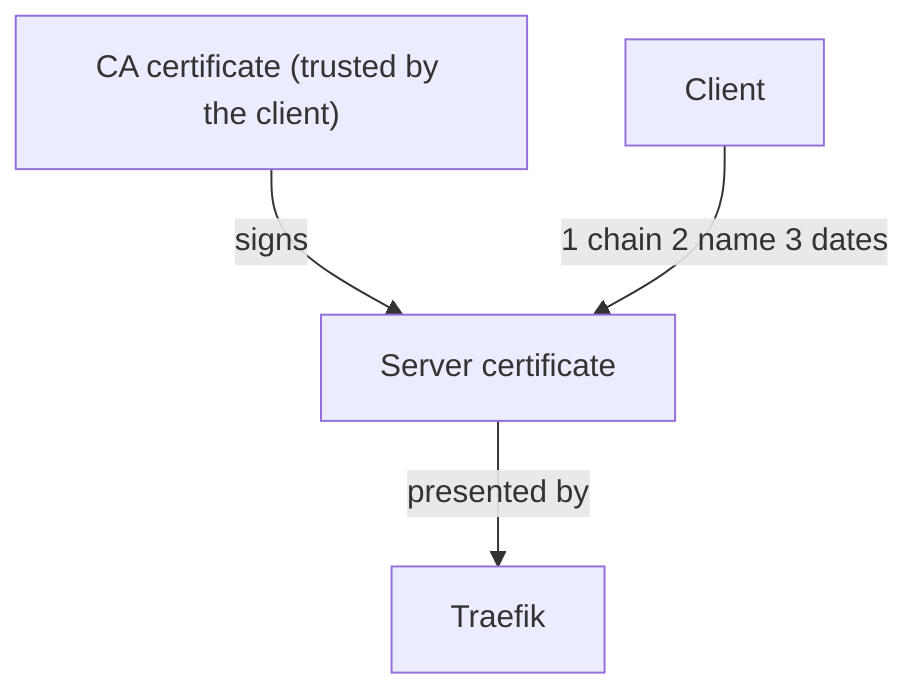

# Certificate Fundamentals Needed For The Exam

Every TLS error on a client comes from one of a small number of checks. If you know what a certificate contains and which field a client reads for which check, you can read the error and find the fix without trial and error. This part explains the fields of a certificate, the idea of a chain of trust and the reason why the common name is not enough. It has no commands, so you can read it before you start the hands-on work.

## What is inside a certificate

A **certificate** is a signed document that links a public key to a name. The format is X.509. A certificate is usually stored as a text file in PEM format, which is base64 data between the lines `-----BEGIN CERTIFICATE-----` and `-----END CERTIFICATE-----`. The matching **private key** is a separate file. The server uses the private key to prove that it owns the certificate. Anyone who holds the private key can impersonate the server, so the key is a secret and the certificate is public.

The fields you must know are these:

- The **subject** says who the certificate is for. Its common name (CN) is one part of it.
- The **issuer** says who signed the certificate.
- The **validity period** has a start time (`notBefore`) and an end time (`notAfter`).
- The **Subject Alternative Name (SAN)** lists the DNS names or IP addresses for which the certificate is valid.
- The **key usage** and **extended key usage** fields limit what the key may be used for. A server certificate needs the extended key usage `serverAuth`.
- The **basic constraints** field says whether the certificate belongs to a certificate authority (`CA:TRUE`) or not.

## Why the common name is not enough

Older clients compared the host name with the CN. Current clients read the SAN list and ignore the CN when a SAN exists. Browsers and current versions of Go reject a certificate that has a CN only, while some OpenSSL-based clients still accept it. A CN-only certificate can therefore pass one test and fail in the next client. A certificate for `scout.example.test` therefore needs `DNS:scout.example.test` in the SAN. A wildcard name such as `*.example.test` matches exactly one label, so it covers `scout.example.test` but not `a.b.example.test` and not `example.test`.

## Chain of trust

A **certificate authority (CA)** is a party that signs certificates. A CA has its own key and its own certificate. A client keeps a list of CA certificates that it trusts, the trust store. A server certificate is trusted when the client can follow signatures from it to a certificate in the trust store. This path is the **chain**. A **self-signed** certificate is signed with its own key, so its subject and issuer are the same. A client trusts it only if you place that exact certificate in the client's trust store.

The diagram shows that the server presents its own certificate, and the client checks it against the CA certificate that it already trusts.

## The three checks of a client

A client verifies three independent things. The **chain** must lead to a trusted CA. The **name** it asked for must be in the SAN. The **dates** must include the current time. Any single failure ends the connection. This is why a certificate that is trusted but issued for another name is still rejected, and why an expired certificate fails with an otherwise correct setup.

You also need the names of the usual files. A key file ends in `.key`, a certificate in `.crt` or `.pem`, and a certificate signing request (CSR) in `.csr`. A CSR is a request that contains a public key and the requested name. A CA signs it and returns a certificate. The next parts create each of these files with `openssl`.

## Common pitfalls

> [!WARNING]
> - **A CN without a SAN.** Modern clients reject it. Put every host name in the SAN.
> - **Mixing up the private key and the certificate.** Only the certificate is public. The key never leaves the server and the Secret.
> - **Expecting a wildcard to cover more than one label.** `*.example.test` covers `scout.example.test` and not `a.scout.example.test`.
> - **Trusting a self-signed certificate without telling the client.** The client must hold the certificate in its trust store.
