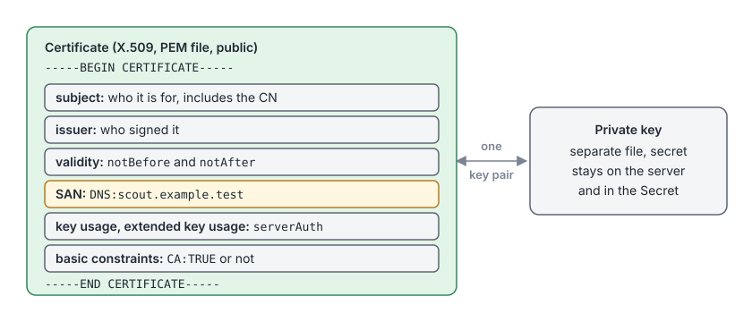
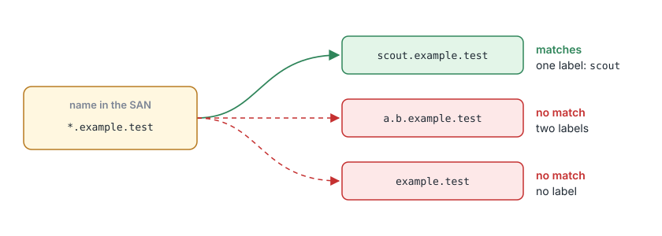
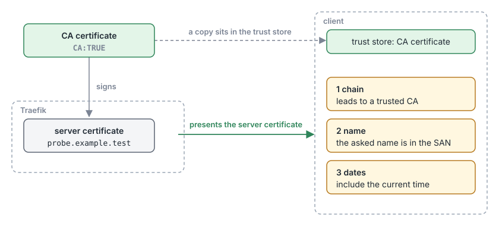

# Certificate Fundamentals Needed For The Exam

Every TLS error on a client comes from one of a small number of checks. TLS (Transport Layer Security) is the protocol that encrypts a connection and lets the client check who the server is. If you know what a certificate contains, and which field the client reads for which check, you can read the error and find the fix without trial and error.

This page explains the fields of a certificate, the chain of trust, and why the common name is not enough. It has no commands, so you can read it before you start the hands-on work.

## What is inside a certificate

A **certificate** is a signed document that links a public key to a name. Its format is called X.509. A certificate is usually stored as a text file in PEM format. PEM is base64 text between the lines `-----BEGIN CERTIFICATE-----` and `-----END CERTIFICATE-----`.

The matching **private key** is a separate file. The server uses the private key to prove that it owns the certificate. Anyone who holds the private key can pretend to be the server. So the key is a secret, and the certificate is public.

The drawing shows the public certificate with its main fields next to the secret private key that stays on the server.

These are the fields you must know:

- The **subject** says who the certificate is for. Its common name (CN) is one part of it.
- The **issuer** says who signed the certificate.
- The **validity period** has a start time (`notBefore`) and an end time (`notAfter`).
- The **Subject Alternative Name (SAN)** lists the DNS names or IP addresses for which the certificate is valid.
- The **key usage** and **extended key usage** fields limit what the key may be used for. A server certificate needs the extended key usage `serverAuth`.
- The **basic constraints** field says whether the certificate belongs to a certificate authority (`CA:TRUE`) or not.

## Why the common name is not enough

Two of these fields hold a name: the CN in the subject and the SAN. They are easy to mix up, and the difference decides whether a client accepts the certificate.

Older clients compared the host name with the CN. Current clients read the SAN list, and they ignore the CN when a SAN exists. Browsers and current versions of Go reject a certificate that has a CN only. Some OpenSSL-based clients still accept it. So a CN-only certificate can pass one test and fail in the next client.

A certificate for `scout.example.test` therefore needs `DNS:scout.example.test` in the SAN. A wildcard name such as `*.example.test` matches exactly one label. A label is one part of a name between two dots. So the wildcard covers `scout.example.test`, but not `a.b.example.test` and not `example.test`.

The drawing shows that the `*` stands for exactly one label: one name matches, and the names with two labels or no label in that place do not.

## Chain of trust

A name in the SAN is only useful if the client believes the certificate is genuine. That belief comes from a signature by someone the client already trusts.

A **certificate authority (CA)** is a party that signs certificates. A CA has its own key and its own certificate. A client keeps a list of CA certificates that it trusts, called the **trust store**. The client trusts a server certificate when it can follow signatures from that certificate to a certificate in its trust store. This path is the **chain**.

A **self-signed** certificate is signed with its own key, so its subject and its issuer are the same. A client trusts it only if you place that exact certificate in the trust store of the client.

The drawing shows that Traefik presents its own server certificate, and the client checks it against the CA certificate that it already trusts.

## The three checks of a client

The drawing also names the three checks. A client verifies three separate things:

- The **chain** must lead to a trusted CA.
- The **name** the client asked for must be in the SAN.
- The **dates** must include the current time.

Any single failure ends the connection. This is why a certificate that is trusted but issued for another name is still rejected. It is also why an expired certificate fails, even when everything else is correct.

You also need the names of the usual files. A key file ends in `.key`, and a certificate ends in `.crt` or `.pem`. A certificate signing request (CSR) ends in `.csr`. A CSR is a request that contains a public key and the requested name. A CA signs it and returns a certificate.

You now know what a certificate contains, why the host name must be in the SAN, and which three checks the client runs. The open question is how to create these files yourself with `openssl`, so that they pass all three checks.

## Common pitfalls

> [!WARNING]
> - **A CN without a SAN.** Modern clients reject it. Put every host name in the SAN.
> - **Mixing up the private key and the certificate.** Only the certificate is public. The key never leaves the server and the Secret.
> - **Expecting a wildcard to cover more than one label.** `*.example.test` covers `scout.example.test` and not `a.scout.example.test`.
> - **Trusting a self-signed certificate without telling the client.** The client must hold the certificate in its trust store.
