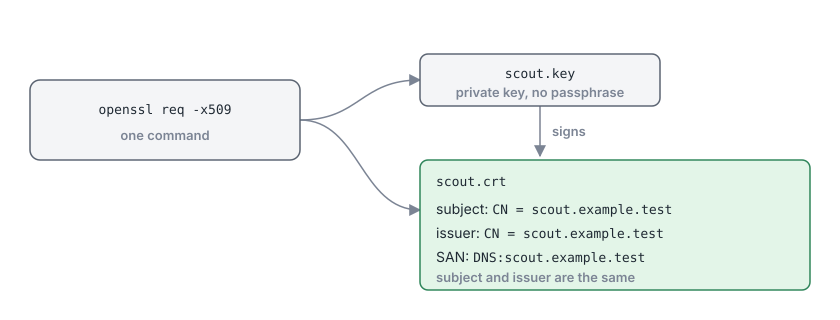

# Self-Signed Certificate With openssl

The fastest way to get a certificate for a test is to create one that signs itself. A self-signed certificate is signed with its own private key, so its subject and its issuer are the same. One `openssl` command makes the key and the certificate together, and the exam often asks for exactly this.

On this page, you build that command option by option and create a certificate for `scout.example.test`. Then you read the result, to prove that the name, the dates and the Subject Alternative Name (SAN) are what you intended. The SAN is the certificate field that lists the host names a client accepts.

## The command and its options

The command `openssl req` creates certificate requests. With the option `-x509`, it creates a certificate directly instead of a request, and it signs the certificate with the key it just made. These options matter:

- `-newkey rsa:2048` creates a new RSA key with 2048 bits together with the certificate.
- `-nodes` leaves the private key without a passphrase. A controller cannot type a passphrase, so a key in a TLS Secret must have none. Newer OpenSSL versions also accept `-noenc` for the same purpose.
- `-days 30` sets the validity to 30 days from now.
- `-keyout` and `-out` set the file names for the key and the certificate.
- `-subj /CN=scout.example.test` sets the subject without asking questions.
- `-addext subjectAltName=DNS:scout.example.test` adds the SAN extension. This option needs OpenSSL 1.1.1 or newer.



The drawing shows the two files that the command writes, and that the certificate names itself as its own issuer.

<!-- astrona:playground:renew -->

Run the command in an empty working folder on your own machine:

```sh
openssl req -x509 -nodes -newkey rsa:2048 -days 30 -keyout scout.key -out scout.crt -subj /CN=scout.example.test -addext subjectAltName=DNS:scout.example.test
```

The command writes two files and prints nothing important. If it reports that `-addext` is unknown, your `openssl` is too old or is LibreSSL. In that case, install a current OpenSSL and run the command with its full path.

You can also create an elliptic-curve key instead of an RSA key, with `-newkey ec -pkeyopt ec_paramgen_curve:prime256v1`. That gives a smaller key and a faster handshake.

## Read what you made

The command ran without errors, but that does not prove that the certificate is right. Never trust a certificate you have not read. Print the subject, the issuer and the dates, and then the extensions:

```sh
openssl x509 -in scout.crt -noout -subject -issuer -dates
openssl x509 -in scout.crt -noout -ext subjectAltName
```

The subject and the issuer are both `CN = scout.example.test`. This shows that the certificate is self-signed. The dates show that it starts now and ends 30 days later.

The second command prints the SAN list with `DNS:scout.example.test`. If the SAN section is missing, the `-addext` option did not work. Such a certificate is useless for a modern client, because the client looks for the host name in the SAN.

Two more reads help in the exam. The first one checks whether the certificate is still valid for a given number of seconds, here 86400 seconds, which is one day. The exit status gives the answer: zero means the certificate will not expire in that time. The second one prints the fingerprint.

```sh
openssl x509 -in scout.crt -noout -checkend 86400 && echo "valid for at least one more day"
openssl x509 -in scout.crt -noout -fingerprint -sha256
```

The fingerprint is a hash of the certificate. Later, you can compare it with the fingerprint of the certificate that Traefik serves. If both are the same, Traefik serves this exact file.

You now have a key and a self-signed certificate, and you have read its subject, issuer, dates and SAN. But a client trusts only certificates that a certificate authority (CA) it knows has signed. The open question is how to act as your own CA and sign a server certificate.

## Common pitfalls

> [!WARNING]
> - **Forgetting `-addext`.** The certificate has a CN and no SAN, and clients reject it.
> - **A passphrase on the key.** Without `-nodes` or `-noenc`, `openssl` asks for a passphrase, and the controller cannot load the key.
> - **A validity that is too short or too long.** Check the dates with `-dates` before you use the certificate.
> - **Using the system `openssl` on macOS without checking the version.** It can be LibreSSL, which lacks options used in the exam.
