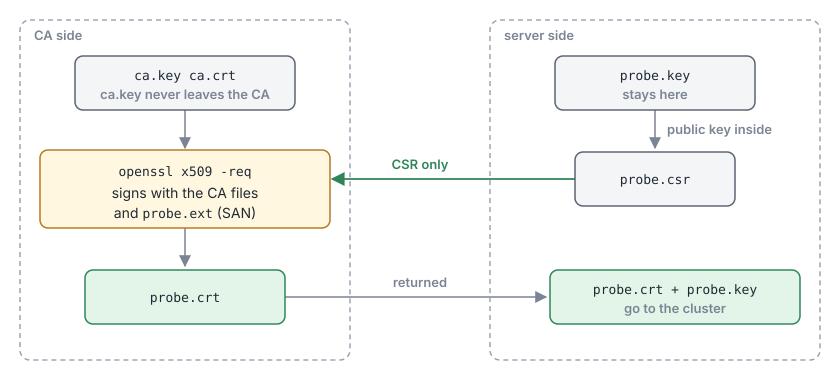

# Sign A Server Certificate With Your Own CA

A client must trust each self-signed certificate one by one. When several servers need certificates, that gets hard to manage. It is easier to create one certificate authority (CA), trust that one CA certificate in the client, and let the CA sign every server certificate. A CA is a party that signs certificates with its own key.

A company CA works the same way, only with more controls. On this page, you create a CA, create a certificate request for `probe.example.test`, sign the request with the CA, and verify the chain. The chain is the path of signatures from the server certificate to the CA certificate that the client trusts.

## Three steps

Signing a server certificate takes three steps, and each step creates its own files:

1. The CA needs its own key and a self-signed certificate that says `CA:TRUE`.
2. The server creates its own key and a certificate signing request (CSR). A CSR holds the public key and the requested name.
3. The CA signs the CSR and writes the server certificate.

By default, the signing step does not copy extensions such as the Subject Alternative Name (SAN) from the CSR. The SAN is the list of host names the certificate is valid for. So the extensions go into a separate extensions file, and the signing command reads that file.



The drawing shows which files each side holds: the CA keeps `ca.key`, the server keeps `probe.key`, and only the CSR travels to the CA.

<!-- astrona:playground:renew -->

Create the CA key and certificate in an empty working folder. The two `-addext` options mark the certificate as a CA and allow it to sign certificates.

```sh
openssl req -x509 -nodes -newkey rsa:2048 -days 365 -keyout ca.key -out ca.crt -subj /CN=starfleet-test-ca -addext basicConstraints=critical,CA:TRUE -addext keyUsage=critical,keyCertSign,cRLSign
```

Next, create the server key and the CSR. The CSR holds the public key and the subject. The key stays on the server side, and only the CSR goes to the CA.

```sh
openssl req -new -nodes -newkey rsa:2048 -keyout probe.key -out probe.csr -subj /CN=probe.example.test
```

## Sign the request

The CA now has a request to sign, but the request does not carry the SAN into the certificate. The extensions file adds it.

Save this as `probe.ext`. It lists the extensions that the CA puts into the signed certificate. The SAN is the important line. The `serverAuth` usage says that the certificate is for a TLS server. The two key identifier lines let a client match the certificate to its issuer.

```text
subjectAltName=DNS:probe.example.test
basicConstraints=CA:FALSE
keyUsage=digitalSignature,keyEncipherment
extendedKeyUsage=serverAuth
subjectKeyIdentifier=hash
authorityKeyIdentifier=keyid
```

Now sign the CSR. The option `-CAcreateserial` creates a serial number file for the CA, `ca.srl`. Every certificate from one CA needs a unique serial number, and this file keeps track of it.

```sh
openssl x509 -req -in probe.csr -CA ca.crt -CAkey ca.key -CAcreateserial -out probe.crt -days 30 -extfile probe.ext
```

## Verify the chain

The signing command wrote `probe.crt`, but you still need proof that a client will accept it. Ask OpenSSL to build the chain from the server certificate to the CA certificate, and then print the issuer and the SAN:

```sh
openssl verify -CAfile ca.crt probe.crt
openssl x509 -in probe.crt -noout -issuer -ext subjectAltName
```

The first command prints `probe.crt: OK` when the chain is valid. The second one shows the issuer `CN = starfleet-test-ca` and the SAN `DNS:probe.example.test`.

A client that trusts `ca.crt` now trusts every certificate this CA signs, for any name the CA put in a SAN. In a test, you give the client `ca.crt` with `--cacert`. In production, the CA key is the most valuable file, and it is stored offline.

You now have a CA certificate that a client can trust, and a server certificate with a SAN that the CA signed. The open question is how to give the server certificate and its key to the cluster, in the form that Traefik reads.

## Common pitfalls

> [!WARNING]
> - **Expecting the CSR to carry the SAN.** Put the SAN in the extensions file for the signing step.
> - **Signing without `basicConstraints` on the CA.** A client can refuse a CA certificate that is not marked `CA:TRUE`.
> - **Sending the CA key to the server.** Only `probe.key` and `probe.crt` go to the cluster.
> - **Forgetting `-CAcreateserial`.** The signing command fails because there is no serial file.
