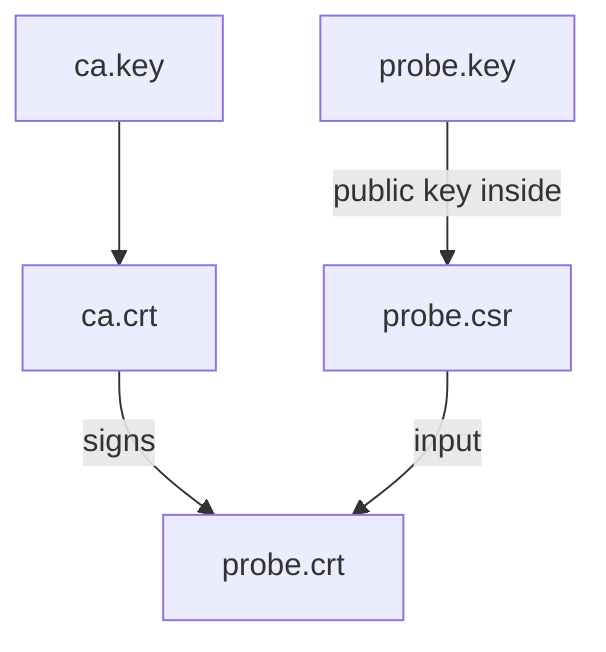

# Sign A Server Certificate With Your Own CA

A self-signed certificate must be trusted one by one. When several servers need certificates, it is easier to create one certificate authority, trust that one certificate in the client, and let it sign every server certificate. This is also how a company CA works, only with more controls. This part creates a CA, creates a certificate request for `probe.example.test`, signs it with the CA and verifies the chain.

## Three steps

First, the CA needs its own key and a self-signed certificate that says `CA:TRUE`. Second, the server creates its own key and a certificate signing request (CSR). Third, the CA signs the CSR and writes the server certificate. The extensions such as the SAN are not copied from the CSR by default, so they go into an extensions file that the signing command reads.

<!-- astrona:playground:renew -->

Create the CA key and certificate in an empty working folder. The two `-addext` options mark the certificate as a CA and allow it to sign certificates.

```sh
openssl req -x509 -nodes -newkey rsa:2048 -days 365 -keyout ca.key -out ca.crt -subj /CN=starfleet-test-ca -addext basicConstraints=critical,CA:TRUE -addext keyUsage=critical,keyCertSign,cRLSign
```

Create the server key and the CSR. The CSR holds the public key and the subject. The key stays on the server side, and only the CSR goes to the CA.

```sh
openssl req -new -nodes -newkey rsa:2048 -keyout probe.key -out probe.csr -subj /CN=probe.example.test
```

## Sign the request

Save this as `probe.ext`. It lists the extensions that the CA puts into the signed certificate. The SAN is the important line. The `serverAuth` usage says the certificate is for a TLS server, and the two key identifier lines let a client match the certificate to its issuer.

```text
subjectAltName=DNS:probe.example.test
basicConstraints=CA:FALSE
keyUsage=digitalSignature,keyEncipherment
extendedKeyUsage=serverAuth
subjectKeyIdentifier=hash
authorityKeyIdentifier=keyid
```

Sign the CSR. The option `-CAcreateserial` creates a serial number file for the CA, `ca.srl`, because every certificate from one CA needs a unique serial number.

```sh
openssl x509 -req -in probe.csr -CA ca.crt -CAkey ca.key -CAcreateserial -out probe.crt -days 30 -extfile probe.ext
```

## Verify the chain

Ask OpenSSL to build the chain from the server certificate to the CA certificate, and then print the issuer and the SAN:

```sh
openssl verify -CAfile ca.crt probe.crt
openssl x509 -in probe.crt -noout -issuer -ext subjectAltName
```

The first command prints `probe.crt: OK` when the chain is valid. The second shows the issuer `CN = starfleet-test-ca` and the SAN `DNS:probe.example.test`. A client that trusts `ca.crt` now trusts every certificate this CA signs, for any name the CA put in a SAN. In a test you give the client `ca.crt` with `--cacert`. In production the CA key is the most valuable file, and it is stored offline.



The diagram shows that the CA signs the request, and the server key never leaves the server.

You now have a CA certificate that a client can trust and a server certificate with a SAN. The remaining task is to give the server certificate and its key to the cluster in the form that Traefik reads.

## Common pitfalls

> [!WARNING]
> - **Expecting the CSR to carry the SAN.** Put the SAN in the extensions file for the signing step.
> - **Signing without `basicConstraints` on the CA.** A client can refuse a CA certificate that is not marked `CA:TRUE`.
> - **Sending the CA key to the server.** Only `probe.key` and `probe.crt` go to the cluster.
> - **Forgetting `-CAcreateserial`.** The signing command fails because there is no serial file.
