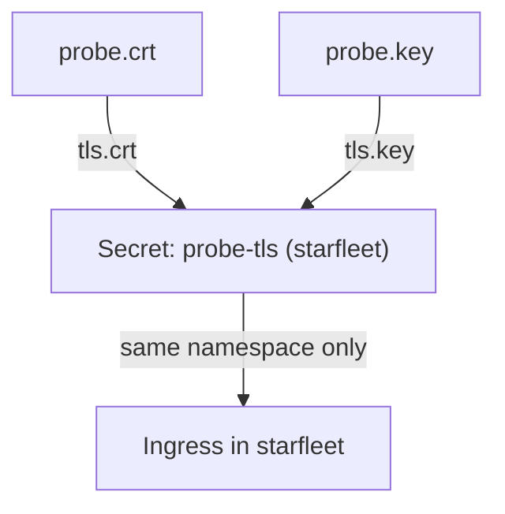

# Create The TLS Secret

Traefik does not read certificate files. It reads a Kubernetes Secret that holds the certificate and the key, in a fixed format. A wrong key name, a wrong type, a mismatched pair or a Secret in the wrong namespace all produce the same symptom on the client, so each of these must be checked before the Ingress is touched. This part creates the Secret from the files and runs those checks.

## The format of a TLS Secret

A Secret of type `kubernetes.io/tls` has exactly two keys: `tls.crt` holds the certificate chain and `tls.key` holds the private key. Both values are stored in base64. Base64 is an encoding, not encryption, so every user who may `get` the Secret can read the private key. The API server checks that both keys exist for this type. It does not check that the certificate and the key belong together, and it does not check the host names.

The Secret must be in the same namespace as the Ingress that names it. A Traefik Ingress cannot use a Secret from another namespace, even though Traefik itself may read Secrets everywhere.

## Check the pair, then create the Secret

The commands below need the files `probe.crt` and `probe.key` in the current folder. A certificate and a key belong together when they contain the same public key. For an RSA pair you can compare the modulus. The comparison prints one hash for each file, and the two hashes must be identical.

<!-- astrona:playground:renew -->

```sh
openssl x509 -in probe.crt -noout -modulus | openssl sha256
openssl rsa -in probe.key -noout -modulus | openssl sha256
```

The modulus method works for RSA keys only. This command compares the public keys and works for every key type. It prints the message only when both are identical:

```sh
diff <(openssl x509 -in probe.crt -noout -pubkey) <(openssl pkey -in probe.key -pubout) && echo "key matches certificate"
```

Now create the Secret in the namespace of the application. The command `kubectl create secret tls` sets the type and the two key names for you.

```sh
kubectl -n starfleet create secret tls probe-tls --cert=probe.crt --key=probe.key
```

## Read the Secret back

Check the type, and decode the certificate from the Secret to prove that it is the file you intended:

```sh
kubectl -n starfleet get secret probe-tls -o jsonpath='{.type}{"\n"}'
kubectl -n starfleet get secret probe-tls -o jsonpath='{.data.tls\.crt}' | base64 --decode | openssl x509 -noout -subject -enddate
```

The type is `kubernetes.io/tls`, and the decoded certificate shows the subject `CN = probe.example.test` and the end date you set. The command `kubectl -n starfleet describe secret probe-tls` lists the keys `tls.crt` and `tls.key` with their sizes and hides their values. To keep the Secret as a file for a later apply, add `--dry-run=client -o yaml` to the create command and redirect the output. That file contains the private key, so keep it out of version control.



The diagram shows that the Secret joins the two files, and only an Ingress in the same namespace can use it.

The Secret is ready, but nothing uses it yet. The next step is to name it in an Ingress and to check from the client side which certificate Traefik serves.

## Common pitfalls

> [!WARNING]
> - **Assuming the API server checks the pair.** It checks only that both keys exist. Compare the public keys yourself.
> - **A Secret in the wrong namespace.** The Ingress and its Secret must share a namespace.
> - **Treating base64 as protection.** Restrict who may read Secrets.
> - **Putting the CA certificate or a passphrase-protected key in the Secret.** The Secret needs the server certificate and an unencrypted key.
