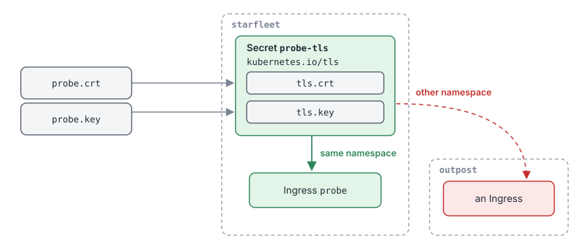

# Create The TLS Secret

Traefik does not read certificate files from a folder. It reads a Kubernetes Secret that holds the certificate and the key in a fixed format. A Secret is the Kubernetes object that stores sensitive data, such as passwords and private keys.

Many small mistakes break this step: a wrong key name, a wrong type, a key that does not belong to the certificate, or a Secret in the wrong namespace. All of them produce the same certificate error on the client. So you check each of them before you touch the Ingress. On this page, you create the Secret from the files and run those checks.

## The format of a TLS Secret

A Secret of type `kubernetes.io/tls` has exactly two keys:

- `tls.crt` holds the certificate chain.
- `tls.key` holds the private key.

Kubernetes stores both values in base64. Base64 is an encoding, not encryption. So every user who may `get` the Secret can read the private key.

The API server is the Kubernetes component that receives and stores every object. For this type, it checks that both keys exist. It does not check that the certificate and the key belong together, and it does not check the host names.

The Secret must also be in the same namespace as the Ingress that names it. A Traefik Ingress cannot use a Secret from another namespace, even though Traefik itself may read Secrets in every namespace.



The drawing shows how the two files become the two keys of the Secret, and that only an Ingress in the same namespace can use it.

## Check the pair, then create the Secret

Because the API server does not compare the certificate and the key, you do it yourself before you create the Secret. The commands below need the files `probe.crt` and `probe.key` in the current folder.

A certificate and a key belong together when they contain the same public key. For an RSA key pair, you can compare the modulus, which is one number from the public key. The commands print one hash for each file, and the two hashes must be identical.

<!-- astrona:playground:renew -->

```sh
openssl x509 -in probe.crt -noout -modulus | openssl sha256
openssl rsa -in probe.key -noout -modulus | openssl sha256
```

The modulus method works for RSA keys only. The next command compares the public keys directly, so it works for every key type. It prints the message only when both public keys are identical:

```sh
diff <(openssl x509 -in probe.crt -noout -pubkey) <(openssl pkey -in probe.key -pubout) && echo "key matches certificate"
```

Now create the Secret in the namespace of the application. The command `kubectl create secret tls` sets the type and the two key names for you.

```sh
kubectl -n starfleet create secret tls probe-tls --cert=probe.crt --key=probe.key
```

## Read the Secret back

The Secret exists now, but you should confirm that it holds the file you intended. Check the type, and decode the certificate from the Secret:

```sh
kubectl -n starfleet get secret probe-tls -o jsonpath='{.type}{"\n"}'
kubectl -n starfleet get secret probe-tls -o jsonpath='{.data.tls\.crt}' | base64 --decode | openssl x509 -noout -subject -enddate
```

The type is `kubernetes.io/tls`. The decoded certificate shows the subject `CN = probe.example.test` and the end date you set.

For a quick look without the values, run `kubectl -n starfleet describe secret probe-tls`. It lists the keys `tls.crt` and `tls.key` with their sizes and hides their contents.

To keep the Secret as a file for a later apply, add `--dry-run=client -o yaml` to the create command and redirect the output to a file. That file contains the private key, so keep it out of version control.

You now have a Secret of the right type, with a key that matches the certificate, in the namespace of the application. But nothing uses it yet. The open question is how to name it in an Ingress, and how to check from the client side which certificate Traefik serves.

## Common pitfalls

> [!WARNING]
> - **Assuming the API server checks the pair.** It checks only that both keys exist. Compare the public keys yourself.
> - **A Secret in the wrong namespace.** The Ingress and its Secret must share a namespace.
> - **Treating base64 as protection.** Anyone who may read the Secret can decode the key, so restrict who may read Secrets.
> - **Putting the CA certificate or a passphrase-protected key in the Secret.** The Secret needs the server certificate and an unencrypted key.
