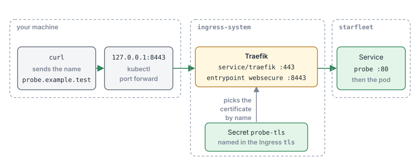
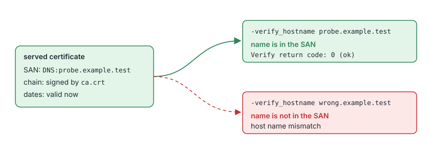

# Configure spec.tls And Verify

A Secret does nothing until an Ingress names it. And an Ingress that names it can still serve the wrong certificate. The only real proof is a client that verifies the certificate it receives.

On this page, you add the `tls` section to an Ingress for `probe.example.test`. An Ingress is the Kubernetes object that describes how outside requests reach a Service. Then you test the route with `curl` and `openssl s_client`, once with the correct host name and once with a wrong one.

## The tls section

The field `spec.tls` is a list. Each entry has two fields:

- `hosts` is a list of host names.
- `secretName` is the name of the Secret, in the namespace of the Ingress.

The two main parts of an Ingress have different jobs. The `rules` section decides where requests go. The `tls` section decides which certificate Traefik can offer.

Kubernetes does not check that the certificate contains the names listed in `hosts`. Traefik adds the certificate to its certificate store. During the TLS handshake, Traefik picks a certificate by the name that the client asks for. So the Subject Alternative Name (SAN) of the certificate must contain the host name.

Traefik also needs two annotations for an HTTPS route. An annotation is a key and value in the metadata of an object that a controller reads:

- `traefik.ingress.kubernetes.io/router.entrypoints: websecure` puts the router on the HTTPS entrypoint. An entrypoint is a port on which Traefik listens.
- `traefik.ingress.kubernetes.io/router.tls: 'true'` marks the router as a TLS router.

Other controllers use other annotations, but `spec.tls` is the same everywhere.

<!-- astrona:playground:renew -->

Save this as `ingress-probe-tls.yaml`:

```yaml
apiVersion: networking.k8s.io/v1
kind: Ingress
metadata:
  name: probe
  namespace: starfleet
  annotations:
    traefik.ingress.kubernetes.io/router.entrypoints: websecure
    traefik.ingress.kubernetes.io/router.tls: 'true'
spec:
  ingressClassName: traefik
  rules:
  - host: probe.example.test
    http:
      paths:
      - path: /
        pathType: Prefix
        backend:
          service:
            name: probe
            port:
              number: 80
  tls:
  - hosts:
    - probe.example.test
    secretName: probe-tls
```

Apply it:

```sh
kubectl apply -f ingress-probe-tls.yaml
```

Then check the result. The `describe` output has a `TLS` section that names `probe-tls` and the host.

```sh
kubectl -n starfleet describe ingress probe
```

## Verify with curl

The `describe` output only shows what Kubernetes stored. To see what Traefik really serves, you need a client that connects over TLS.

Open a second terminal, start the port forward and leave it running. The port forward makes `kubectl` listen on your machine and pass the connections to the `traefik` Service: local port 8080 goes to Service port 80, and local port 8443 goes to Service port 443.

```sh
kubectl -n ingress-system port-forward service/traefik 8080:80 8443:443
```



The drawing shows the path of the test request, and that Traefik chooses the certificate by the name the client sends.

The option `--resolve` tells `curl` to connect to `127.0.0.1:8443`, while it still uses the name `probe.example.test` from the URL. So the client sends that name in the TLS handshake and checks it against the certificate. The option `--cacert` makes `ca.crt` the only trusted certificate authority (CA). Run the command with `-v` to see the handshake:

```sh
curl -sv --cacert ca.crt --resolve probe.example.test:8443:127.0.0.1 https://probe.example.test:8443/ 2>&1 | grep -E 'subject:|issuer:|SSL certificate verify|app='
```

The output shows the subject and the issuer of the served certificate, and the line that says the certificate verified. It also shows the response from the `probe` pod.

If you used a self-signed certificate, pass that certificate file to `--cacert` instead of `ca.crt`. The command `curl -k` would also succeed, but it skips the check and proves nothing.

## Verify with openssl s_client

`curl` showed that the right name passes. A good test also shows that a wrong name fails. The command `openssl s_client` opens a TLS connection and prints the certificate, and it makes this second test easy.

The option `-servername` sends the name in the handshake. The option `-verify_hostname` makes OpenSSL check a name against the SAN. Run it for the right name and for a wrong name:

```sh
openssl s_client -connect 127.0.0.1:8443 -servername probe.example.test -CAfile ca.crt -verify_hostname probe.example.test </dev/null 2>&1 | grep -i 'verif'
openssl s_client -connect 127.0.0.1:8443 -servername probe.example.test -CAfile ca.crt -verify_hostname wrong.example.test </dev/null 2>&1 | grep -i 'verif'
```

The first command ends with `Verify return code: 0 (ok)`. The second one reports a host name mismatch. The chain and the dates are the same in both runs, so the name alone causes the failure.



The drawing shows the two runs side by side: the same certificate and the same CA, and only the checked name differs.

To print the served certificate itself, pipe the output of `openssl s_client` into `openssl x509 -noout -subject -issuer -ext subjectAltName`.

You now have a working HTTPS route, and you have seen the verification pass for the right name and fail for a wrong one. The open question is what a client receives when the Secret or the name is wrong, and how to send plain HTTP clients to HTTPS.

## Common pitfalls

> [!WARNING]
> - **Using `curl -k` to make a test pass.** It skips the identity check.
> - **A SAN that does not contain the host.** The route works, but the client rejects the certificate.
> - **Missing `router.tls` or a wrong entrypoint.** The router is not a TLS router, or it listens on the HTTP entrypoint.
> - **Port forward not running.** A refused connection on `127.0.0.1:8443` means the forward stopped.
