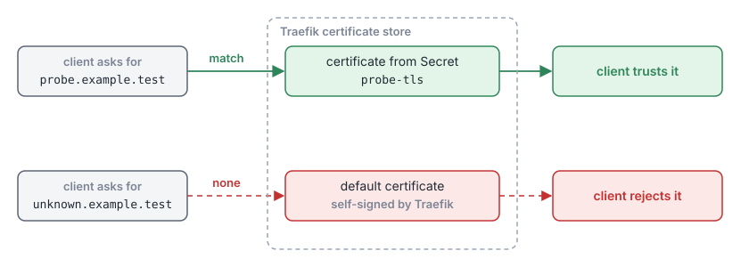
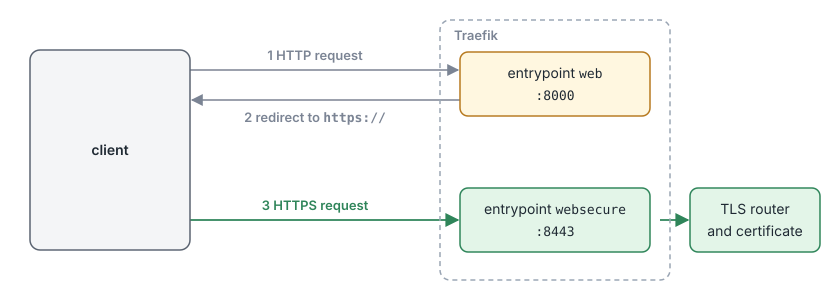
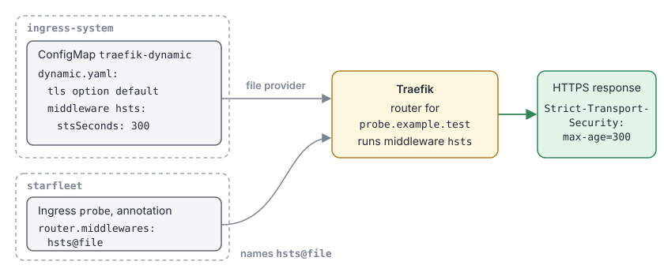

# HTTPS Redirect, HSTS And The Default Certificate

A route with a good certificate is only one part of a safe HTTPS setup. Three gaps remain:

- A client that asks for an unknown host name still gets a certificate.
- A client that uses plain HTTP is not sent to HTTPS on its own.
- A browser does not know that it should always use HTTPS for this host.

On this page, you see what Traefik serves for an unknown name. Then you redirect HTTP to HTTPS on the Traefik entrypoint, and you add an HSTS header to one route. An entrypoint is a port on which Traefik listens: in the playground, `web` is the HTTP entrypoint and `websecure` is the HTTPS entrypoint.

## What Traefik serves for an unknown name

During the TLS handshake, the client sends the host name it wants. Traefik looks for a certificate whose Subject Alternative Name (SAN) matches that name. When no certificate in its store matches, Traefik serves its default certificate.

If you did not set your own default certificate, Traefik generates a self-signed one. A client that checks certificates rejects it. So a request for an unknown host fails in a visible way, instead of showing the wrong site. An Ingress with a `tls` section for `probe.example.test` plays no part here, because the name matches nothing.



The drawing shows the two cases: a known name gets the certificate from its Secret, and an unknown name gets the default certificate that no client trusts.

<!-- astrona:playground:renew -->

Start the port forward in a second terminal and leave it running:

```sh
kubectl -n ingress-system port-forward service/traefik 8080:80 8443:443
```

Now ask for a name that no Ingress uses, and print the subject and the issuer of the certificate that comes back:

```sh
openssl s_client -connect 127.0.0.1:8443 -servername unknown.example.test </dev/null 2>/dev/null | openssl x509 -noout -subject -issuer
```

The subject and the issuer belong to the Traefik default certificate, not to `probe.example.test`. The exact subject text depends on the Traefik version.

You can replace the default certificate with a certificate store entry in the dynamic configuration of Traefik. For the exam, the key point is simpler: no client trusts this default certificate.

## Redirect HTTP to HTTPS

The default certificate covers unknown names. The next gap is clients that still connect over plain HTTP. Traefik can redirect on the entrypoint, so every request on `web` gets a redirect to `websecure`.

Static arguments of the Traefik Deployment control this redirect. The `args` list is not merged by key. So a strategic merge patch would replace the whole list and drop the existing arguments. A JSON patch that appends two items is safe. Save this as `traefik-redirect-patch.json`:

```json
[
  {"op": "add", "path": "/spec/template/spec/containers/0/args/-", "value": "--entryPoints.web.http.redirections.entryPoint.to=websecure"},
  {"op": "add", "path": "/spec/template/spec/containers/0/args/-", "value": "--entryPoints.web.http.redirections.entryPoint.scheme=https"}
]
```

Apply it and wait for the new pod. A change to the pod template makes the Deployment start a new pod, so the old port forward ends:

```sh
kubectl -n ingress-system patch deployment traefik --type=json --patch-file traefik-redirect-patch.json
kubectl -n ingress-system rollout status deployment/traefik
```

Start the port forward again in the second terminal. Then request the plain HTTP port and show only the first lines of the response, with the headers:

```sh
curl -si -H 'Host: probe.example.test' http://127.0.0.1:8080/ | head -n 5
```

The response is a redirect with a `Location` header that starts with `https://probe.example.test`. Traefik uses a permanent redirect status for this feature.

The port in the `Location` value can differ from your forwarded port, because Traefik builds it from the entrypoint address. So check the scheme and the host in the header. Do not just follow the redirect and expect it to reach your forwarded port.



The drawing shows that the redirect sends the client back with an HTTPS address, and that the second request reaches the TLS router.

## HSTS

The redirect still lets the first request go out over plain HTTP. HTTP Strict Transport Security (HSTS) closes that gap in the browser.

HSTS is a response header, `Strict-Transport-Security: max-age=...`. A browser that receives it over HTTPS remembers, for `max-age` seconds, that this host must only be reached over HTTPS. The browser then upgrades plain HTTP requests itself, before any redirect is needed. The header has no effect over plain HTTP. A long `max-age` is hard to undo, so start with a short value.

In Traefik, the header comes from a headers middleware with `stsSeconds`. A middleware is a step that Traefik runs on a request or a response, between the router and the Service.

With the file provider, which reads configuration from files, you define a middleware named `hsts` in the dynamic configuration. You attach it to an Ingress with the annotation `traefik.ingress.kubernetes.io/router.middlewares: hsts@file`. The suffix `@file` tells Traefik that the middleware comes from the file provider and not from Kubernetes objects. Other controllers use their own annotation to set the same header.



The drawing shows where each piece lives: the middleware in the ConfigMap, the link to it on the Ingress, and the header in the HTTPS response.

In the playground, Traefik reads the file `dynamic.yaml` from the ConfigMap `traefik-dynamic` in `ingress-system`. The file already holds the TLS option `default`. The ConfigMap holds the whole file, so the new version must keep that option and add the middleware. Save this as `configmap-traefik-dynamic.yaml`:

```yaml
apiVersion: v1
kind: ConfigMap
metadata:
  name: traefik-dynamic
  namespace: ingress-system
data:
  dynamic.yaml: |
    tls:
      options:
        default:
          minVersion: VersionTLS12
    http:
      middlewares:
        hsts:
          headers:
            stsSeconds: 300
```

Apply it:

```sh
kubectl apply -f configmap-traefik-dynamic.yaml
```

The kubelet, the agent on each node that runs the pods, updates the mounted file in the Traefik pod after a short delay, often up to a minute. Traefik then reloads the file, because the file provider watches the folder.

The middleware does nothing until a route uses it. Attach it to the Ingress `probe` with the annotation:

```sh
kubectl -n starfleet annotate ingress probe traefik.ingress.kubernetes.io/router.middlewares=hsts@file
```

Then check the result. Keep the port forward running, and read the response headers of an HTTPS request. Use the same certificate file for `--cacert` as before:

```sh
curl -si --cacert ca.crt --resolve probe.example.test:8443:127.0.0.1 https://probe.example.test:8443/ | grep -i strict-transport
```

The output is the header `Strict-Transport-Security: max-age=300`. If the command prints nothing, Traefik has not read the new file yet, so wait a little and run it again. The same request over plain HTTP gets the redirect and no HSTS header, because the header only counts over HTTPS.

You now know what Traefik serves for an unknown name, how to send HTTP clients to HTTPS, and how to tell browsers to stay on HTTPS. The open question for a real setup is how long `max-age` should be, because browsers keep the rule for that whole time.

## Common pitfalls

> [!WARNING]
> - **Replacing the whole `args` list with a merge patch.** Use a JSON patch that appends items.
> - **Forgetting that the pod restarts.** The port forward ends, and you must start it again.
> - **Dropping the TLS option `default` when you add the middleware.** The ConfigMap holds the whole file, so write the existing option again.
> - **Setting HSTS with a long `max-age` while testing.** Browsers keep the rule, and you cannot undo it from the server.
> - **Treating the default certificate as a working certificate.** No client trusts it.
