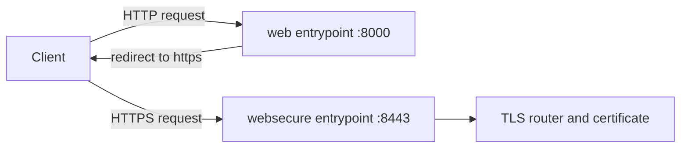

# HTTPS Redirect, HSTS And The Default Certificate

A route with a good certificate is only part of a safe HTTPS setup. Clients that ask for an unknown host still get a certificate, clients that use plain HTTP are not sent to HTTPS by themselves, and browsers do not know that they should always use HTTPS. This part shows what Traefik serves for an unknown name, redirects HTTP to HTTPS on the entrypoint, and explains HSTS.

## What Traefik serves for an unknown name

When the name in the handshake matches no certificate in the store, Traefik serves its default certificate. Without your own default certificate that is a self-signed certificate generated by Traefik. A client that checks certificates rejects it, so a request for an unknown host fails visibly instead of showing the wrong site. The Ingress with the `tls` section from the previous work is not involved here, because the name matches nothing.

<!-- astrona:playground:renew -->

Start the port forward in a second terminal and leave it running:

```sh
kubectl -n ingress-system port-forward service/traefik 8080:80 8443:443
```

Ask for a name that no Ingress uses and print the certificate that comes back:

```sh
openssl s_client -connect 127.0.0.1:8443 -servername unknown.example.test </dev/null 2>/dev/null | openssl x509 -noout -subject -issuer
```

The subject and issuer are those of the Traefik default certificate, not of `probe.example.test`. The exact subject text depends on the Traefik version. You can replace the default certificate with a certificate store entry in the dynamic configuration, but the key point for the exam is that this certificate is not trusted by any client.

## Redirect HTTP to HTTPS

Traefik can redirect on the entrypoint, so every request on `web` receives a redirect to `websecure`. The static arguments of the Deployment control this. The `args` list is not merged by key, so a strategic merge patch would replace the whole list. A JSON patch that appends two items is safe. Save this as `traefik-redirect-patch.json`:

```json
[
  {"op": "add", "path": "/spec/template/spec/containers/0/args/-", "value": "--entryPoints.web.http.redirections.entryPoint.to=websecure"},
  {"op": "add", "path": "/spec/template/spec/containers/0/args/-", "value": "--entryPoints.web.http.redirections.entryPoint.scheme=https"}
]
```

Apply it and wait for the new pod. Changing the pod template starts a new pod, so the old port forward ends:

```sh
kubectl -n ingress-system patch deployment traefik --type=json --patch-file traefik-redirect-patch.json
kubectl -n ingress-system rollout status deployment/traefik
```

Start the port forward again in the second terminal, then request the plain HTTP port and show only the headers:

```sh
curl -si -H 'Host: probe.example.test' http://127.0.0.1:8080/ | head -n 5
```

The response is a redirect with a `Location` header that starts with `https://probe.example.test`. Traefik uses a permanent redirect status for this feature. The port in the `Location` value can differ from your forwarded port, because Traefik builds it from the entrypoint address, so check the scheme and the host and do not follow the redirect with the forwarded port blindly.



The diagram shows that the redirect sends the client back with an HTTPS address, and the second request reaches the TLS router.

## HSTS

HTTP Strict Transport Security (HSTS) is a response header, `Strict-Transport-Security: max-age=...`. A browser that receives it over HTTPS remembers for `max-age` seconds that this host must only be reached over HTTPS. The browser then upgrades plain HTTP requests itself, which closes the gap before the first redirect. The header is useless over plain HTTP, and a long `max-age` is hard to undo, so start with a short value.

In Traefik the header comes from a headers middleware with `stsSeconds`. With the file provider, a middleware named `hsts` in the dynamic configuration is attached to an Ingress with the annotation `traefik.ingress.kubernetes.io/router.middlewares: hsts@file`. Other controllers use an annotation that sets the same header. The module that follows uses the dynamic configuration file for TLS options, and this part does not change it.

## Common pitfalls

> [!WARNING]
> - **Replacing the whole `args` list with a merge patch.** Use a JSON patch that appends items.
> - **Forgetting that the pod restarts.** The port forward ends and must be started again.
> - **Setting HSTS with a long `max-age` while testing.** Browsers keep the rule and you cannot undo it from the server.
> - **Treating the default certificate as a working certificate.** No client trusts it.
