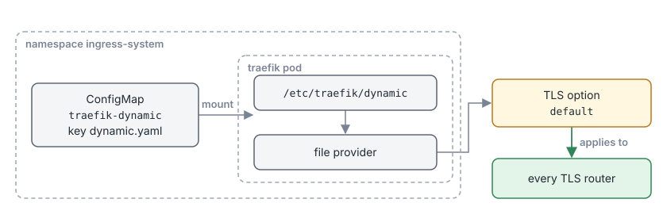

# TLS Versions, Ciphers And Server Names

A certificate tells the client who the server is. The TLS policy decides how the connection is protected. Old protocol versions and weak ciphers can be broken, so a controller should refuse them.

Traefik keeps this policy in TLS options, which are not part of the Ingress object. On this page, you set a minimum TLS version and strict server name matching. Then you prove the result from the client side with `openssl s_client`.

## Where the policy lives

Before you change the policy, you need to know where Traefik keeps it. A TLS option is a named set of rules for the TLS handshake, the first messages in which the client and the server agree on how to protect the connection. An option can hold these fields:

- `minVersion` and `maxVersion`: the lowest and highest TLS version the server accepts;
- `cipherSuites`: the cipher suites the server accepts for TLS 1.2;
- `sniStrict`: whether the server refuses a server name that matches no certificate;
- `clientAuth`: whether the server asks the client for a certificate.

The option named `default` applies to every TLS router that does not choose another option. A router is the Traefik rule that matches a request (for example by host name) and sends it to a Service. In this cluster, the options are written in the key `dynamic.yaml` of the ConfigMap `traefik-dynamic`. The ConfigMap is mounted into the Traefik pod, and Traefik reads the folder with its file provider, the part of Traefik that loads configuration from files.



The drawing shows the path of the policy. It goes from the ConfigMap, through the mounted folder, to the file provider in the Traefik pod, and from there to every TLS router.

Two of the fields need a short explanation. A cipher suite is a set of algorithms for key exchange, encryption and integrity checks. TLS 1.3 has a short, fixed list of strong suites, and that is the main reason to require it. For TLS 1.2, the option `cipherSuites` limits the list.

The option `sniStrict: true` works with Server Name Indication (SNI), the field in which the client names the host it wants during the handshake. With `sniStrict: true`, Traefik refuses a handshake whose server name matches no certificate. Without it, Traefik serves its default certificate instead.

## Read the current policy and test it

Start with the policy that runs now, so you have a result to compare with later.

<!-- astrona:playground:renew -->

Show the current option and the Traefik arguments that load the folder:

```sh
kubectl -n ingress-system get configmap traefik-dynamic -o jsonpath='{.data.dynamic\.yaml}'
kubectl -n ingress-system get deployment traefik -o jsonpath='{.spec.template.spec.containers[0].args}{"\n"}'
```

The ConfigMap holds `minVersion: VersionTLS12`. To test the policy from your machine, you need a connection to the Traefik Service. Start the port forward in a second terminal and leave it running:

```sh
kubectl -n ingress-system port-forward service/traefik 8443:443
```

Now connect once with each TLS version. The flags `-tls1_2` and `-tls1_3` make `openssl s_client` offer only that version. A connection that completes shows a certificate and the protocol line. A refused version ends with a handshake failure.

```sh
openssl s_client -connect 127.0.0.1:8443 -servername probe.example.test -tls1_2 </dev/null 2>&1 | grep -E 'Protocol|handshake failure|Cipher'
openssl s_client -connect 127.0.0.1:8443 -servername probe.example.test -tls1_3 </dev/null 2>&1 | grep -E 'Protocol|handshake failure|Cipher'
```

With the minimum at TLS 1.2, both connections complete. So today the controller still accepts a client that offers only TLS 1.2.

## Change the policy

The new policy requires TLS 1.3 and strict server names. You write it to a file first and then load it into the ConfigMap.

Save this as `dynamic.yaml`. It requires TLS 1.3 and strict names:

```yaml
tls:
  options:
    default:
      minVersion: VersionTLS13
      sniStrict: true
```

Next, replace the ConfigMap and restart Traefik. The file provider can watch a folder for changes. But Kubernetes updates a ConfigMap mount by swapping a link to the files, so a restart is the sure way to load the change.

```sh
kubectl -n ingress-system create configmap traefik-dynamic --from-file=dynamic.yaml --dry-run=client -o yaml | kubectl apply -f -
kubectl -n ingress-system rollout restart deployment/traefik
kubectl -n ingress-system rollout status deployment/traefik
```

The restart ends the port forward, because the old pod is gone. Start the port forward again, then repeat the two `s_client` commands. The TLS 1.2 attempt now fails with a protocol or handshake failure, and the TLS 1.3 attempt completes.

Strict server names have an effect too. A request for a name that has no certificate is now refused:

```sh
openssl s_client -connect 127.0.0.1:8443 -servername unknown.example.test -tls1_3 </dev/null 2>&1 | grep -E 'alert|handshake failure|Verification|subject'
```


The drawing shows that Traefik checks the TLS option during the handshake. A refused client never reaches a router or a backend Service.

You can now set the lowest TLS version that Traefik accepts and make it refuse unknown server names, and you can prove both with `openssl s_client`. The `default` option protects every route in the same way. The open question is how to give one route a stricter rule, such as a client certificate.

## Common pitfalls

> [!WARNING]
> - **Editing the ConfigMap and expecting an instant change.** Restart the Deployment and wait for the rollout to finish.
> - **Breaking old clients without knowing it.** A minimum of TLS 1.3 refuses every client that supports only TLS 1.2.
> - **Using `sniStrict` without a certificate for each name.** Traefik refuses clients that ask for any other name.
> - **A YAML indent error in the ConfigMap.** Traefik logs the error and keeps the old policy. Read the Traefik log after the restart.
