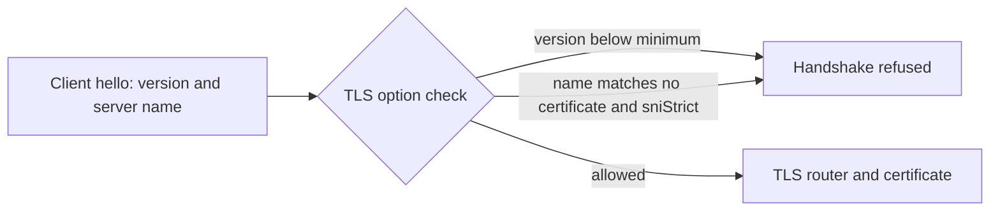

# TLS Versions, Ciphers And Server Names

The certificate says who the server is. The TLS policy says how the connection is protected. Old protocol versions and weak ciphers can be broken, so a controller should refuse them. Traefik keeps the policy in TLS options, which are not part of the Ingress object. This part sets a minimum version and strict server name matching, and proves the result from the client side.

## Where the policy lives

A TLS option is a named set of rules: `minVersion`, `maxVersion`, `cipherSuites`, `sniStrict` and `clientAuth`. The option named `default` applies to every TLS router that does not choose another one. In this cluster the options are written in the key `dynamic.yaml` of the ConfigMap `traefik-dynamic`, which is mounted into the Traefik pod. Traefik reads the folder with its file provider.

A cipher suite is a set of algorithms for key exchange, encryption and integrity. TLS 1.3 has a short fixed list of strong suites, which is the main reason to require it. For TLS 1.2 the option `cipherSuites` restricts the list. The option `sniStrict: true` makes Traefik refuse a handshake whose server name matches no certificate, instead of serving the default certificate.

## Read the current policy and test it

<!-- astrona:playground:renew -->

Show the current option and the Traefik arguments that load the folder:

```sh
kubectl -n ingress-system get configmap traefik-dynamic -o jsonpath='{.data.dynamic\.yaml}'
kubectl -n ingress-system get deployment traefik -o jsonpath='{.spec.template.spec.containers[0].args}{"\n"}'
```

The ConfigMap holds `minVersion: VersionTLS12`. Start the port forward in a second terminal and leave it running:

```sh
kubectl -n ingress-system port-forward service/traefik 8443:443
```

The flags `-tls1_2` and `-tls1_3` make `openssl s_client` offer only that version. A connection that completes shows a certificate and the protocol line. A refused version ends with a handshake failure:

```sh
openssl s_client -connect 127.0.0.1:8443 -servername probe.example.test -tls1_2 </dev/null 2>&1 | grep -E 'Protocol|handshake failure|Cipher'
openssl s_client -connect 127.0.0.1:8443 -servername probe.example.test -tls1_3 </dev/null 2>&1 | grep -E 'Protocol|handshake failure|Cipher'
```

With the minimum at TLS 1.2, both connections complete.

## Change the policy

Save this as `dynamic.yaml`. It requires TLS 1.3 and strict names:

```yaml
tls:
  options:
    default:
      minVersion: VersionTLS13
      sniStrict: true
```

Replace the ConfigMap and restart Traefik. The file provider can watch a folder, but a ConfigMap mount updates through a link swap, so a restart is the sure way to load the change:

```sh
kubectl -n ingress-system create configmap traefik-dynamic --from-file=dynamic.yaml --dry-run=client -o yaml | kubectl apply -f -
kubectl -n ingress-system rollout restart deployment/traefik
kubectl -n ingress-system rollout status deployment/traefik
```

The restart ends the port forward. Start it again, then repeat the two `s_client` commands. The TLS 1.2 attempt now fails with a protocol or handshake failure, and the TLS 1.3 attempt completes. A request for an unknown name is also refused now:

```sh
openssl s_client -connect 127.0.0.1:8443 -servername unknown.example.test -tls1_3 </dev/null 2>&1 | grep -E 'alert|handshake failure|Verification|subject'
```



The diagram shows that the options are checked during the handshake, before any router or backend is reached.

## Common pitfalls

> [!WARNING]
> - **Editing the ConfigMap and expecting an instant change.** Restart the Deployment and wait for the rollout.
> - **Breaking old clients without knowing it.** Raising the minimum to TLS 1.3 refuses every client that supports only TLS 1.2.
> - **Using `sniStrict` without a certificate for each name.** Clients that ask for another name are refused.
> - **A YAML indent error in the ConfigMap.** Traefik logs the error and keeps the old policy; read the Traefik log after the restart.
