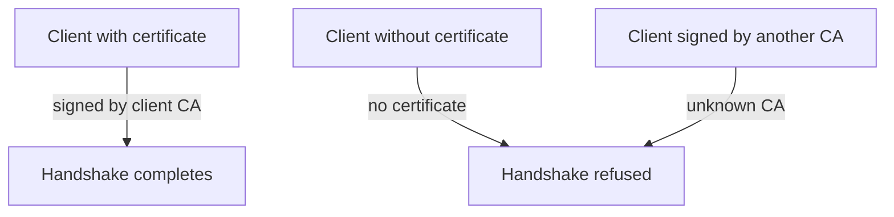

# Mutual TLS With Client Certificates

In normal TLS only the server proves its identity. In mutual TLS (mTLS) the client also presents a certificate, and the server checks it against a CA it trusts. A route that requires client certificates stops every caller that does not hold one, before any request reaches the application. This part builds a CA, issues a client certificate, adds a TLS option that requires it and tests a request with and without the certificate.

## How Traefik checks the client

A TLS option can carry a `clientAuth` section with two fields. `caFiles` lists the CA certificates that Traefik trusts for clients. `clientAuthType` sets the policy. The value `RequireAndVerifyClientCert` refuses a handshake without a certificate or with a certificate that the CA did not sign. The value `VerifyClientCertIfGiven` accepts a client with no certificate and checks one only when it is sent. The strict value is the one for protected routes.

An option is attached to a route with an annotation on the Ingress: `traefik.ingress.kubernetes.io/router.tls.options: mtls@file`. The text after `@` names the provider, which here is the file provider. The route also needs the TLS router annotations from before.

## Create the CA and a client certificate

<!-- astrona:playground:renew -->

```sh
openssl req -x509 -nodes -newkey rsa:2048 -days 30 -keyout client-ca.key -out client-ca.crt -subj "/CN=starfleet-client-ca"
openssl req -nodes -newkey rsa:2048 -keyout client.key -out client.csr -subj "/CN=ensign-one"
openssl x509 -req -in client.csr -CA client-ca.crt -CAkey client-ca.key -CAcreateserial -out client.crt -days 30
```

The client certificate has the common name `ensign-one`. Check that the CA signed it:

```sh
openssl verify -CAfile client-ca.crt client.crt
```

## Give Traefik the CA and the option

The pod mounts an optional ConfigMap named `client-ca` at `/etc/traefik/client-ca`. Create it from the CA certificate. Then add an `mtls` option to the dynamic configuration. Save the file as `dynamic.yaml`:

```yaml
tls:
  options:
    default:
      minVersion: VersionTLS12
    mtls:
      minVersion: VersionTLS12
      clientAuth:
        clientAuthType: RequireAndVerifyClientCert
        caFiles:
        - /etc/traefik/client-ca/client-ca.crt
```

The file name in `caFiles` equals the key name in the ConfigMap, which is the file name used in `--from-file`. Apply both ConfigMaps and restart Traefik. A new ConfigMap volume source is read when the pod starts, so the restart is needed:

```sh
kubectl -n ingress-system create configmap client-ca --from-file=client-ca.crt
kubectl -n ingress-system create configmap traefik-dynamic --from-file=dynamic.yaml --dry-run=client -o yaml | kubectl apply -f -
kubectl -n ingress-system rollout restart deployment/traefik
kubectl -n ingress-system rollout status deployment/traefik
```

Now attach the option to the Ingress `probe`. The annotation is added in place:

```sh
kubectl -n starfleet annotate ingress probe traefik.ingress.kubernetes.io/router.tls.options=mtls@file --overwrite
```

## Test with and without the certificate

Start the port forward in a second terminal. The playground certificate for `probe.example.test` is self-signed, so its trust file is the Secret itself. Extract it, then run both requests:

```sh
kubectl -n ingress-system port-forward service/traefik 8443:443
kubectl -n starfleet get secret probe-tls -o jsonpath='{.data.tls\.crt}' | base64 --decode > server.crt
curl -s --cacert server.crt --resolve probe.example.test:8443:127.0.0.1 https://probe.example.test:8443/ ; echo "exit=$?"
curl -s --cacert server.crt --cert client.crt --key client.key --resolve probe.example.test:8443:127.0.0.1 https://probe.example.test:8443/ ; echo "exit=$?"
```

The first request has no client certificate. It fails, and `curl` exits with a nonzero status such as 56, because the server closes the handshake or sends an alert. The second request sends `client.crt` and `client.key` and receives the response from the `probe` pod. The exact error text of the first request depends on the TLS version, so read the exit status.



The diagram shows that the decision is taken from the CA that signed the client certificate, before the application sees a request.

## Common pitfalls

> [!WARNING]
> - **Using the server CA as the client CA by habit.** The trust for clients is a separate list; keep the two CAs apart.
> - **`VerifyClientCertIfGiven` on a protected route.** It lets clients without a certificate through.
> - **A wrong path in `caFiles`.** The path must exist in the pod. Read the Traefik log after the restart.
> - **Losing the client key.** Anyone who holds `client.key` and `client.crt` can act as the client; store it with care.
