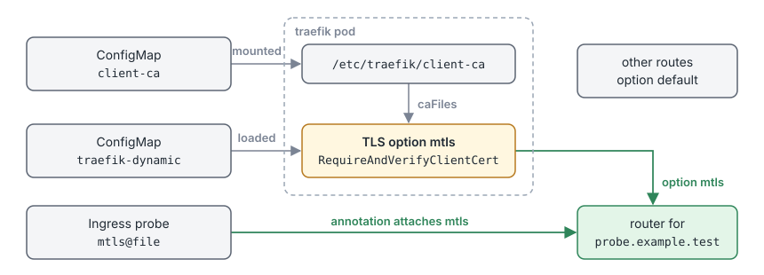
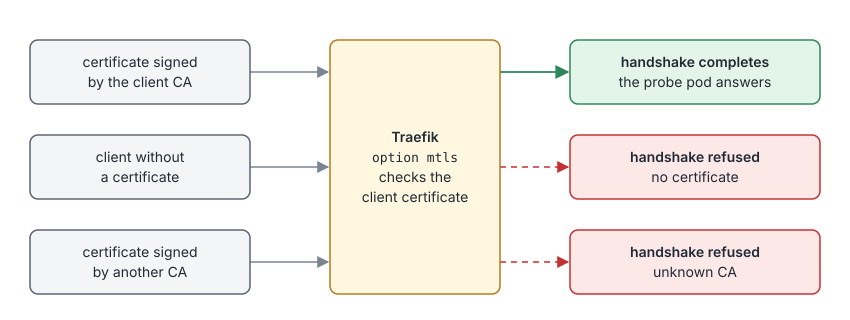

# Mutual TLS With Client Certificates

In normal TLS, only the server proves who it is. In mutual TLS (mTLS), the client also presents a certificate, and the server checks it against a certificate authority (CA) that it trusts. A CA is the key and certificate that sign other certificates.

A route that requires client certificates stops every caller that does not hold one, before any request reaches the application. On this page, you build a CA, issue a client certificate and add a TLS option that requires it. Then you send a request with and without the certificate.

## How Traefik checks the client

Traefik checks client certificates with the same TLS options that set the TLS version. A TLS option can carry a `clientAuth` section with two fields:

- `caFiles` lists the CA certificates that Traefik trusts for clients.
- `clientAuthType` sets the policy for client certificates.

Two values of `clientAuthType` matter most. `RequireAndVerifyClientCert` refuses a handshake when the client sends no certificate, or a certificate that the CA did not sign. `VerifyClientCertIfGiven` accepts a client with no certificate, and checks a certificate only when the client sends one. Use the strict value for protected routes.

An option is attached to one route with an annotation on the Ingress: `traefik.ingress.kubernetes.io/router.tls.options: mtls@file`. The text after `@` names the provider that defines the option, which here is the file provider. The route also needs the TLS router annotations, which the Ingress `probe` already has: `router.entrypoints: websecure` and `router.tls: 'true'`.



The drawing shows the three pieces you create on this page. The CA file comes from one ConfigMap, the option comes from the dynamic configuration, and the annotation ties the option to the `probe` route only.

## Create the CA and a client certificate

The first piece is the CA and one client certificate that it signs. The commands create a CA key and certificate, then a key and a certificate signing request (CSR) for the client, and then sign the request with the CA.

<!-- astrona:playground:renew -->

```sh
openssl req -x509 -nodes -newkey rsa:2048 -days 30 -keyout client-ca.key -out client-ca.crt -subj "/CN=starfleet-client-ca"
openssl req -nodes -newkey rsa:2048 -keyout client.key -out client.csr -subj "/CN=ensign-one"
openssl x509 -req -in client.csr -CA client-ca.crt -CAkey client-ca.key -CAcreateserial -out client.crt -days 30
```

The client certificate has the common name `ensign-one`. Check that the CA signed it:

```sh
openssl verify -CAfile client-ca.crt client.crt
```

## Give Traefik the CA and the option

Traefik now needs the CA certificate and an option that uses it. The Traefik pod already mounts an optional ConfigMap named `client-ca` at `/etc/traefik/client-ca`, so you only have to create that ConfigMap from the CA certificate. Then you add an `mtls` option to the dynamic configuration.

Save the file as `dynamic.yaml`:

```yaml
tls:
  options:
    default:
      minVersion: VersionTLS12
    mtls:
      minVersion: VersionTLS12
      clientAuth:
        clientAuthType: RequireAndVerifyClientCert
        caFiles:
        - /etc/traefik/client-ca/client-ca.crt
```

The file name in `caFiles` must equal the key name in the ConfigMap. That key is the file name you pass to `--from-file`.

Apply both ConfigMaps and restart Traefik. The pod reads a new ConfigMap volume source when it starts, so the restart is needed:

```sh
kubectl -n ingress-system create configmap client-ca --from-file=client-ca.crt
kubectl -n ingress-system create configmap traefik-dynamic --from-file=dynamic.yaml --dry-run=client -o yaml | kubectl apply -f -
kubectl -n ingress-system rollout restart deployment/traefik
kubectl -n ingress-system rollout status deployment/traefik
```

Now attach the option to the Ingress `probe`. The command adds the annotation in place:

```sh
kubectl -n starfleet annotate ingress probe traefik.ingress.kubernetes.io/router.tls.options=mtls@file --overwrite
```

## Test with and without the certificate

A good test sends one request that must fail and one that must pass. Start the port forward in a second terminal. The playground certificate for `probe.example.test` is self-signed, so the file that `curl` must trust is the certificate in the Secret itself. The commands extract it and then run both requests:

```sh
kubectl -n ingress-system port-forward service/traefik 8443:443
kubectl -n starfleet get secret probe-tls -o jsonpath='{.data.tls\.crt}' | base64 --decode > server.crt
curl -s --cacert server.crt --resolve probe.example.test:8443:127.0.0.1 https://probe.example.test:8443/ ; echo "exit=$?"
curl -s --cacert server.crt --cert client.crt --key client.key --resolve probe.example.test:8443:127.0.0.1 https://probe.example.test:8443/ ; echo "exit=$?"
```

The first request has no client certificate. It fails, and `curl` exits with a nonzero status such as 56, because Traefik closes the handshake or sends an alert. The exact error text depends on the TLS version, so read the exit status, not the message.

The second request sends `client.crt` and `client.key`. It receives the response from the `probe` pod.



The drawing shows that Traefik decides from the CA that signed the client certificate. It does so during the handshake, before the application sees any request.

You can now build a client CA, give it to Traefik and require a certificate on one route, and you can prove the rule with two `curl` requests. The TLS policy is in good shape. The open question is what the controller itself can read and expose if an attacker takes it over.

## Common pitfalls

> [!WARNING]
> - **Using the server CA as the client CA by habit.** The trust list for clients is a separate list. Keep the two CAs apart.
> - **`VerifyClientCertIfGiven` on a protected route.** It lets clients without a certificate through.
> - **A wrong path in `caFiles`.** The path must exist inside the pod. Read the Traefik log after the restart.
> - **Losing the client key.** Anyone who holds `client.key` and `client.crt` can act as the client, so store them with care.
