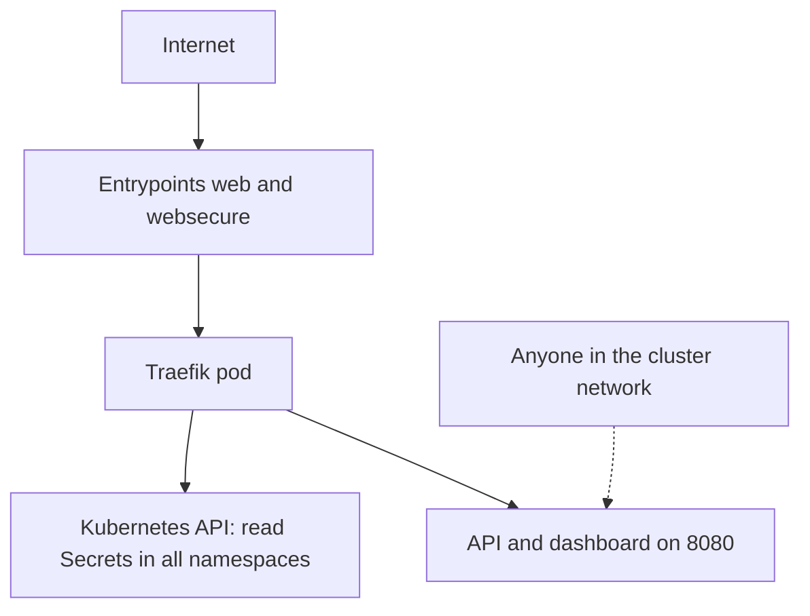

# Shrink The Controller Attack Surface

The Ingress controller sits on the edge of the cluster, takes input from the internet and holds credentials for the Kubernetes API. If it is compromised, an attacker gets its permissions. This part lists what a Traefik installation can reach and expose, and shows the commands that find each item.

## What the controller can read

Traefik runs as a ServiceAccount with a ClusterRole. To load certificates it needs to read Secrets. In the default installation this permission is cluster-wide, so a compromised controller can read every Secret in every namespace, not only TLS Secrets. A tighter design runs one controller for each team in a namespace and limits the reading to that namespace with a Role and the namespaces option of the provider. The command `kubectl auth can-i` tests a permission for any identity without changing anything.

<!-- astrona:playground:renew -->

```sh
kubectl auth can-i list secrets --all-namespaces --as=system:serviceaccount:ingress-system:traefik
kubectl auth can-i create pods --as=system:serviceaccount:ingress-system:traefik
kubectl get clusterrole traefik -o jsonpath='{range .rules[*]}{.resources}{" "}{.verbs}{"\n"}{end}'
```

The first command answers `yes`, which shows the cluster-wide Secret access. The second answers `no`, so the controller cannot start pods. The third prints the resources and verbs the role grants. A controller must never receive more than `get`, `list` and `watch` for these resources.

## What the controller exposes

Traefik can open more than the two entrypoints. With `--api.insecure=true` the API and dashboard listen on port 8080 without authentication, and anyone who can reach that port sees every router, service and middleware. The Service decides which ports other pods and the internet can reach. Check the arguments and the Service of this controller:

```sh
kubectl -n ingress-system get deployment traefik -o jsonpath='{.spec.template.spec.containers[0].args}{"\n"}'
kubectl -n ingress-system get service traefik -o jsonpath='{range .spec.ports[*]}{.name}{" "}{.port}{" "}{.targetPort}{"\n"}{end}'
kubectl -n ingress-system get service traefik -o jsonpath='{.spec.type}{"\n"}'
```

The arguments here contain no `--api.insecure` flag, so the API is not enabled, and the Service lists only the ports 80 and 443. If you ever find `--api.insecure=true` on a controller, treat it as a finding: remove it, or protect the API with a router and authentication. A Service of type `ClusterIP` is reachable only from inside the cluster, which is the right type for an internal port. Never publish port 8080 through a `LoadBalancer` or `NodePort`.

## What the controller runs as

Read the security settings of the pod. A hardened container drops capabilities, runs as a non-root user and has a read-only root file system:

```sh
kubectl -n ingress-system get deployment traefik -o jsonpath='{.spec.template.spec.containers[0].securityContext}{"\n"}'
kubectl -n ingress-system get deployment traefik -o jsonpath='{.spec.template.spec.serviceAccountName}{"\n"}'
```

An empty result means the container has no restrictions of its own. Entrypoints above port 1024, as the `8000` and `8443` here, do not need extra privileges to bind.



The diagram shows two paths of risk: the data plane reaches the pod from outside, and the pod reaches the API with its permissions.

## Common pitfalls

> [!WARNING]
> - **Leaving `--api.insecure=true` on a shared cluster.** Remove it or protect the API with a router and authentication.
> - **Assuming a TLS Secret is the only Secret the controller can read.** The default role covers every Secret.
> - **Exposing the Service as `LoadBalancer` with all ports.** Publish only 80 and 443.
> - **Running the controller as an admin ServiceAccount.** Give it a purpose-built role and nothing more.
