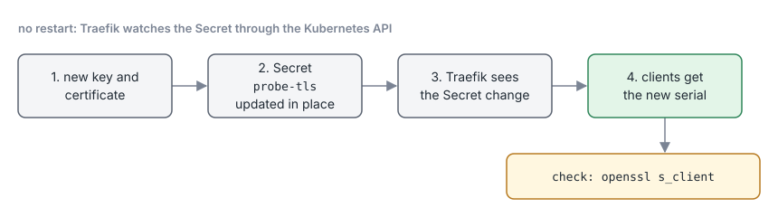

# Rotate And Replace Certificates

Every certificate expires. When the certificate of a route expires, every client fails at once. And when a private key leaks, the certificate needs a replacement long before its end date.

Rotation means issuing a new certificate and key, updating the Secret and proving that the new certificate is the one on the wire. On this page, you read the dates and the serial number of the current certificate, replace it and check the result.

## Read the dates and the serial

Before you replace a certificate, you need to know which one is served now and when it ends. The playground certificate for `probe.example.test` is valid for one day.

The command `openssl x509 -checkend` takes a number of seconds. It exits with 0 when the certificate is still valid after that time, and with 1 when it will have expired by then. Because the answer is an exit status, a script or a monitor can use it.

<!-- astrona:playground:renew -->

```sh
kubectl -n starfleet get secret probe-tls -o jsonpath='{.data.tls\.crt}' | base64 --decode > old.crt
openssl x509 -in old.crt -noout -serial -enddate
openssl x509 -in old.crt -noout -checkend 604800; echo "valid for another week: exit=$?"
```

The exit status is 1, because a one-day certificate ends within a week (604800 seconds). The serial number identifies this one certificate, so a changed serial on the wire shows that a new certificate is served.

## Issue a new certificate and update the Secret

Now create the new key and certificate, with a longer life of 90 days. The certificate carries the host name in its Subject Alternative Name (SAN), the list of names a certificate is valid for.

Then replace the Secret. The command `kubectl create secret tls --dry-run=client -o yaml | kubectl apply -f -` updates the existing Secret, where a plain `kubectl create` would fail because the Secret already exists.

```sh
openssl req -x509 -nodes -newkey rsa:2048 -days 90 -keyout new.key -out new.crt -subj "/CN=probe.example.test" -addext "subjectAltName=DNS:probe.example.test"
kubectl -n starfleet create secret tls probe-tls --cert=new.crt --key=new.key --dry-run=client -o yaml | kubectl apply -f -
```

Traefik watches the Secret through the Kubernetes API, so the controller loads the new certificate without a restart. Allow a few seconds for the update.

## Prove the new certificate is served

A changed Secret does not prove that clients get the new certificate. Only a check on the wire does. Start the port forward in a second terminal, then read the serial and the end date that Traefik serves:

```sh
kubectl -n ingress-system port-forward service/traefik 8443:443
openssl s_client -connect 127.0.0.1:8443 -servername probe.example.test </dev/null 2>/dev/null | openssl x509 -noout -serial -enddate
```

The serial differs from the old one, and the end date is about 90 days away. If Traefik still serves the old serial, either the Secret was not updated or the controller has not reloaded yet. Check the Secret with `kubectl -n starfleet get secret probe-tls -o jsonpath='{.metadata.resourceVersion}'` and read the Traefik log.

Remove the old key from disk when you no longer need it. An old key that leaks still lets an attacker pose as the host until the old certificate expires.



The drawing shows the order of a rotation. The new pair comes first, then the Secret, then Traefik loads it, and the check with `openssl s_client` closes the loop.

You can now read the end date of a certificate, replace it in place and prove the new serial on the wire. All of this assumes the route was working to begin with. The open question is how to find the cause when a TLS route does not work at all.

## Common pitfalls

> [!WARNING]
> - **Letting the expiry date pass unnoticed.** Run `-checkend` on a schedule and send an alert before the end date.
> - **Creating a new Secret name without changing the Ingress.** The Ingress still names the old Secret.
> - **Rotating the certificate but not the key.** After a key leak, always generate a new key.
> - **A new SAN list that misses an old host.** Copy every name that the old certificate had.
