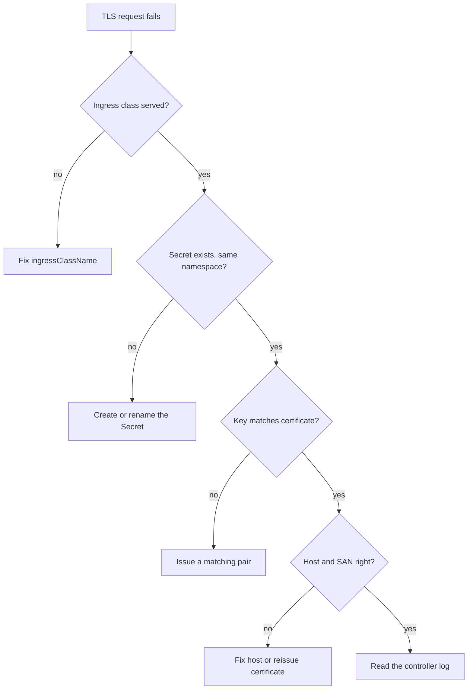

# Troubleshoot TLS Ingress Failures

A client that cannot connect gives you one line: a certificate error, a reset or a 404. The cause can be in the Secret, the Ingress, the class or the controller. This part gives a fixed order of checks and applies it to four broken Ingresses, `case-one` to `case-four`, that were prepared in the playground.

## The order of checks

1. Does the Ingress exist, and which class and host does it name? `kubectl -n starfleet get ingress` and `describe`.
2. Does the class belong to a controller that runs? `kubectl get ingressclass` shows `traefik` only.
3. Does the Secret exist in the same namespace, with the right type and keys? `kubectl -n starfleet get secret`.
4. Do the certificate and the key belong together, and does the SAN contain the host? Decode and compare.
5. What does the controller say? `kubectl -n ingress-system logs deployment/traefik`.

<!-- astrona:playground:renew -->

```sh
kubectl get ingressclass
kubectl -n starfleet get ingress
kubectl -n starfleet get secret
```

You see the class `traefik`, five Ingresses and the Secrets `probe-tls`, `one-cert`, `two-tls`, `three-tls` and `four-tls`. There is no Secret `one-tls`, although `case-one` names it.

## Read the controller log

Traefik writes a line when it cannot use a Secret or a router. Filter for the cases:

```sh
kubectl -n ingress-system logs deployment/traefik --tail=200 | grep -iE 'case-|secret|tls|error' | tail -n 20
```

The lines name the Ingress and the problem, for example that a Secret was not found. The exact wording depends on the Traefik version, so match on the Ingress name and the word `error`.

## The four cases

Find the cause of each one with these commands:

```sh
kubectl -n starfleet get ingress case-one -o jsonpath='{.spec.tls[0].secretName}{"\n"}'
kubectl -n starfleet get secret two-tls -o jsonpath='{.data.tls\.crt}' | base64 --decode | openssl x509 -noout -pubkey | openssl sha256
kubectl -n starfleet get secret two-tls -o jsonpath='{.data.tls\.key}' | base64 --decode | openssl pkey -pubout | openssl sha256
kubectl -n starfleet get ingress case-three -o jsonpath='{.spec.rules[0].host}{"\n"}'
kubectl -n starfleet get ingress case-four -o jsonpath='{.spec.ingressClassName}{"\n"}'
```

The results map to four causes:

- **case-one:** the Ingress names `one-tls`, which does not exist. A working certificate exists as `one-cert`. Fix the Ingress to name `one-cert`, or create a Secret with the missing name.
- **case-two:** `two-tls` has the right type but the key does not match the certificate. The two hashes differ. Create a new Secret from a matching pair.
- **case-three:** the host is `three.example.tset`, a typo. Clients ask for `three.example.test` and match no router. Fix the host in the rule and in the `tls` entry.
- **case-four:** the class is `nginx`, and no controller serves it. The Ingress is accepted and ignored. Set `ingressClassName: traefik`.

Apply a repair with a JSON patch and read the result back, for example for the class:

```sh
kubectl -n starfleet patch ingress case-four --type=json -p '[{"op":"replace","path":"/spec/ingressClassName","value":"traefik"}]'
kubectl -n starfleet get ingress case-four -o jsonpath='{.spec.ingressClassName}{"\n"}'
```



The diagram turns the order of checks into a tree, from the object nearest to the API to the log.

## Common pitfalls

> [!WARNING]
> - **Reading only the Ingress.** It is accepted even when its class, host or Secret is wrong; check the Secret and the log.
> - **Fixing the host in `rules` and not in `tls`.** Both lists name the host.
> - **Using `-k` to hide a certificate problem.** The problem is still there for real clients.
> - **Deleting the Ingress to start over.** You lose the evidence; compare the object with a working one first.
