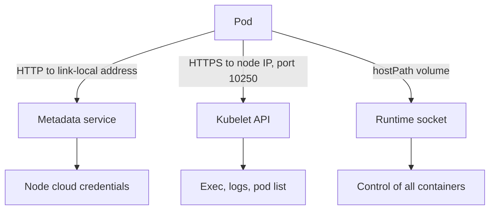

# Endpoints That Carry Authority

Before you restrict access you need to know what is worth protecting. Three kinds of endpoint on or near a node issue authority that Kubernetes RBAC does not control. This part describes each one, explains the difference between a node identity and a workload identity, and shows how to inspect the kubelet and the host paths that pods use.

## Two identities

A workload has a Kubernetes identity, its ServiceAccount. RBAC decides what that account may do through the Kubernetes API. A node running in a cloud has a second identity, assigned by the provider to the virtual machine. The provider decides what that identity may do: pull images from a registry, attach disks, read storage. The two identities are separate systems. Reducing the RBAC permissions of a ServiceAccount does nothing to the permissions of the machine it runs on.

The link between them is the metadata service. It is an HTTP endpoint on a link-local address, `169.254.169.254` on the major providers, and it is reachable from the machine and, unless something blocks it, from every pod on the machine. A request to it returns facts about the instance and, depending on the provider, short-lived credentials of the node identity. A pod that fetches those credentials acts with the authority of the node, not of its ServiceAccount.

## The kubelet API

The kubelet listens on port 10250 on every node. Through it a caller can list pods, read logs, run commands in containers and open interactive sessions. Two settings decide who may call it. Authentication decides whether an anonymous caller is accepted and how a caller proves who it is. Authorization decides what an authenticated caller may do. With `authorization.mode: AlwaysAllow` every authenticated caller may do everything. With `Webhook` the kubelet asks the API server, so normal RBAC applies. A secure node has anonymous access off and Webhook authorization on.

## The container runtime socket

The container runtime listens on a Unix socket on the node, for example `/run/containerd/containerd.sock`. Whoever can write to that socket can start containers, including privileged ones, and read the data of other containers. A pod does not need the network to reach it. If the socket path is mounted into a pod as a `hostPath` volume, the pod can control the runtime, whatever its other restrictions say.



The diagram shows three different routes from a pod to authority outside the Kubernetes API. Each route needs its own control.

## Inspect the kubelet

<!-- astrona:playground:renew -->

You can read the settings the kubelet really uses through the API server proxy, as in the benchmark section of this course. Store the name of the control plane node and request the `configz` document:

```sh
NODE=$(kubectl get nodes -o name | grep control-plane | cut -d/ -f2)
kubectl get --raw "/api/v1/nodes/$NODE/proxy/configz" | grep -o '"anonymous":{[^}]*}'
kubectl get --raw "/api/v1/nodes/$NODE/proxy/configz" | grep -o '"authorization":{[^}]*}'
```

On a kubeadm-built node, which is what `kind` uses, the first line shows that anonymous access is disabled and the second shows the mode `Webhook`. If you ever see `"enabled":true` for anonymous or the mode `AlwaysAllow`, treat it as a finding to correct.

## Find pods that bypass the pod network or mount host paths

Two pod settings give a pod a route around the pod network and its policies. `hostNetwork: true` puts the pod in the network namespace of the node. A `hostPath` volume gives it a path from the node's file system. List both across the cluster:

```sh
kubectl get pods -A -o custom-columns='NAMESPACE:.metadata.namespace,NAME:.metadata.name,HOSTNETWORK:.spec.hostNetwork' | grep true
kubectl get pods -A -o jsonpath='{range .items[*]}{.metadata.namespace}{"/"}{.metadata.name}{" "}{range .spec.volumes[*]}{.hostPath.path}{" "}{end}{"\n"}{end}' | grep -E 'sock|/run|/var/lib'
```

Expect system pods in `kube-system` and the Calico namespace to appear, because node agents and the network plugin need the host. Application namespaces such as `starfleet` and `outpost` should not appear. Any application pod that does appear needs a justification, because it is outside the reach of ordinary NetworkPolicy and may touch the runtime.

You now know the endpoints and the settings that decide their exposure. The next part looks at the network route that a normal pod uses to reach a metadata-style endpoint.

## Common pitfalls

> [!WARNING]
> - **Treating RBAC as the whole boundary.** Cloud credentials and runtime sockets sit outside it.
> - **Mounting the runtime socket for convenience.** One `hostPath` entry hands over control of the node.
> - **Leaving anonymous kubelet access on.** Combined with `AlwaysAllow`, it exposes every container on the node.
> - **Assuming that provider defaults protect you.** Check the settings that apply to your cluster.
