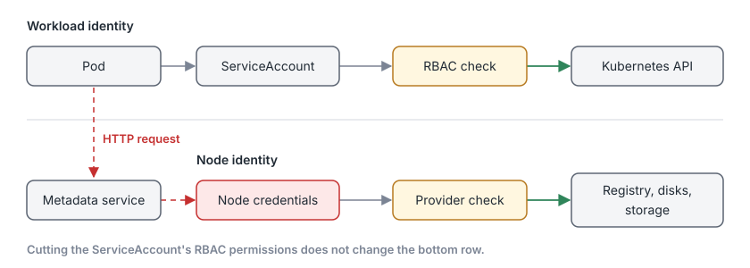
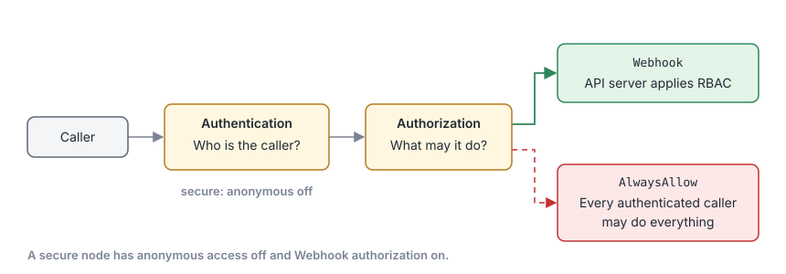
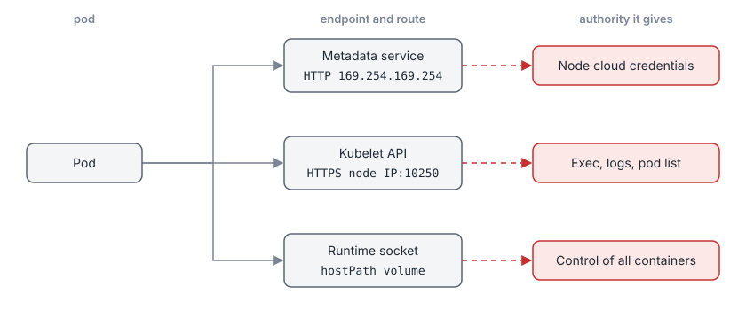

# Endpoints That Carry Authority

Before you restrict access, you need to know what is worth protecting. Three kinds of endpoint on or near a node hand out authority that Kubernetes role-based access control (RBAC) does not control. RBAC is the system that decides what a user or a ServiceAccount may do through the Kubernetes API.

On this page, you meet each of the three endpoints and see why a node identity differs from a workload identity. You also inspect the kubelet settings and the host paths that pods use, on the running playground.

## Two identities

A workload has a Kubernetes identity: its ServiceAccount. A ServiceAccount is the Kubernetes account that a pod uses when it talks to the Kubernetes API. RBAC decides what that account may do through the API.

A node that runs in a cloud has a second identity. The cloud provider assigns it to the virtual machine. The provider decides what that identity may do, for example pull images from a registry, attach disks or read storage. The two identities live in separate systems. When you reduce the RBAC permissions of a ServiceAccount, the permissions of the machine it runs on stay the same.

The metadata service links the two identities. It is an HTTP endpoint on a link-local address, which is an address that is only valid on the local network segment. On the major providers, this address is `169.254.169.254`. The machine can reach it, and so can every pod on the machine, unless something blocks it.

A request to the metadata service returns facts about the instance. Depending on the provider, it can also return short-lived credentials of the node identity. A pod that fetches those credentials acts with the authority of the node, not with the authority of its ServiceAccount.



The drawing shows the two separate rows of authority: RBAC checks the ServiceAccount, and only the provider checks the node credentials that the metadata service returns.

## The kubelet API

The metadata service is not the only endpoint with authority. The kubelet is the agent on every node that starts and watches the pods, and it has its own API on port 10250. Through this API, a caller can list pods, read logs, run commands in containers and open interactive sessions.

Two settings decide who may call the kubelet API:

- **Authentication** decides whether the kubelet accepts an anonymous caller, and how a caller proves who it is.
- **Authorization** decides what an authenticated caller may do. With `authorization.mode: AlwaysAllow`, every authenticated caller may do everything. With `Webhook`, the kubelet asks the API server, so normal RBAC applies.

A secure node has anonymous access off and Webhook authorization on.



The drawing shows the two checks in order, and how the authorization mode decides whether RBAC applies at all.

## The container runtime socket

The third endpoint does not use the network at all. The container runtime listens on a Unix socket on the node, for example `/run/containerd/containerd.sock`. Whoever can write to that socket can start containers, including privileged ones, and read the data of other containers.

A pod does not need the network to reach this socket. A `hostPath` volume mounts a path from the node's file system into a pod. If the socket path is mounted into a pod as a `hostPath` volume, the pod can control the runtime, whatever its other restrictions say.



The drawing shows three different routes from a pod to authority outside the Kubernetes API. Each route needs its own control.

## Inspect the kubelet

Now that you know the three endpoints, check how the kubelet in your playground is set up. You can read the settings that the kubelet really uses through the API server proxy. The `configz` document on that proxy returns the live kubelet configuration.

<!-- astrona:playground:renew -->

Store the name of the control plane node and request the `configz` document:

```sh
NODE=$(kubectl get nodes -o name | grep control-plane | cut -d/ -f2)
kubectl get --raw "/api/v1/nodes/$NODE/proxy/configz" | grep -o '"anonymous":{[^}]*}'
kubectl get --raw "/api/v1/nodes/$NODE/proxy/configz" | grep -o '"authorization":{[^}]*}'
```

The `kind` tool builds its nodes with kubeadm, the standard Kubernetes setup tool. On a kubeadm-built node, the first line shows that anonymous access is disabled, and the second line shows the mode `Webhook`. If you ever see `"enabled":true` for anonymous, or the mode `AlwaysAllow`, treat it as a finding to correct.

## Find pods that bypass the pod network or mount host paths

The kubelet settings protect one endpoint. Two pod settings can still give a pod a route around the pod network and its policies:

- `hostNetwork: true` puts the pod in the network namespace of the node, so it uses the node's network directly.
- A `hostPath` volume gives the pod a path from the node's file system, such as the runtime socket.

List both across the cluster:

```sh
kubectl get pods -A -o custom-columns='NAMESPACE:.metadata.namespace,NAME:.metadata.name,HOSTNETWORK:.spec.hostNetwork' | grep true
kubectl get pods -A -o jsonpath='{range .items[*]}{.metadata.namespace}{"/"}{.metadata.name}{" "}{range .spec.volumes[*]}{.hostPath.path}{" "}{end}{"\n"}{end}' | grep -E 'sock|/run|/var/lib'
```

Expect system pods in `kube-system` and in the Calico namespace to appear. Node agents and the network plugin need the host to do their work. Application namespaces such as `starfleet` and `outpost` should not appear.

Any application pod that does appear needs a reason. Such a pod is outside the reach of an ordinary NetworkPolicy, and it may touch the runtime.

You now know the three endpoints that carry authority and the settings that decide how exposed they are. What is still open is the network route itself: which paths a normal pod uses to reach a metadata-style endpoint, and which of them a NetworkPolicy can see.

## Common pitfalls

> [!WARNING]
> - **Treating RBAC as the whole boundary.** Cloud credentials and runtime sockets sit outside it.
> - **Mounting the runtime socket for convenience.** One `hostPath` entry hands over control of the node.
> - **Leaving anonymous kubelet access on.** Together with `AlwaysAllow`, it exposes every container on the node.
> - **Assuming that provider defaults protect you.** Check the settings that apply to your own cluster.
